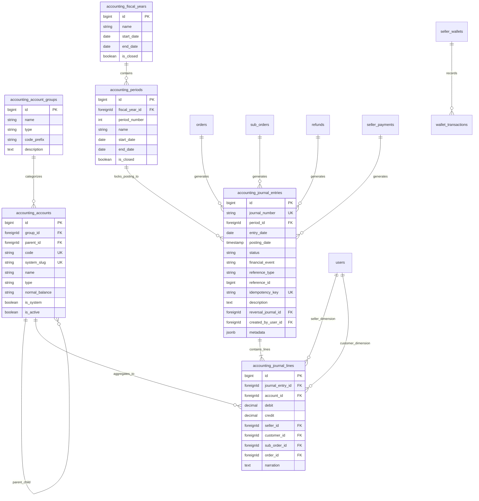

# 03. Accounting Database Design & Entity Relationships

> **Platform:** B2Bhaat Multi-Vendor E-Commerce  
> **Database:** PostgreSQL (Production) / SQLite `:memory:` (Automated Test Suite)  
> **Architecture:** Strict Double-Entry Ledger with Sub-Ledger Dimensions  

---

## 1. Entity Relationship Diagram (ERD)

---

## 2. Integrity Constraints & Invariants

1. **Double-Entry Balancing Constraint:**
   Every posted entry MUST satisfy:
   $$\sum \text{debit} = \sum \text{credit} \quad \text{where } \sum \text{debit} > 0$$
   An entry with unbalanced debits and credits is rejected at database and service level.

2. **Immutability of Posted Lines:**
   Lines belonging to `posted` or `reversed` journals cannot be updated or deleted. Database-level foreign keys use `onDelete('restrict')`. Corrections are made exclusively by posting an offsetting reversal journal.

3. **Period Locking:**
   Postings are checked against `accounting_periods.is_closed`. If an accounting period is closed, transactions cannot be posted into that date range without authorized period reopening.

4. **Idempotency Guarantee:**
   `accounting_journal_entries.idempotency_key` has a `UNIQUE` database constraint. Any duplicate event dispatch (e.g. repeated courier webhook or duplicate payment callback) fails safely without duplicate ledger entries.

5. **Sub-Ledger Reconcilability:**
   Every balance in `seller_wallets` (`available_balance`, `escrow_held_balance`) is mathematically verifiable against:
   $$\text{Seller Balance} = \sum \text{Credits}(seller\_id) - \sum \text{Debits}(seller\_id)$$
   on accounts `seller_wallet_payable` and `seller_escrow_payable`.

---

*End of 03-accounting-database-design.md*
