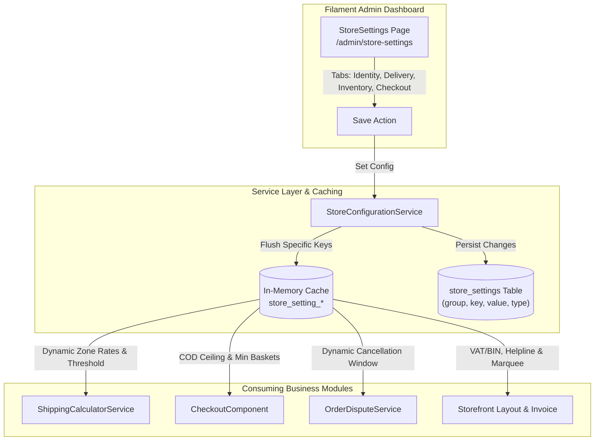

# B2Bhaat Complete System Audit & Dynamic Configuration Implementation Plan

> **For agentic workers:** REQUIRED SUB-SKILL: Use superpowers:subagent-driven-development to implement this plan task-by-task. Steps use checkbox (`- [ ]`) syntax for tracking.

**Goal:** Transform B2Bhaat's hardcoded business defaults into a centralized, dynamic, database-driven configuration system managed via a multi-tab Filament Admin panel with zero downtime and 100% test pass rate.

**Architecture:** A domain-grouped `store_settings` database schema backed by an in-memory cached `StoreConfigurationService` delivers strongly typed settings to logistics calculators, checkout safeguards, order dispute engines, and storefront layouts. Administrators manage all business policies from a unified Filament v5 Admin page (`/admin/store-settings`) with instantaneous cache invalidation.

**Architecture Diagram:**

**Tech Stack:** Laravel 11/12, PHP 8.5, Filament v5, Livewire v3, PostgreSQL / SQLite, Tailwind CSS.

## Global Constraints

- PHP 8.5 typed properties and return types are strictly mandatory.
- No raw SQL or unvalidated client values in financial or order calculations.
- Caching must auto-invalidate on save (`store_setting_{$key}`).
- All modified PHP code must pass Laravel Pint formatting (`vendor/bin/pint --dirty --format agent`).
- Full test suite (158+ tests) must pass with 0 errors.

---

### Task 1: StoreSetting Schema Enhancement & Model Type Casting

**Files:**
- Create: `database/migrations/2026_11_01_173000_enhance_store_settings_table.php`
- Modify: `app/Models/StoreSetting.php`
- Test: `tests/Feature/DynamicStoreConfigurationTest.php`

**Interfaces:**
- Produces: `StoreSetting::getCastValue()`, `StoreSetting::setTypedValue(string $key, mixed $value, string $group, string $type)`

- [x] **Step 1: Write the failing test for StoreSetting type casting**
- [x] **Step 2: Run test to verify it fails**
- [x] **Step 3: Create migration and update StoreSetting model**
- [x] **Step 4: Run test to verify it passes**
- [x] **Step 5: Commit**

---

### Task 2: StoreConfigurationService Engine & Seeded Defaults

**Files:**
- Create: `app/Services/Settings/StoreConfigurationService.php`
- Modify: `database/seeders/PromotionsAndStoreSettingsSeeder.php`
- Test: `tests/Feature/DynamicStoreConfigurationTest.php`

**Interfaces:**
- Produces: `StoreConfigurationService::getDeliveryFee(string $zone): float`, `StoreConfigurationService::getFreeShippingThreshold(): float`, `StoreConfigurationService::getLowStockThreshold(): int`, `StoreConfigurationService::getStockReservationTtl(): int`, `StoreConfigurationService::isGuestCheckoutAllowed(): bool`, `StoreConfigurationService::getOrderCancellationWindowHours(): int`, `StoreConfigurationService::getCodMaxLimit(): float`

- [x] **Step 1: Write test for StoreConfigurationService typed getters**
- [x] **Step 2: Run test to verify it fails**
- [x] **Step 3: Implement StoreConfigurationService & update Seeder**
- [x] **Step 4: Run test to verify it passes**
- [x] **Step 5: Commit**

---

### Task 3: Centralized Multi-Tab Filament Admin StoreSettings Page & RBAC

**Files:**
- Create: `app/Filament/Admin/Pages/StoreSettings.php`
- Create: `resources/views/filament/admin/pages/store-settings.blade.php`
- Test: `tests/Feature/DynamicStoreConfigurationTest.php`

**Interfaces:**
- Consumes: `StoreConfigurationService`
- Produces: Filament Admin page at `/admin/store-settings` guarded with `canAccess()`

- [x] **Step 1: Write test for Filament Admin StoreSettings authorization and update**
- [x] **Step 2: Run test to verify it fails**
- [x] **Step 3: Implement StoreSettings Page in Filament Admin**
- [x] **Step 4: Run test to verify it passes**
- [x] **Step 5: Commit**

---

### Task 4: Dynamic Shipping & Logistics Integration

**Files:**
- Modify: `app/Services/Logistics/ShippingCalculatorService.php`
- Modify: `app/Livewire/Storefront/CheckoutComponent.php`
- Modify: `resources/views/livewire/storefront/checkout-component.blade.php`
- Modify: `resources/views/livewire/storefront/cart-component.blade.php`
- Test: `tests/Feature/DynamicStoreConfigurationTest.php`

**Interfaces:**
- Consumes: `StoreConfigurationService::getDeliveryFee()`, `StoreConfigurationService::getFreeShippingThreshold()`

- [x] **Step 1: Write test for dynamic shipping calculation**
- [x] **Step 2: Run test to verify it fails**
- [x] **Step 3: Update ShippingCalculatorService & Views**
- [x] **Step 4: Run test to verify it passes**
- [x] **Step 5: Commit**

---

### Task 5: Dynamic Checkout Safeguards & Order Cancellation Window

**Files:**
- Modify: `app/Livewire/Storefront/CheckoutComponent.php`
- Modify: `app/Services/Orders/OrderDisputeService.php`
- Modify: `resources/views/livewire/storefront/checkout-component.blade.php`
- Test: `tests/Feature/DynamicStoreConfigurationTest.php`

**Interfaces:**
- Consumes: `StoreConfigurationService::getCodMaxLimit()`, `StoreConfigurationService::getOrderCancellationWindowHours()`

- [x] **Step 1: Write test for checkout safeguards and cancellation window**
- [x] **Step 2: Run test to verify it fails**
- [x] **Step 3: Update CheckoutComponent and OrderDisputeService**
- [x] **Step 4: Run test to verify it passes**
- [x] **Step 5: Commit**

---

### Task 6: Dynamic Storefront Header Marquee & Tax Invoice Printing

**Files:**
- Modify: `resources/views/layouts/storefront.blade.php`
- Modify: `resources/views/storefront/invoice.blade.php`
- Test: `tests/Feature/DynamicStoreConfigurationTest.php`

**Interfaces:**
- Consumes: `StoreConfigurationService::getStoreIdentity()`

- [x] **Step 1: Write test for dynamic invoice rendering**
- [x] **Step 2: Run test to verify it fails**
- [x] **Step 3: Update Storefront Layout & Invoice Views**
- [x] **Step 4: Run test to verify it passes**
- [x] **Step 5: Commit**

---

### Task 7: Full Regression Suite Verification & Pint Code Styling

**Files:**
- Modify: All modified files
- Run: `vendor/bin/pint --dirty --format agent`
- Run: `php artisan test`
- Run: `npm run build`

- [x] **Step 1: Format all PHP files with Laravel Pint**
- [x] **Step 2: Run entire test suite across all feature and unit tests**
- [x] **Step 3: Rebuild production frontend assets**
- [x] **Step 4: Commit and finalize**
