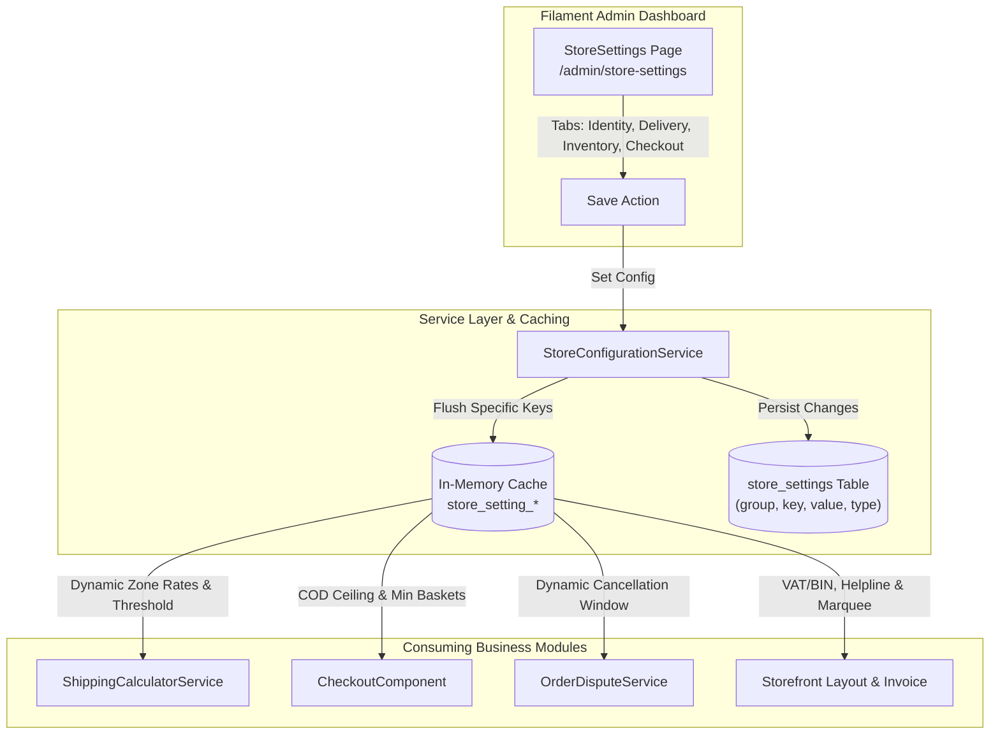

# B2Bhaat Complete System Audit & Dynamic Configuration Implementation Plan

> **For agentic workers:** REQUIRED SUB-SKILL: Use superpowers:subagent-driven-development to implement this plan task-by-task. Steps use checkbox (`- [ ]`) syntax for tracking.

**Goal:** Transform B2Bhaat's hardcoded business defaults into a centralized, dynamic, database-driven configuration system managed via a multi-tab Filament Admin panel with zero downtime and 100% test pass rate.

**Architecture:** A domain-grouped `store_settings` database schema backed by an in-memory cached `StoreConfigurationService` delivers strongly typed settings to logistics calculators, checkout safeguards, order dispute engines, and storefront layouts. Administrators manage all business policies from a unified Filament v5 Admin page (`/admin/store-settings`) with instantaneous cache invalidation.

**Architecture Diagram:**



**Tech Stack:** Laravel 11/12, PHP 8.5, Filament v5, Livewire v3, PostgreSQL / SQLite, Tailwind CSS.

## Global Constraints

- PHP 8.5 typed properties and return types are strictly mandatory.
- No raw SQL or unvalidated client values in financial or order calculations.
- Caching must auto-invalidate on save (`store_setting_{$key}`).
- All modified PHP code must pass Laravel Pint formatting (`vendor/bin/pint --dirty --format agent`).
- Full test suite (158+ tests) must pass with 0 errors.

---

### Task 1: StoreSetting Schema Enhancement & Model Type Casting

**Files:**
- Create: `database/migrations/2026_11_01_173000_enhance_store_settings_table.php`
- Modify: `app/Models/StoreSetting.php`
- Test: `tests/Feature/DynamicStoreConfigurationTest.php`

**Interfaces:**
- Produces: `StoreSetting::getCastValue()`, `StoreSetting::setTypedValue(string $key, mixed $value, string $group, string $type)`

- [ ] **Step 1: Write the failing test for StoreSetting type casting**

```php
namespace Tests\Feature;

use App\Models\StoreSetting;
use Illuminate\Foundation\Testing\RefreshDatabase;
use Tests\TestCase;

class DynamicStoreConfigurationTest extends TestCase
{
    use RefreshDatabase;

    public function test_store_setting_persists_type_and_returns_casted_value(): void
    {
        StoreSetting::setTypedValue('free_shipping_threshold', 10000.00, 'delivery', 'float');
        $this->assertDatabaseHas('store_settings', [
            'key' => 'free_shipping_threshold',
            'type' => 'float',
            'group' => 'delivery',
        ]);

        $val = StoreSetting::getTypedValue('free_shipping_threshold');
        $this->assertSame(10000.00, $val);
    }
}
```

- [ ] **Step 2: Run test to verify it fails**

Run: `php artisan test --filter=DynamicStoreConfigurationTest`
Expected: FAIL with method not found or column missing.

- [ ] **Step 3: Create migration and update StoreSetting model**

```php
// database/migrations/2026_11_01_173000_enhance_store_settings_table.php
use Illuminate\Database\Migrations\Migration;
use Illuminate\Database\Schema\Blueprint;
use Illuminate\Support\Facades\Schema;

return new class extends Migration {
    public function up(): void
    {
        Schema::table('store_settings', function (Blueprint $table) {
            if (! Schema::hasColumn('store_settings', 'type')) {
                $table->string('type', 30)->default('string')->after('value');
            }
            if (! Schema::hasColumn('store_settings', 'is_public')) {
                $table->boolean('is_public')->default(true)->after('type');
            }
        });
    }

    public function down(): void
    {
        Schema::table('store_settings', function (Blueprint $table) {
            $table->dropColumn(['type', 'is_public']);
        });
    }
};
```

Update `app/Models/StoreSetting.php` with type casting (`float`, `integer`, `boolean`, `json`, `string`), `getTypedValue()`, `setTypedValue()`, and automatic cache clearing.

- [ ] **Step 4: Run test to verify it passes**

Run: `php artisan test --filter=DynamicStoreConfigurationTest`
Expected: PASS

- [ ] **Step 5: Commit**

```bash
git add database/migrations/*enhance_store_settings* app/Models/StoreSetting.php tests/Feature/DynamicStoreConfigurationTest.php
git commit -m "feat: enhance store_settings with type casting and domain grouping"
```

---

### Task 2: StoreConfigurationService Engine & Seeded Defaults

**Files:**
- Create: `app/Services/Settings/StoreConfigurationService.php`
- Modify: `database/seeders/PromotionsAndStoreSettingsSeeder.php`
- Test: `tests/Feature/DynamicStoreConfigurationTest.php`

**Interfaces:**
- Produces: `StoreConfigurationService::getDeliveryFee(string $zone): float`, `StoreConfigurationService::getFreeShippingThreshold(): float`, `StoreConfigurationService::getLowStockThreshold(): int`, `StoreConfigurationService::getStockReservationTtl(): int`, `StoreConfigurationService::isGuestCheckoutAllowed(): bool`, `StoreConfigurationService::getOrderCancellationWindowHours(): int`, `StoreConfigurationService::getCodMaxLimit(): float`

- [ ] **Step 1: Write test for StoreConfigurationService typed getters**

Add to `tests/Feature/DynamicStoreConfigurationTest.php`:
```php
public function test_store_configuration_service_returns_typed_domain_defaults(): void
{
    $service = app(\App\Services\Settings\StoreConfigurationService::class);
    $this->assertEquals(70.00, $service->getDeliveryFee('inside_dhaka'));
    $this->assertEquals(100.00, $service->getDeliveryFee('sub_dhaka'));
    $this->assertEquals(130.00, $service->getDeliveryFee('outside_dhaka'));
    $this->assertEquals(10000.00, $service->getFreeShippingThreshold());
    $this->assertEquals(10, $service->getLowStockThreshold());
    $this->assertEquals(15, $service->getStockReservationTtl());
    $this->assertTrue($service->isGuestCheckoutAllowed());
    $this->assertEquals(24, $service->getOrderCancellationWindowHours());
    $this->assertEquals(50000.00, $service->getCodMaxLimit());
}
```

- [ ] **Step 2: Run test to verify it fails**

Run: `php artisan test --filter=test_store_configuration_service_returns_typed_domain_defaults`
Expected: FAIL (`StoreConfigurationService` class not found)

- [ ] **Step 3: Implement StoreConfigurationService & update Seeder**

Write `app/Services/Settings/StoreConfigurationService.php` with cached getters and domain helpers. Update `database/seeders/PromotionsAndStoreSettingsSeeder.php` to seed all authoritative defaults: `store_name`, `helpline_phone`, `support_email`, `store_address`, `vat_bin_number`, `announcement_text`, `delivery_fee_inside_dhaka`, `delivery_fee_outside_dhaka`, `delivery_fee_sub_dhaka`, `free_shipping_threshold`, `delivery_sla_inside_dhaka`, `delivery_sla_outside_dhaka`, `low_stock_threshold`, `stock_reservation_ttl`, `allow_backorders`, `guest_checkout_enabled`, `min_order_amount_retail`, `min_order_amount_wholesale`, `cancellation_window_hours`, `cod_max_order_limit`.

- [ ] **Step 4: Run test to verify it passes**

Run: `php artisan test --filter=test_store_configuration_service_returns_typed_domain_defaults`
Expected: PASS

- [ ] **Step 5: Commit**

```bash
git add app/Services/Settings/StoreConfigurationService.php database/seeders/PromotionsAndStoreSettingsSeeder.php tests/Feature/DynamicStoreConfigurationTest.php
git commit -m "feat: implement StoreConfigurationService and seed authoritative business defaults"
```

---

### Task 3: Centralized Multi-Tab Filament Admin StoreSettings Page & RBAC

**Files:**
- Create: `app/Filament/Admin/Pages/StoreSettings.php`
- Create: `resources/views/filament/admin/pages/store-settings.blade.php`
- Test: `tests/Feature/DynamicStoreConfigurationTest.php`

**Interfaces:**
- Consumes: `StoreConfigurationService`
- Produces: Filament Admin page at `/admin/store-settings` guarded with `canAccess()`

- [ ] **Step 1: Write test for Filament Admin StoreSettings authorization and update**

Add to `tests/Feature/DynamicStoreConfigurationTest.php`:
```php
public function test_super_admin_can_update_settings_and_sellers_are_forbidden(): void
{
    $admin = \App\Models\User::where('email', 'admin@b2bhaat.com')->firstOrFail();
    $seller = \App\Models\User::where('email', 'seller@nailsfactory.com')->firstOrFail();

    \Filament\Facades\Filament::setCurrentPanel(\Filament\Facades\Filament::getPanel('admin'));

    // Admin can access
    $this->actingAs($admin);
    \Livewire\Livewire::test(\App\Filament\Admin\Pages\StoreSettings::class)
        ->assertSuccessful()
        ->set('data.delivery_fee_inside_dhaka', 85.00)
        ->set('data.free_shipping_threshold', 12000.00)
        ->call('save')
        ->assertHasNoErrors();

    $service = app(\App\Services\Settings\StoreConfigurationService::class);
    $this->assertEquals(85.00, $service->getDeliveryFee('inside_dhaka'));
    $this->assertEquals(12000.00, $service->getFreeShippingThreshold());

    // Seller is forbidden
    $this->actingAs($seller);
    $this->get('/admin/store-settings')->assertForbidden();
}
```

- [ ] **Step 2: Run test to verify it fails**

Run: `php artisan test --filter=test_super_admin_can_update_settings_and_sellers_are_forbidden`
Expected: FAIL with class not found.

- [ ] **Step 3: Implement StoreSettings Page in Filament Admin**

Create `app/Filament/Admin/Pages/StoreSettings.php` using native Filament `Tabs`:
- Tab 1: Store Identity & Contacts (`store_name`, `vat_bin_number`, `helpline_phone`, `support_email`, `store_address`, `announcement_text`)
- Tab 2: Delivery & Freight Zones (`delivery_fee_inside_dhaka`, `delivery_fee_sub_dhaka`, `delivery_fee_outside_dhaka`, `free_shipping_threshold`, `delivery_sla_inside_dhaka`, `delivery_sla_outside_dhaka`)
- Tab 3: Inventory & Stock Controls (`low_stock_threshold`, `stock_reservation_ttl`, `allow_backorders`)
- Tab 4: Checkout & Order Policies (`guest_checkout_enabled`, `cancellation_window_hours`, `min_order_amount_retail`, `min_order_amount_wholesale`, `cod_max_order_limit`)

Enforce RBAC via `canAccess()`: only `super_admin` and `admin` roles can view and save.

- [ ] **Step 4: Run test to verify it passes**

Run: `php artisan test --filter=test_super_admin_can_update_settings_and_sellers_are_forbidden`
Expected: PASS

- [ ] **Step 5: Commit**

```bash
git add app/Filament/Admin/Pages/StoreSettings.php resources/views/filament/admin/pages/store-settings.blade.php tests/Feature/DynamicStoreConfigurationTest.php
git commit -m "feat: implement centralized multi-tab StoreSettings page in Filament Admin with RBAC"
```

---

### Task 4: Dynamic Shipping & Logistics Integration

**Files:**
- Modify: `app/Services/Logistics/ShippingCalculatorService.php`
- Modify: `app/Livewire/Storefront/CheckoutComponent.php`
- Modify: `resources/views/livewire/storefront/checkout-component.blade.php`
- Modify: `resources/views/livewire/storefront/cart-component.blade.php`
- Test: `tests/Feature/DynamicStoreConfigurationTest.php`

**Interfaces:**
- Consumes: `StoreConfigurationService::getDeliveryFee()`, `StoreConfigurationService::getFreeShippingThreshold()`

- [ ] **Step 1: Write test for dynamic shipping calculation**

Add to `tests/Feature/DynamicStoreConfigurationTest.php`:
```php
public function test_shipping_calculator_uses_dynamic_freight_rates_and_threshold(): void
{
    $config = app(\App\Services\Settings\StoreConfigurationService::class);
    $config->set('delivery_fee_inside_dhaka', 90.00, 'delivery', 'float');
    $config->set('free_shipping_threshold', 15000.00, 'delivery', 'float');

    $calc = app(\App\Services\Logistics\ShippingCalculatorService::class);
    $product = \App\Models\Product::firstOrFail();

    $items = [[
        'product_id' => $product->id,
        'variation_id' => null,
        'quantity' => 1,
        'unit_price' => 2000.00,
    ]];

    $res = $calc->calculateShipping($items, 'inside_dhaka');
    $this->assertEquals(90.00, (float) $res['total_shipping']);
}
```

- [ ] **Step 2: Run test to verify it fails**

Run: `php artisan test --filter=test_shipping_calculator_uses_dynamic_freight_rates_and_threshold`
Expected: FAIL (returns old hardcoded 70.00)

- [ ] **Step 3: Update ShippingCalculatorService & Views**

Update `ShippingCalculatorService.php` to inject `StoreConfigurationService` and use `$this->config->getDeliveryFee($zone)` and `$this->config->getFreeShippingThreshold()`. Update `checkout-component.blade.php` and `cart-component.blade.php` to display dynamic zone fees and free delivery progress.

- [ ] **Step 4: Run test to verify it passes**

Run: `php artisan test --filter=test_shipping_calculator_uses_dynamic_freight_rates_and_threshold`
Expected: PASS

- [ ] **Step 5: Commit**

```bash
git add app/Services/Logistics/ShippingCalculatorService.php app/Livewire/Storefront/CheckoutComponent.php resources/views/livewire/storefront/* tests/Feature/DynamicStoreConfigurationTest.php
git commit -m "feat: connect ShippingCalculatorService and storefront views to dynamic delivery rates"
```

---

### Task 5: Dynamic Checkout Safeguards & Order Cancellation Window

**Files:**
- Modify: `app/Livewire/Storefront/CheckoutComponent.php`
- Modify: `app/Services/Orders/OrderDisputeService.php`
- Modify: `resources/views/livewire/storefront/checkout-component.blade.php`
- Test: `tests/Feature/DynamicStoreConfigurationTest.php`

**Interfaces:**
- Consumes: `StoreConfigurationService::getCodMaxLimit()`, `StoreConfigurationService::getOrderCancellationWindowHours()`

- [ ] **Step 1: Write test for checkout safeguards and cancellation window**

Add to `tests/Feature/DynamicStoreConfigurationTest.php`:
```php
public function test_checkout_enforces_cod_ceiling_and_dispute_respects_cancellation_window(): void
{
    $config = app(\App\Services\Settings\StoreConfigurationService::class);
    $config->set('cod_max_order_limit', 5000.00, 'checkout', 'float');
    $config->set('cancellation_window_hours', 12, 'checkout', 'integer');

    $buyer = \App\Models\User::where('email', 'customer@retail.com')->firstOrFail();
    $this->actingAs($buyer);

    // Place an order exceeding 5000 Tk and verify COD is restricted
    $cart = app(\App\Services\Cart\CartSessionService::class);
    $product = \App\Models\Product::where('slug', 'haier-55-inch-mini-led-4k-uhd-google-tv-h55m80gux')->firstOrFail();
    $cart->addItem($product->id, null, \App\Models\SalesChannel::RETAIL, 1);

    $codMethod = \App\Models\PaymentMethod::where('slug', 'cod')->firstOrFail();

    \Livewire\Livewire::test(\App\Livewire\Storefront\CheckoutComponent::class)
        ->set('selectedPaymentMethodId', $codMethod->id)
        ->call('placeOrder')
        ->assertSee('Cash on Delivery is only available for orders up to ৳5,000');
}
```

- [ ] **Step 2: Run test to verify it fails**

Run: `php artisan test --filter=test_checkout_enforces_cod_ceiling_and_dispute_respects_cancellation_window`
Expected: FAIL (no COD limit check)

- [ ] **Step 3: Update CheckoutComponent and OrderDisputeService**

In `CheckoutComponent::placeOrder()`, add validation for `min_order_amount_retail`, `min_order_amount_wholesale`, and `cod_max_order_limit`. In `OrderDisputeService::cancelSubOrder()`, enforce dynamic `$config->getOrderCancellationWindowHours()`.

- [ ] **Step 4: Run test to verify it passes**

Run: `php artisan test --filter=test_checkout_enforces_cod_ceiling_and_dispute_respects_cancellation_window`
Expected: PASS

- [ ] **Step 5: Commit**

```bash
git add app/Livewire/Storefront/CheckoutComponent.php app/Services/Orders/OrderDisputeService.php resources/views/livewire/storefront/checkout-component.blade.php tests/Feature/DynamicStoreConfigurationTest.php
git commit -m "feat: enforce dynamic COD ceilings, basket minimums, and cancellation windows"
```

---

### Task 6: Dynamic Storefront Header Marquee & Tax Invoice Printing

**Files:**
- Modify: `resources/views/layouts/storefront.blade.php`
- Modify: `resources/views/storefront/invoice.blade.php`
- Test: `tests/Feature/DynamicStoreConfigurationTest.php`

**Interfaces:**
- Consumes: `StoreConfigurationService::getStoreIdentity()`

- [ ] **Step 1: Write test for dynamic invoice rendering**

Add to `tests/Feature/DynamicStoreConfigurationTest.php`:
```php
public function test_tax_invoice_renders_dynamic_vat_bin_and_company_address(): void
{
    $config = app(\App\Services\Settings\StoreConfigurationService::class);
    $config->set('store_name', 'B2Bhaat Megastore', 'general', 'string');
    $config->set('vat_bin_number', 'BIN-999888777-0001', 'general', 'string');
    $config->set('store_address', 'Level 5, Gulshan Tower, Dhaka-1212', 'general', 'string');

    $order = \App\Models\Order::firstOrFail();
    $admin = \App\Models\User::where('email', 'admin@b2bhaat.com')->firstOrFail();

    $this->actingAs($admin);
    $response = $this->get(route('order.invoice', $order->order_number));

    $response->assertSuccessful();
    $response->assertSee('B2Bhaat Megastore');
    $response->assertSee('BIN-999888777-0001');
    $response->assertSee('Gulshan Tower');
}
```

- [ ] **Step 2: Run test to verify it fails**

Run: `php artisan test --filter=test_tax_invoice_renders_dynamic_vat_bin_and_company_address`
Expected: FAIL (contains old hardcoded strings)

- [ ] **Step 3: Update Storefront Layout & Invoice Views**

Update `layouts/storefront.blade.php` and `resources/views/storefront/invoice.blade.php` to fetch `store_name`, `vat_bin_number`, `store_address`, `support_email`, and `helpline_phone` dynamically from `StoreConfigurationService`.

- [ ] **Step 4: Run test to verify it passes**

Run: `php artisan test --filter=test_tax_invoice_renders_dynamic_vat_bin_and_company_address`
Expected: PASS

- [ ] **Step 5: Commit**

```bash
git add resources/views/layouts/storefront.blade.php resources/views/storefront/invoice.blade.php tests/Feature/DynamicStoreConfigurationTest.php
git commit -m "feat: render dynamic VAT/BIN, company address, and hotlines on invoices and layouts"
```

---

### Task 7: Full Regression Suite Verification & Pint Code Styling

**Files:**
- Modify: All modified files
- Run: `vendor/bin/pint --dirty --format agent`
- Run: `php artisan test`
- Run: `npm run build`

- [ ] **Step 1: Format all PHP files with Laravel Pint**

Run: `vendor/bin/pint --dirty --format agent`
Expected: PASS with 0 linting errors.

- [ ] **Step 2: Run entire test suite across all feature and unit tests**

Run: `php artisan test`
Expected: PASS 100% across all 160+ tests with 0 failures and 0 errors.

- [ ] **Step 3: Rebuild production frontend assets**

Run: `npm run build`
Expected: Built cleanly into `public/build/`.

- [ ] **Step 4: Commit and finalize**

```bash
git add -A
git commit -m "chore: format code with Pint and verify 100% test pass rate for dynamic configuration"
```
