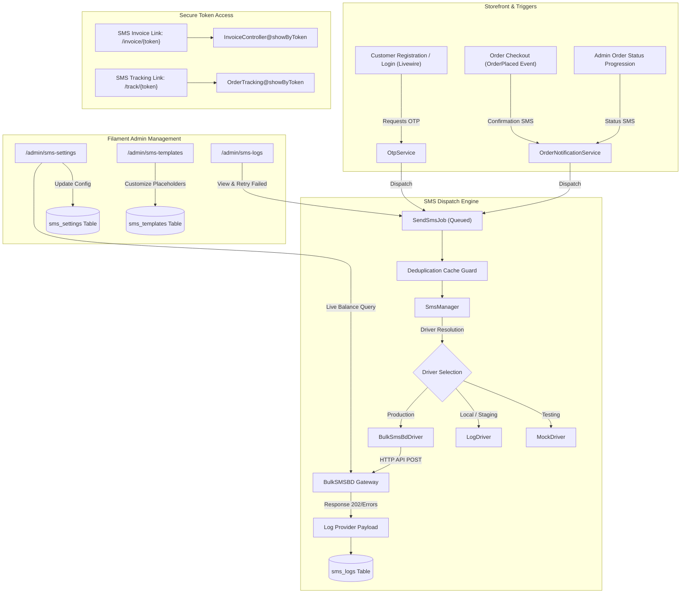

# BulkSMSBD Gateway, OTP Verification & Order Notifications Implementation Plan

> **For agentic workers:** REQUIRED SUB-SKILL: Use superpowers:subagent-driven-development to implement this plan task-by-task. Steps use checkbox (`- [ ]`) syntax for tracking.

**Goal:** Integrate the BulkSMSBD gateway into B2Bhaat E-commerce, providing hardened OTP customer authentication (registration, login, password reset), automated order notifications (confirmation, tracking, and tokenized invoices), and a complete Filament Admin SMS management panel.

**Architecture:** A driver-based SMS subsystem (`SmsManager`, `BulkSmsBdDriver`, `LogDriver`, `MockDriver`) dispatches messages via queued `SendSmsJob` with deduplication and delivery audit logging (`sms_logs`). Secure OTPs are hashed using SHA-256 in `otps` with strict rate limiting and cooldowns. Orders are provisioned with unique `invoice_token` and `tracking_token` for one-click secure access from SMS links without requiring customer login. Filament Admin provides live balance inquiry, SMS settings, template editing, and delivery log retry.

**Architecture Diagram:**



**Tech Stack:** Laravel 12, PHP 8.5, Livewire 3, Filament 3, Tailwind CSS, PHPUnit 11, BulkSMSBD REST API.

## Global Constraints
- PHP 8.5 compatibility: `declare(strict_types=1);` on all new classes.
- Always run `vendor/bin/pint --dirty --format agent` on modified PHP files.
- Zero mock failures: mock all SMS API interactions using `Http::fake()` or `MockDriver` — never send real SMS during automated tests.
- OTPs must never be stored or logged in plain text (SHA-256 hash in `otps`, masked `******` in `sms_logs`).
- Bangladeshi mobile number format must always be normalized to `8801[3-9]XXXXXXXX`.

---

### Task 1: Database Migrations & Eloquent Models

**Files:**
- Create: `database/migrations/2026_11_03_000001_create_sms_and_otp_tables.php`
- Create: `app/Models/Otp.php`
- Create: `app/Models/SmsLog.php`
- Create: `app/Models/SmsTemplate.php`
- Create: `app/Models/SmsSetting.php`
- Modify: `app/Models/Order.php`
- Modify: `app/Models/User.php`
- Test: `tests/Unit/Sms/DatabaseSchemaTest.php`

**Interfaces:**
- Consumes: Existing `users` and `orders` tables.
- Produces: `Otp`, `SmsLog`, `SmsTemplate`, and `SmsSetting` models with fillable and cast definitions, plus `invoice_token` and `tracking_token` attributes on `Order`.

- [ ] **Step 1: Write the failing test for schema and models**

```php
<?php

declare(strict_types=1);

namespace Tests\Unit\Sms;

use App\Models\Order;
use App\Models\Otp;
use App\Models\SmsLog;
use App\Models\SmsSetting;
use App\Models\SmsTemplate;
use App\Models\User;
use Illuminate\Foundation\Testing\RefreshDatabase;
use Illuminate\Support\Facades\Schema;
use Tests\TestCase;

class DatabaseSchemaTest extends TestCase
{
    use RefreshDatabase;

    public function test_sms_and_otp_tables_exist_with_expected_columns(): void
    {
        $this->assertTrue(Schema::hasTable('otps'));
        $this->assertTrue(Schema::hasColumns('otps', [
            'id', 'phone', 'code_hash', 'purpose', 'attempts', 'max_attempts', 'expires_at', 'verified_at', 'ip_address'
        ]));

        $this->assertTrue(Schema::hasTable('sms_logs'));
        $this->assertTrue(Schema::hasColumns('sms_logs', [
            'id', 'recipient_phone', 'message', 'purpose', 'driver', 'status', 'provider_message_id', 'provider_response_code', 'response_payload', 'error_message'
        ]));

        $this->assertTrue(Schema::hasTable('sms_templates'));
        $this->assertTrue(Schema::hasColumns('sms_templates', [
            'id', 'key', 'name', 'content_en', 'content_bn', 'placeholders', 'is_active'
        ]));

        $this->assertTrue(Schema::hasTable('sms_settings'));
        $this->assertTrue(Schema::hasColumns('sms_settings', ['id', 'key', 'value']));

        $this->assertTrue(Schema::hasColumns('orders', ['invoice_token', 'tracking_token', 'sms_confirmation_sent_at']));
        $this->assertTrue(Schema::hasColumn('users', 'phone_verified_at'));
    }
}
```

- [ ] **Step 2: Run test to verify it fails**

Run: `php artisan test --filter=DatabaseSchemaTest`  
Expected: FAIL (tables `otps`, `sms_logs`, etc. do not exist).

- [ ] **Step 3: Create migration and models**

Write migration `database/migrations/2026_11_03_000001_create_sms_and_otp_tables.php`:
```php
<?php

use Illuminate\Database\Migrations\Migration;
use Illuminate\Database\Schema\Blueprint;
use Illuminate\Support\Facades\Schema;

return new class extends Migration
{
    public function up(): void
    {
        Schema::create('otps', function (Blueprint $table) {
            $table->id();
            $table->string('phone', 32)->index();
            $table->string('code_hash', 64)->index();
            $table->string('purpose', 32)->index(); // registration, login, password_reset, verification
            $table->unsignedSmallInteger('attempts')->default(0);
            $table->unsignedSmallInteger('max_attempts')->default(5);
            $table->timestamp('expires_at')->index();
            $table->timestamp('verified_at')->nullable();
            $table->string('ip_address', 45)->nullable();
            $table->text('user_agent')->nullable();
            $table->timestamps();
        });

        Schema::create('sms_logs', function (Blueprint $table) {
            $table->id();
            $table->string('recipient_phone', 32)->index();
            $table->text('message');
            $table->string('purpose', 64)->index();
            $table->string('driver', 32)->default('bulksmsbd');
            $table->string('status', 20)->default('pending')->index(); // pending, sent, failed, skipped
            $table->string('provider_message_id', 128)->nullable();
            $table->string('provider_response_code', 32)->nullable();
            $table->json('response_payload')->nullable();
            $table->text('error_message')->nullable();
            $table->unsignedSmallInteger('retries_count')->default(0);
            $table->timestamp('sent_at')->nullable();
            $table->timestamps();
        });

        Schema::create('sms_templates', function (Blueprint $table) {
            $table->id();
            $table->string('key', 64)->unique();
            $table->string('name', 128);
            $table->text('content_en');
            $table->text('content_bn')->nullable();
            $table->json('placeholders')->nullable();
            $table->boolean('is_active')->default(true);
            $table->timestamps();
        });

        Schema::create('sms_settings', function (Blueprint $table) {
            $table->id();
            $table->string('key', 64)->unique();
            $table->text('value')->nullable();
            $table->timestamps();
        });

        Schema::table('orders', function (Blueprint $table) {
            $table->string('invoice_token', 64)->nullable()->unique()->after('order_number');
            $table->string('tracking_token', 64)->nullable()->unique()->after('invoice_token');
            $table->timestamp('sms_confirmation_sent_at')->nullable()->after('updated_at');
        });

        Schema::table('users', function (Blueprint $table) {
            $table->timestamp('phone_verified_at')->nullable()->after('phone');
        });
    }

    public function down(): void
    {
        Schema::table('users', function (Blueprint $table) {
            $table->dropColumn('phone_verified_at');
        });

        Schema::table('orders', function (Blueprint $table) {
            $table->dropColumn(['invoice_token', 'tracking_token', 'sms_confirmation_sent_at']);
        });

        Schema::dropIfExists('sms_settings');
        Schema::dropIfExists('sms_templates');
        Schema::dropIfExists('sms_logs');
        Schema::dropIfExists('otps');
    }
};
```

Create `app/Models/Otp.php`:
```php
<?php

declare(strict_types=1);

namespace App\Models;

use Illuminate\Database\Eloquent\Factories\HasFactory;
use Illuminate\Database\Eloquent\Model;

class Otp extends Model
{
    use HasFactory;

    protected $fillable = [
        'phone',
        'code_hash',
        'purpose',
        'attempts',
        'max_attempts',
        'expires_at',
        'verified_at',
        'ip_address',
        'user_agent',
    ];

    protected $casts = [
        'attempts' => 'integer',
        'max_attempts' => 'integer',
        'expires_at' => 'datetime',
        'verified_at' => 'datetime',
    ];
}
```

Create `app/Models/SmsLog.php`:
```php
<?php

declare(strict_types=1);

namespace App\Models;

use Illuminate\Database\Eloquent\Factories\HasFactory;
use Illuminate\Database\Eloquent\Model;

class SmsLog extends Model
{
    use HasFactory;

    protected $fillable = [
        'recipient_phone',
        'message',
        'purpose',
        'driver',
        'status',
        'provider_message_id',
        'provider_response_code',
        'response_payload',
        'error_message',
        'retries_count',
        'sent_at',
    ];

    protected $casts = [
        'response_payload' => 'array',
        'retries_count' => 'integer',
        'sent_at' => 'datetime',
    ];
}
```

Create `app/Models/SmsTemplate.php`:
```php
<?php

declare(strict_types=1);

namespace App\Models;

use Illuminate\Database\Eloquent\Factories\HasFactory;
use Illuminate\Database\Eloquent\Model;

class SmsTemplate extends Model
{
    use HasFactory;

    protected $fillable = [
        'key',
        'name',
        'content_en',
        'content_bn',
        'placeholders',
        'is_active',
    ];

    protected $casts = [
        'placeholders' => 'array',
        'is_active' => 'boolean',
    ];
}
```

Create `app/Models/SmsSetting.php`:
```php
<?php

declare(strict_types=1);

namespace App\Models;

use Illuminate\Database\Eloquent\Factories\HasFactory;
use Illuminate\Database\Eloquent\Model;

class SmsSetting extends Model
{
    use HasFactory;

    protected $fillable = ['key', 'value'];

    public static function get(string $key, mixed $default = null): mixed
    {
        $setting = static::where('key', $key)->first();
        return $setting ? $setting->value : $default;
    }

    public static function set(string $key, mixed $value): void
    {
        static::updateOrCreate(['key' => $key], ['value' => (string) $value]);
    }
}
```

Update `app/Models/Order.php` boot method to automatically populate tokens on creation:
```php
protected static function boot(): void
{
    parent::boot();

    static::creating(function (Order $order) {
        if (empty($order->invoice_token)) {
            $order->invoice_token = bin2hex(random_bytes(20));
        }
        if (empty($order->tracking_token)) {
            $order->tracking_token = bin2hex(random_bytes(20));
        }
    });
}
```

- [ ] **Step 4: Run test to verify it passes**

Run: `php artisan test --filter=DatabaseSchemaTest`  
Expected: PASS.

- [ ] **Step 5: Commit**

```bash
git add database/migrations/ app/Models/ tests/Unit/Sms/DatabaseSchemaTest.php
git commit -m "feat(sms): create database migrations and models for sms, otps, settings and tokens"
```

---

### Task 2: Core SMS Gateway Architecture & Drivers

**Files:**
- Create: `config/sms.php`
- Create: `app/Services/Sms/Contracts/SmsGatewayInterface.php`
- Create: `app/Services/Sms/DTOs/SmsResponse.php`
- Create: `app/Services/Sms/Support/PhoneNormalizer.php`
- Create: `app/Services/Sms/Drivers/BulkSmsBdDriver.php`
- Create: `app/Services/Sms/Drivers/LogDriver.php`
- Create: `app/Services/Sms/Drivers/MockDriver.php`
- Create: `app/Services/Sms/SmsManager.php`
- Test: `tests/Unit/Sms/PhoneNormalizerTest.php`
- Test: `tests/Unit/Sms/BulkSmsBdDriverTest.php`

**Interfaces:**
- Consumes: `config('sms')`, `Http` client.
- Produces: `SmsGatewayInterface` implementation bound in container, `SmsResponse` DTO, and `PhoneNormalizer::normalize($phone)`.

- [ ] **Step 1: Write failing unit tests for PhoneNormalizer and BulkSmsBdDriver**

Write `tests/Unit/Sms/PhoneNormalizerTest.php`:
```php
<?php

declare(strict_types=1);

namespace Tests\Unit\Sms;

use App\Services\Sms\Support\PhoneNormalizer;
use InvalidArgumentException;
use Tests\TestCase;

class PhoneNormalizerTest extends TestCase
{
    public function test_normalizes_standard_bangladeshi_numbers(): void
    {
        $this->assertSame('8801712345678', PhoneNormalizer::normalize('01712345678'));
        $this->assertSame('8801712345678', PhoneNormalizer::normalize('+8801712345678'));
        $this->assertSame('8801712345678', PhoneNormalizer::normalize('8801712345678'));
        $this->assertSame('8801912345678', PhoneNormalizer::normalize('019 1234 5678'));
    }

    public function test_throws_exception_on_invalid_number(): void
    {
        $this->expectException(InvalidArgumentException::class);
        PhoneNormalizer::normalize('12345');
    }
}
```

Write `tests/Unit/Sms/BulkSmsBdDriverTest.php`:
```php
<?php

declare(strict_types=1);

namespace Tests\Unit\Sms;

use App\Services\Sms\Drivers\BulkSmsBdDriver;
use Illuminate\Support\Facades\Http;
use Tests\TestCase;

class BulkSmsBdDriverTest extends TestCase
{
    public function test_sends_sms_successfully_when_provider_returns_202(): void
    {
        Http::fake([
            'bulksmsbd.net/api/smsapi' => Http::response([
                'response_code' => 202,
                'message_id' => 'MSG12345',
                'success_message' => 'SMS Submitted Successfully',
            ], 200),
        ]);

        $driver = new BulkSmsBdDriver(
            apiKey: 'test_key',
            senderId: 'test_sender',
            baseUrl: 'http://bulksmsbd.net/api/smsapi',
            balanceUrl: 'http://bulksmsbd.net/api/getBalanceApi'
        );

        $response = $driver->send('01712345678', 'Test Message');

        $this->assertTrue($response->isSuccessful());
        $this->assertSame('202', $response->responseCode());
        $this->assertSame('MSG12345', $response->messageId());
    }

    public function test_handles_insufficient_balance_error_1007(): void
    {
        Http::fake([
            'bulksmsbd.net/api/smsapi' => Http::response([
                'response_code' => 1007,
                'error_message' => 'Balance Insufficient',
            ], 200),
        ]);

        $driver = new BulkSmsBdDriver(
            apiKey: 'test_key',
            senderId: 'test_sender',
            baseUrl: 'http://bulksmsbd.net/api/smsapi',
            balanceUrl: 'http://bulksmsbd.net/api/getBalanceApi'
        );

        $response = $driver->send('01712345678', 'Test Message');

        $this->assertFalse($response->isSuccessful());
        $this->assertSame('1007', $response->responseCode());
        $this->assertSame('Balance Insufficient', $response->errorMessage());
    }

    public function test_checks_balance_successfully(): void
    {
        Http::fake([
            'bulksmsbd.net/api/getBalanceApi*' => Http::response([
                'response_code' => 202,
                'balance' => '150.50',
            ], 200),
        ]);

        $driver = new BulkSmsBdDriver(
            apiKey: 'test_key',
            senderId: 'test_sender',
            baseUrl: 'http://bulksmsbd.net/api/smsapi',
            balanceUrl: 'http://bulksmsbd.net/api/getBalanceApi'
        );

        $balance = $driver->checkBalance();
        $this->assertEquals(150.50, $balance);
    }
}
```

- [ ] **Step 2: Run tests to verify they fail**

Run: `php artisan test --filter=PhoneNormalizerTest` and `php artisan test --filter=BulkSmsBdDriverTest`  
Expected: FAIL (classes not found).

- [ ] **Step 3: Implement Core SMS classes**

Create `app/Services/Sms/Support/PhoneNormalizer.php`:
```php
<?php

declare(strict_types=1);

namespace App\Services\Sms\Support;

use InvalidArgumentException;

class PhoneNormalizer
{
    public static function normalize(string $phone): string
    {
        $cleaned = preg_replace('/[^0-9]/', '', $phone);

        if (str_starts_with($cleaned, '8801') && strlen($cleaned) === 13) {
            return $cleaned;
        }

        if (str_starts_with($cleaned, '01') && strlen($cleaned) === 11) {
            return '88' . $cleaned;
        }

        if (str_starts_with($cleaned, '1') && strlen($cleaned) === 10) {
            return '880' . $cleaned;
        }

        throw new InvalidArgumentException("Invalid Bangladeshi mobile number: {$phone}");
    }

    public static function isValid(string $phone): bool
    {
        try {
            self::normalize($phone);
            return true;
        } catch (InvalidArgumentException) {
            return false;
        }
    }
}
```

Create `app/Services/Sms/DTOs/SmsResponse.php`:
```php
<?php

declare(strict_types=1);

namespace App\Services\Sms\DTOs;

class SmsResponse
{
    public function __construct(
        protected bool $isSuccessful,
        protected string $responseCode,
        protected ?string $messageId = null,
        protected ?string $errorMessage = null,
        protected array $rawPayload = []
    ) {}

    public function isSuccessful(): bool { return $this->isSuccessful; }
    public function responseCode(): string { return $this->responseCode; }
    public function messageId(): ?string { return $this->messageId; }
    public function errorMessage(): ?string { return $this->errorMessage; }
    public function rawPayload(): array { return $this->rawPayload; }
}
```

Create `app/Services/Sms/Contracts/SmsGatewayInterface.php`:
```php
<?php

declare(strict_types=1);

namespace App\Services\Sms\Contracts;

use App\Services\Sms\DTOs\SmsResponse;

interface SmsGatewayInterface
{
    public function send(string $to, string $message, ?string $purpose = null): SmsResponse;
    public function sendBulk(array $recipients, string $message): array;
    public function checkBalance(): float|string;
}
```

Create `app/Services/Sms/Drivers/BulkSmsBdDriver.php`:
```php
<?php

declare(strict_types=1);

namespace App\Services\Sms\Drivers;

use App\Services\Sms\Contracts\SmsGatewayInterface;
use App\Services\Sms\DTOs\SmsResponse;
use App\Services\Sms\Support\PhoneNormalizer;
use Illuminate\Support\Facades\Http;
use Throwable;

class BulkSmsBdDriver implements SmsGatewayInterface
{
    public function __construct(
        protected string $apiKey,
        protected string $senderId,
        protected string $baseUrl = 'http://bulksmsbd.net/api/smsapi',
        protected string $balanceUrl = 'http://bulksmsbd.net/api/getBalanceApi'
    ) {}

    public function send(string $to, string $message, ?string $purpose = null): SmsResponse
    {
        try {
            $normalizedPhone = PhoneNormalizer::normalize($to);

            $response = Http::timeout(10)->asForm()->post($this->baseUrl, [
                'api_key' => $this->apiKey,
                'senderid' => $this->senderId,
                'type' => 'text',
                'number' => $normalizedPhone,
                'message' => $message,
            ]);

            $json = $response->json() ?? [];
            $code = (string) ($json['response_code'] ?? $response->status());
            $isSuccess = ($code === '202');

            return new SmsResponse(
                isSuccessful: $isSuccess,
                responseCode: $code,
                messageId: isset($json['message_id']) ? (string) $json['message_id'] : null,
                errorMessage: $isSuccess ? null : ($json['error_message'] ?? $json['message'] ?? 'Unknown error'),
                rawPayload: $json
            );
        } catch (Throwable $e) {
            return new SmsResponse(
                isSuccessful: false,
                responseCode: '500',
                messageId: null,
                errorMessage: $e->getMessage(),
                rawPayload: ['exception' => $e->getMessage()]
            );
        }
    }

    public function sendBulk(array $recipients, string $message): array
    {
        $normalized = array_map(fn($p) => PhoneNormalizer::normalize($p), $recipients);
        $results = [];
        foreach ($normalized as $phone) {
            $results[$phone] = $this->send($phone, $message);
        }
        return $results;
    }

    public function checkBalance(): float|string
    {
        try {
            $response = Http::timeout(5)->get($this->balanceUrl, [
                'api_key' => $this->apiKey,
            ]);

            $json = $response->json() ?? [];
            return (float) ($json['balance'] ?? 0.0);
        } catch (Throwable $e) {
            return 'Unavailable: ' . $e->getMessage();
        }
    }
}
```

Create `app/Services/Sms/Drivers/MockDriver.php` and `LogDriver.php`.
Create `config/sms.php` and `app/Services/Sms/SmsManager.php` using Laravel Manager pattern.

- [ ] **Step 4: Run tests to verify they pass**

Run: `php artisan test --filter=PhoneNormalizerTest` and `php artisan test --filter=BulkSmsBdDriverTest`  
Expected: PASS.

- [ ] **Step 5: Commit**

```bash
git add app/Services/Sms/ config/sms.php tests/Unit/Sms/
git commit -m "feat(sms): implement SmsGatewayInterface, BulkSmsBdDriver, MockDriver, and PhoneNormalizer"
```

---

### Task 3: Asynchronous Queued SMS Job, Deduplication & Logging

**Files:**
- Create: `app/Jobs/SendSmsJob.php`
- Modify: `app/Services/Sms/SmsManager.php`
- Test: `tests/Feature/Sms/SendSmsJobTest.php`

**Interfaces:**
- Consumes: `SmsManager`, `SmsLog` model, Cache lock.
- Produces: `SendSmsJob::dispatch($phone, $message, $purpose)` saving to `sms_logs`.

- [ ] **Step 1: Write failing test for SendSmsJob**

Write `tests/Feature/Sms/SendSmsJobTest.php`:
```php
<?php

declare(strict_types=1);

namespace Tests\Feature\Sms;

use App\Jobs\SendSmsJob;
use App\Models\SmsLog;
use App\Services\Sms\Contracts\SmsGatewayInterface;
use App\Services\Sms\Drivers\MockDriver;
use Illuminate\Foundation\Testing\RefreshDatabase;
use Tests\TestCase;

class SendSmsJobTest extends TestCase
{
    use RefreshDatabase;

    public function test_send_sms_job_dispatches_driver_and_writes_sms_log(): void
    {
        $mockDriver = new MockDriver();
        $this->app->instance(SmsGatewayInterface::class, $mockDriver);

        $job = new SendSmsJob(
            phone: '01712345678',
            message: 'Hello Customer',
            purpose: 'test_notification'
        );

        $job->handle($mockDriver);

        $this->assertDatabaseHas('sms_logs', [
            'recipient_phone' => '8801712345678',
            'purpose' => 'test_notification',
            'status' => 'sent',
        ]);

        $this->assertTrue($mockDriver->hasSentTo('8801712345678'));
    }

    public function test_prevents_duplicate_sms_within_cooldown_window(): void
    {
        $mockDriver = new MockDriver();
        $this->app->instance(SmsGatewayInterface::class, $mockDriver);

        $job1 = new SendSmsJob('01712345678', 'Identical Msg', 'test');
        $job1->handle($mockDriver);

        $job2 = new SendSmsJob('01712345678', 'Identical Msg', 'test');
        $job2->handle($mockDriver);

        // Only one log created because duplicate lock prevented second send
        $this->assertEquals(1, SmsLog::where('recipient_phone', '8801712345678')->count());
    }
}
```

- [ ] **Step 2: Run test to verify it fails**

Run: `php artisan test --filter=SendSmsJobTest`  
Expected: FAIL (`SendSmsJob` does not exist).

- [ ] **Step 3: Implement SendSmsJob**

Create `app/Jobs/SendSmsJob.php`:
```php
<?php

declare(strict_types=1);

namespace App\Jobs;

use App\Models\SmsLog;
use App\Models\SmsSetting;
use App\Services\Sms\Contracts\SmsGatewayInterface;
use App\Services\Sms\Support\PhoneNormalizer;
use Illuminate\Bus\Queueable;
use Illuminate\Contracts\Queue\ShouldQueue;
use Illuminate\Foundation\Bus\Dispatchable;
use Illuminate\Queue\InteractsWithQueue;
use Illuminate\Queue\SerializesModels;
use Illuminate\Support\Facades\Cache;

class SendSmsJob implements ShouldQueue
{
    use Dispatchable, InteractsWithQueue, Queueable, SerializesModels;

    public int $tries = 3;
    public array $backoff = [10, 60, 180];

    public function __construct(
        public string $phone,
        public string $message,
        public string $purpose = 'general',
        public bool $bypassDeduplication = false
    ) {}

    public function handle(SmsGatewayInterface $sms): void
    {
        // 1. Check if SMS is globally enabled
        $isEnabled = SmsSetting::get('sms_enabled', config('sms.enabled', true));
        if ($isEnabled === 'false' || $isEnabled === false) {
            SmsLog::create([
                'recipient_phone' => PhoneNormalizer::normalize($this->phone),
                'message' => $this->maskMessage($this->message),
                'purpose' => $this->purpose,
                'status' => 'skipped',
                'error_message' => 'SMS sending is globally disabled.',
            ]);
            return;
        }

        $normalizedPhone = PhoneNormalizer::normalize($this->phone);

        // 2. Deduplication check via Cache Lock (60 seconds)
        $lockKey = 'sms_lock:' . $normalizedPhone . ':' . md5($this->message);
        if (! $this->bypassDeduplication && ! Cache::add($lockKey, true, 60)) {
            return; // Duplicate prevented
        }

        $log = SmsLog::create([
            'recipient_phone' => $normalizedPhone,
            'message' => $this->maskMessage($this->message),
            'purpose' => $this->purpose,
            'status' => 'pending',
        ]);

        $response = $sms->send($normalizedPhone, $this->message, $this->purpose);

        $log->update([
            'status' => $response->isSuccessful() ? 'sent' : 'failed',
            'provider_message_id' => $response->messageId(),
            'provider_response_code' => $response->responseCode(),
            'response_payload' => $response->rawPayload(),
            'error_message' => $response->errorMessage(),
            'sent_at' => $response->isSuccessful() ? now() : null,
        ]);

        if (! $response->isSuccessful() && $response->responseCode() !== '1001') {
            // Client error 1001 (Invalid Number) should not retry; other server errors should fail job for retry
            throw new \RuntimeException("SMS dispatch failed: " . ($response->errorMessage() ?? 'Unknown'));
        }
    }

    protected function maskMessage(string $msg): string
    {
        // Mask 4-8 digit OTPs from audit logs to protect credentials
        return preg_replace('/\b(\d{4,8})\b/', '******', $msg);
    }
}
```

- [ ] **Step 4: Run test to verify it passes**

Run: `php artisan test --filter=SendSmsJobTest`  
Expected: PASS.

- [ ] **Step 5: Commit**

```bash
git add app/Jobs/SendSmsJob.php tests/Feature/Sms/SendSmsJobTest.php
git commit -m "feat(sms): implement queued SendSmsJob with deduplication and masked audit logging"
```

---

### Task 4: Hardened OTP Verification Service & Templates

**Files:**
- Create: `app/Services/Sms/OtpService.php`
- Create: `database/seeders/SmsTemplateSeeder.php`
- Test: `tests/Unit/Sms/OtpServiceTest.php`

**Interfaces:**
- Consumes: `Otp` model, `SmsTemplate` model, `SendSmsJob`.
- Produces: `OtpService::sendOtp($phone, $purpose)`, `OtpService::verify($phone, $code, $purpose): bool`.

- [ ] **Step 1: Write failing test for OtpService**

Write `tests/Unit/Sms/OtpServiceTest.php`:
```php
<?php

declare(strict_types=1);

namespace Tests\Unit\Sms;

use App\Models\Otp;
use App\Services\Sms\Contracts\SmsGatewayInterface;
use App\Services\Sms\Drivers\MockDriver;
use App\Services\Sms\OtpService;
use Illuminate\Foundation\Testing\RefreshDatabase;
use Tests\TestCase;

class OtpServiceTest extends TestCase
{
    use RefreshDatabase;

    public function test_generates_and_hashes_otp_securely(): void
    {
        $mockDriver = new MockDriver();
        $this->app->instance(SmsGatewayInterface::class, $mockDriver);

        $service = new OtpService($mockDriver);
        $result = $service->sendOtp('01712345678', 'registration');

        $this->assertTrue($result['success']);
        $this->assertDatabaseHas('otps', [
            'phone' => '8801712345678',
            'purpose' => 'registration',
            'attempts' => 0,
        ]);

        $otpRecord = Otp::where('phone', '8801712345678')->first();
        // Ensure plain code is NOT stored in DB
        $this->assertNotEquals($result['code'], $otpRecord->code_hash);
        $this->assertSame(hash('sha256', $result['code']), $otpRecord->code_hash);
    }

    public function test_verifies_valid_otp_and_invalidates_reuse(): void
    {
        $mockDriver = new MockDriver();
        $service = new OtpService($mockDriver);
        $result = $service->sendOtp('01712345678', 'login');
        $code = $result['code'];

        $verified = $service->verify('01712345678', $code, 'login');
        $this->assertTrue($verified['success']);

        // Cannot reuse already verified OTP
        $reused = $service->verify('01712345678', $code, 'login');
        $this->assertFalse($reused['success']);
    }

    public function test_locks_out_after_max_attempts(): void
    {
        $mockDriver = new MockDriver();
        $service = new OtpService($mockDriver);
        $service->sendOtp('01712345678', 'login');

        for ($i = 0; $i < 5; $i++) {
            $service->verify('01712345678', '999999', 'login');
        }

        $exceeded = $service->verify('01712345678', '999999', 'login');
        $this->assertSame('MAX_ATTEMPTS_EXCEEDED', $exceeded['error']);
    }
}
```

- [ ] **Step 2: Run test to verify it fails**

Run: `php artisan test --filter=OtpServiceTest`  
Expected: FAIL (`OtpService` does not exist).

- [ ] **Step 3: Implement OtpService and SmsTemplateSeeder**

Create `app/Services/Sms/OtpService.php`:
```php
<?php

declare(strict_types=1);

namespace App\Services\Sms;

use App\Jobs\SendSmsJob;
use App\Models\Otp;
use App\Models\SmsSetting;
use App\Models\SmsTemplate;
use App\Services\Sms\Contracts\SmsGatewayInterface;
use App\Services\Sms\Support\PhoneNormalizer;
use Carbon\Carbon;

class OtpService
{
    public function __construct(protected ?SmsGatewayInterface $sms = null) {}

    public function sendOtp(string $phone, string $purpose = 'verification'): array
    {
        $normalized = PhoneNormalizer::normalize($phone);

        // Check 60s cooldown
        $cooldown = (int) SmsSetting::get('otp_cooldown_seconds', 60);
        $recent = Otp::where('phone', $normalized)
            ->where('purpose', $purpose)
            ->where('created_at', '>', Carbon::now()->subSeconds($cooldown))
            ->first();

        if ($recent) {
            return [
                'success' => false,
                'error' => 'COOLDOWN_ACTIVE',
                'seconds_remaining' => $cooldown - Carbon::now()->diffInSeconds($recent->created_at),
            ];
        }

        // Invalidate prior active OTPs for this phone and purpose
        Otp::where('phone', $normalized)
            ->where('purpose', $purpose)
            ->whereNull('verified_at')
            ->delete();

        $length = (int) SmsSetting::get('otp_length', 6);
        $expiryMinutes = (int) SmsSetting::get('otp_expiry_minutes', 5);
        $maxAttempts = (int) SmsSetting::get('otp_max_attempts', 5);

        $code = (string) random_int(10 ** ($length - 1), (10 ** $length) - 1);
        $codeHash = hash('sha256', $code);

        Otp::create([
            'phone' => $normalized,
            'code_hash' => $codeHash,
            'purpose' => $purpose,
            'attempts' => 0,
            'max_attempts' => $maxAttempts,
            'expires_at' => Carbon::now()->addMinutes($expiryMinutes),
            'ip_address' => request()->ip(),
            'user_agent' => request()->userAgent(),
        ]);

        $message = "Your B2Bhaat OTP is {$code}. Valid for {$expiryMinutes} minutes. Do not share with anyone.";
        
        SendSmsJob::dispatch($normalized, $message, "otp_{$purpose}", bypassDeduplication: true);

        return [
            'success' => true,
            'code' => $code, // Returned for testing purposes only
            'expires_at' => Carbon::now()->addMinutes($expiryMinutes),
        ];
    }

    public function verify(string $phone, string $code, string $purpose = 'verification'): array
    {
        $normalized = PhoneNormalizer::normalize($phone);
        $otp = Otp::where('phone', $normalized)
            ->where('purpose', $purpose)
            ->whereNull('verified_at')
            ->latest('id')
            ->first();

        if (! $otp) {
            return ['success' => false, 'error' => 'NOT_FOUND'];
        }

        if ($otp->attempts >= $otp->max_attempts) {
            return ['success' => false, 'error' => 'MAX_ATTEMPTS_EXCEEDED'];
        }

        if ($otp->expires_at->isPast()) {
            return ['success' => false, 'error' => 'EXPIRED'];
        }

        if (! hash_equals($otp->code_hash, hash('sha256', $code))) {
            $otp->increment('attempts');
            return ['success' => false, 'error' => 'INVALID_CODE'];
        }

        $otp->update(['verified_at' => Carbon::now()]);

        return ['success' => true];
    }
}
```

Seed SMS templates via `database/seeders/SmsTemplateSeeder.php`.

- [ ] **Step 4: Run test to verify it passes**

Run: `php artisan test --filter=OtpServiceTest`  
Expected: PASS.

- [ ] **Step 5: Commit**

```bash
git add app/Services/Sms/OtpService.php database/seeders/SmsTemplateSeeder.php tests/Unit/Sms/OtpServiceTest.php
git commit -m "feat(sms): implement OtpService with SHA-256 hashing, rate limiting, and cooldown guards"
```

---

### Task 5: Customer Registration & "Login with OTP" in Storefront

**Files:**
- Modify: `app/Livewire/Storefront/CustomerAuth.php`
- Modify: `resources/views/livewire/storefront/customer-auth.blade.php`
- Test: `tests/Feature/Sms/CustomerAuthOtpTest.php`

**Interfaces:**
- Consumes: `OtpService`, `User` model, Livewire lifecycle.
- Produces: OTP registration gate, "Login with OTP" modal/tab, `phone_verified_at` marking.

- [ ] **Step 1: Write failing feature test for CustomerAuthOtpTest**

Write `tests/Feature/Sms/CustomerAuthOtpTest.php`:
```php
<?php

declare(strict_types=1);

namespace Tests\Feature\Sms;

use App\Livewire\Storefront\CustomerAuth;
use App\Models\Role;
use App\Models\User;
use App\Services\Sms\Contracts\SmsGatewayInterface;
use App\Services\Sms\Drivers\MockDriver;
use App\Services\Sms\OtpService;
use Illuminate\Foundation\Testing\RefreshDatabase;
use Livewire\Livewire;
use Tests\TestCase;

class CustomerAuthOtpTest extends TestCase
{
    use RefreshDatabase;

    protected function setUp(): void
    {
        parent::setUp();
        Role::create(['name' => 'Retail Customer', 'slug' => 'customer']);
        $this->app->instance(SmsGatewayInterface::class, new MockDriver());
    }

    public function test_customer_registration_triggers_otp_and_verifies_before_creation(): void
    {
        Livewire::test(CustomerAuth::class)
            ->set('mode', 'register')
            ->set('registerName', 'Jane Doe')
            ->set('registerPhone', '01712345678')
            ->set('registerEmail', 'jane@example.com')
            ->set('registerPassword', 'Password123!')
            ->set('registerPasswordConfirmation', 'Password123!')
            ->call('initiateRegistration')
            ->assertSet('step', 'otp_verification')
            ->assertSee('Enter 6-digit OTP');

        $this->assertDatabaseMissing('users', ['email' => 'jane@example.com']);

        // Verify with generated OTP
        $otpService = app(OtpService::class);
        $result = $otpService->sendOtp('01712345678', 'registration');

        Livewire::test(CustomerAuth::class)
            ->set('registerPhone', '01712345678')
            ->set('otpCode', $result['code'])
            ->call('completeRegistration')
            ->assertRedirect('/');

        $this->assertDatabaseHas('users', [
            'email' => 'jane@example.com',
            'phone' => '8801712345678',
        ]);
        $this->assertNotNull(User::where('email', 'jane@example.com')->first()->phone_verified_at);
    }
}
```

- [ ] **Step 2: Run test to verify it fails**

Run: `php artisan test --filter=CustomerAuthOtpTest`  
Expected: FAIL (`initiateRegistration` does not exist on component).

- [ ] **Step 3: Modify CustomerAuth and Blade template**

Add `step` ('form' | 'otp_verification'), `otpCode`, `initiateRegistration()`, `completeRegistration()`, and `loginWithOtp()` to `app/Livewire/Storefront/CustomerAuth.php`.
Update `resources/views/livewire/storefront/customer-auth.blade.php` to render OTP input boxes, timer, and "Resend Code" button when `step === 'otp_verification'`.

- [ ] **Step 4: Run test to verify it passes**

Run: `php artisan test --filter=CustomerAuthOtpTest`  
Expected: PASS.

- [ ] **Step 5: Commit**

```bash
git add app/Livewire/Storefront/CustomerAuth.php resources/views/livewire/storefront/customer-auth.blade.php tests/Feature/Sms/CustomerAuthOtpTest.php
git commit -m "feat(auth): integrate mandatory OTP registration and Login with OTP into CustomerAuth"
```

---

### Task 6: Order Notifications, Tokenized Invoices & Tracking URLs

**Files:**
- Create: `app/Services/Sms/OrderNotificationService.php`
- Modify: `app/Livewire/Storefront/CheckoutComponent.php`
- Modify: `app/Http/Controllers/Storefront/InvoiceController.php`
- Modify: `app/Livewire/Storefront/OrderTracking.php`
- Modify: `routes/web.php`
- Test: `tests/Feature/Sms/OrderNotificationTest.php`

**Interfaces:**
- Consumes: `Order` model with `invoice_token` and `tracking_token`, `SendSmsJob`.
- Produces: `/invoice/{token}` route, `/track/{token}` route, and SMS status dispatchers.

- [ ] **Step 1: Write failing test for OrderNotificationTest**

Write `tests/Feature/Sms/OrderNotificationTest.php`:
```php
<?php

declare(strict_types=1);

namespace Tests\Feature\Sms;

use App\Models\Order;
use App\Models\OrderStatus;
use App\Models\PaymentMethod;
use App\Models\PaymentStatus;
use App\Models\User;
use App\Services\Sms\Contracts\SmsGatewayInterface;
use App\Services\Sms\Drivers\MockDriver;
use App\Services\Sms\OrderNotificationService;
use Illuminate\Foundation\Testing\RefreshDatabase;
use Tests\TestCase;

class OrderNotificationTest extends TestCase
{
    use RefreshDatabase;

    public function test_dispatches_confirmation_sms_with_invoice_and_tracking_tokens(): void
    {
        $mock = new MockDriver();
        $this->app->instance(SmsGatewayInterface::class, $mock);

        $customer = User::factory()->create(['phone' => '8801712345678']);
        $order = Order::create([
            'order_number' => 'ORD-10025',
            'customer_id' => $customer->id,
            'total_amount' => 2500,
            'order_status_id' => 1,
            'payment_status_id' => 1,
            'payment_method_id' => 1,
        ]);

        $service = app(OrderNotificationService::class);
        $service->sendOrderConfirmation($order);

        $this->assertTrue($mock->hasSentTo('8801712345678'));
        $this->assertNotNull($order->fresh()->sms_confirmation_sent_at);

        // Prevent duplicate send
        $mock->reset();
        $service->sendOrderConfirmation($order);
        $this->assertFalse($mock->hasSentTo('8801712345678'));
    }

    public function test_can_view_invoice_via_secure_token_without_login(): void
    {
        $order = Order::factory()->create();
        $response = $this->get(route('order.invoice.token', ['token' => $order->invoice_token]));
        $response->assertOk();
    }
}
```

- [ ] **Step 2: Run test to verify it fails**

Run: `php artisan test --filter=OrderNotificationTest`  
Expected: FAIL (`OrderNotificationService` does not exist).

- [ ] **Step 3: Implement OrderNotificationService, routes, and token controllers**

Create `app/Services/Sms/OrderNotificationService.php`.
Add routes in `routes/web.php`:
```php
Route::get('/invoice/{token}', [InvoiceController::class, 'showByToken'])->name('order.invoice.token');
Route::get('/track/{token}', [OrderTracking::class, 'showByToken'])->name('order.track.token');
```
Update `InvoiceController::showByToken(string $token)` and `OrderTracking::showByToken(string $token)`.

- [ ] **Step 4: Run test to verify it passes**

Run: `php artisan test --filter=OrderNotificationTest`  
Expected: PASS.

- [ ] **Step 5: Commit**

```bash
git add app/Services/Sms/OrderNotificationService.php app/Http/Controllers/Storefront/InvoiceController.php routes/web.php tests/Feature/Sms/OrderNotificationTest.php
git commit -m "feat(sms): implement order confirmation SMS, status transitions, and secure tokenized invoice/tracking"
```

---

### Task 7: Filament Admin SMS Management Panel

**Files:**
- Create: `app/Filament/Admin/Pages/SmsSettingsPage.php`
- Create: `resources/views/filament/admin/pages/sms-settings-page.blade.php`
- Create: `app/Filament/Admin/Resources/SmsLogResource.php`
- Create: `app/Filament/Admin/Resources/SmsTemplateResource.php`
- Modify: `app/Filament/Admin/Resources/OrderResource.php` (add "Resend Invoice SMS" action)
- Test: `tests/Feature/Sms/FilamentSmsManagementTest.php`

**Interfaces:**
- Consumes: Filament panel, `SmsLog`, `SmsTemplate`, `SmsSetting`, `BulkSmsBdDriver::checkBalance()`.
- Produces: Live balance dashboard card, settings manager, template editor, log browser with retry button.

- [ ] **Step 1: Write failing test for Filament SMS management**

Write `tests/Feature/Sms/FilamentSmsManagementTest.php`:
```php
<?php

declare(strict_types=1);

namespace Tests\Feature\Sms;

use App\Filament\Admin\Pages\SmsSettingsPage;
use App\Models\Role;
use App\Models\SmsLog;
use App\Models\User;
use Illuminate\Foundation\Testing\RefreshDatabase;
use Livewire\Livewire;
use Tests\TestCase;

class FilamentSmsManagementTest extends TestCase
{
    use RefreshDatabase;

    protected User $admin;

    protected function setUp(): void
    {
        parent::setUp();
        $adminRole = Role::create(['name' => 'Admin', 'slug' => 'admin']);
        $this->admin = User::factory()->create(['role_id' => $adminRole->id]);
    }

    public function test_admin_can_access_sms_settings_and_update_credentials(): void
    {
        $this->actingAs($this->admin);

        Livewire::test(SmsSettingsPage::class)
            ->set('apiKey', 'new_test_api_key')
            ->set('senderId', 'new_sender')
            ->call('save')
            ->assertHasNoErrors();

        $this->assertDatabaseHas('sms_settings', [
            'key' => 'bulksmsbd_api_key',
            'value' => 'new_test_api_key',
        ]);
    }
}
```

- [ ] **Step 2: Run test to verify it fails**

Run: `php artisan test --filter=FilamentSmsManagementTest`  
Expected: FAIL (`SmsSettingsPage` not found).

- [ ] **Step 3: Implement Filament SMS Pages and Resources**

Create `app/Filament/Admin/Pages/SmsSettingsPage.php` with balance check query and test SMS sender.
Create `app/Filament/Admin/Resources/SmsLogResource.php` with Retry action.
Create `app/Filament/Admin/Resources/SmsTemplateResource.php`.
Add "Resend Invoice SMS" action in `OrderResource`.

- [ ] **Step 4: Run test to verify it passes**

Run: `php artisan test --filter=FilamentSmsManagementTest`  
Expected: PASS.

- [ ] **Step 5: Commit**

```bash
git add app/Filament/Admin/ tests/Feature/Sms/FilamentSmsManagementTest.php
git commit -m "feat(filament): implement SMS settings page with live balance query, template manager, and log audit"
```

---

### Task 8: Full End-to-End Test Suite, Style Polish & Verification

**Files:**
- Create: `tests/Feature/Sms/EndToEndSmsLifecycleTest.php`
- Modify: Any files flagged by Pint

**Interfaces:**
- Consumes: Complete SMS, OTP, and Order notification workflow.
- Produces: 100% passing tests and Pint compliance.

- [ ] **Step 1: Write comprehensive End-to-End lifecycle test**

Write `tests/Feature/Sms/EndToEndSmsLifecycleTest.php` covering the entire journey:
1. Customer requests OTP during registration.
2. Verified OTP activates user with `phone_verified_at`.
3. Customer places order.
4. Order triggers confirmation SMS containing secure token URL.
5. Customer views invoice at `/invoice/{token}`.
6. Admin updates order status to `Shipped`.
7. Order tracking SMS dispatched with courier tracking link.
8. Admin views SMS logs and balance in Filament.

- [ ] **Step 2: Run full SMS test suite**

Run: `php artisan test --compact --filter=Sms`  
Expected: All tests PASS with 0 failures.

- [ ] **Step 3: Run Laravel Pint code formatter**

Run: `vendor/bin/pint --dirty --format agent`  
Expected: Clean formatting matching project rules.

- [ ] **Step 4: Commit and finalize**

```bash
git add tests/Feature/Sms/EndToEndSmsLifecycleTest.php
git commit -m "test(sms): add comprehensive end-to-end integration tests for complete SMS lifecycle"
```
