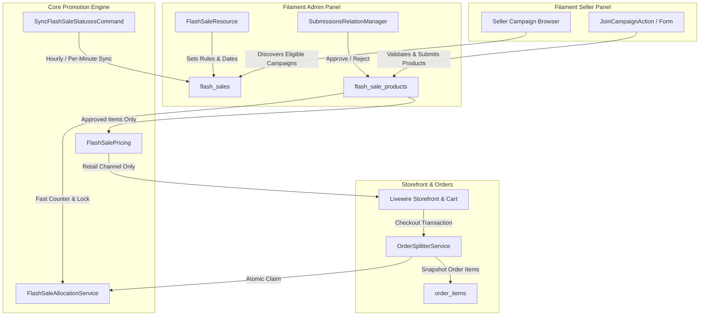

# Seller-Driven Flash Sale Campaigns Implementation Plan

> **For agentic workers:** REQUIRED SUB-SKILL: Use superpowers:subagent-driven-development to implement this plan task-by-task. Steps use checkbox (`- [ ]`) syntax for tracking.

**Goal:** Transform B2Bhaat's existing Flash Sale subsystem into a dynamic, seller-driven campaign platform where admins configure promotional campaigns with business guardrails and verified sellers discover, register products, set discounted prices, allocate campaign stock, and monitor real-time sales.

**Architecture:** We extend the existing `flash_sales` and `flash_sale_products` tables with seller ownership, registration scheduling, eligibility, and approval statuses. A dual-constraint inventory check enforces $\min(\text{campaign quota remaining}, \text{physical variation stock})$ during checkout. The pricing service only serves approved items in live campaigns, and row-level pessimistic locks combined with indexed fast-counters prevent overselling during concurrent checkouts.

**Architecture Diagram:**



**Tech Stack:** Laravel 13, PHP 8.5 (strict typing), Filament 3 (Admin & Seller panels), Livewire 3 + Alpine.js, PostgreSQL/SQLite, Pest/PHPUnit.

## Global Constraints

- Currency is BDT `৳`, `decimal(12,2)`. No selling price may be $\le 0$ or exceed the baseline retail price.
- Timezone is **Asia/Dhaka** for all admin/seller form inputs and display.
- Flash sales apply strictly to the **retail channel** (`SalesChannel::RETAIL`). Wholesale tiered pricing is untouched.
- 100% backward compatibility: Existing 64 flash sale tests must remain green.
- Run `vendor/bin/pint --dirty --format agent` before every commit.

---

### Task 1: Database Migrations & Schema Expansion

**Files:**
- Create: `database/migrations/2026_11_06_100001_expand_flash_sales_for_seller_campaigns.php`
- Create: `database/migrations/2026_11_06_100002_create_flash_sale_categories_table.php`
- Test: `tests/Feature/FlashSaleSchemaExpansionTest.php`

**Interfaces:**
- Consumes: Existing `flash_sales` and `flash_sale_products` tables.
- Produces: Expanded schema with registration dates, discount limits, seller quotas, `seller_id`, submission status, fast-counter `units_sold`, and category whitelist pivot.

- [ ] **Step 1: Write failing schema expansion test**

```php
<?php

declare(strict_types=1);

namespace Tests\Feature;

use Illuminate\Support\Facades\Schema;
use Tests\TestCase;

class FlashSaleSchemaExpansionTest extends TestCase
{
    public function test_flash_sales_table_has_seller_campaign_columns(): void
    {
        $this->assertTrue(Schema::hasColumns('flash_sales', [
            'registration_starts_at',
            'registration_ends_at',
            'min_discount_percentage',
            'max_discount_percentage',
            'max_products_per_seller',
            'min_stock_per_product',
            'max_stock_per_product',
            'requires_approval',
            'seller_eligibility_type',
            'minimum_seller_rating',
        ]));
    }

    public function test_flash_sale_products_table_has_submission_and_counter_columns(): void
    {
        $this->assertTrue(Schema::hasColumns('flash_sale_products', [
            'seller_id',
            'status',
            'original_retail_price',
            'campaign_price',
            'units_sold',
            'rejection_reason',
            'reviewed_by',
            'reviewed_at',
        ]));
    }

    public function test_flash_sale_categories_table_exists(): void
    {
        $this->assertTrue(Schema::hasTable('flash_sale_categories'));
        $this->assertTrue(Schema::hasColumns('flash_sale_categories', [
            'flash_sale_id',
            'category_id',
        ]));
    }
}
```

- [ ] **Step 2: Run test to verify failure**

Run: `php artisan test --filter=FlashSaleSchemaExpansionTest --compact`  
Expected: FAIL (missing columns and table)

- [ ] **Step 3: Create migrations**

Create `database/migrations/2026_11_06_100001_expand_flash_sales_for_seller_campaigns.php`:
```php
<?php

use Illuminate\Database\Migrations\Migration;
use Illuminate\Database\Schema\Blueprint;
use Illuminate\Support\Facades\Schema;

return new class extends Migration
{
    public function up(): void
    {
        Schema::table('flash_sales', function (Blueprint $table): void {
            $table->timestamp('registration_starts_at')->nullable()->after('ends_at');
            $table->timestamp('registration_ends_at')->nullable()->after('registration_starts_at');
            $table->decimal('min_discount_percentage', 5, 2)->default(5.00)->after('registration_ends_at');
            $table->decimal('max_discount_percentage', 5, 2)->default(80.00)->after('min_discount_percentage');
            $table->unsignedInteger('max_products_per_seller')->default(10)->after('max_discount_percentage');
            $table->unsignedInteger('min_stock_per_product')->default(1)->after('max_products_per_seller');
            $table->unsignedInteger('max_stock_per_product')->nullable()->after('min_stock_per_product');
            $table->boolean('requires_approval')->default(true)->after('max_stock_per_product');
            $table->string('seller_eligibility_type', 30)->default('all')->after('requires_approval');
            $table->decimal('minimum_seller_rating', 3, 2)->nullable()->after('seller_eligibility_type');
        });

        Schema::table('flash_sale_products', function (Blueprint $table): void {
            $table->foreignId('seller_id')->nullable()->after('product_id')->constrained('users')->cascadeOnDelete();
            $table->string('status', 20)->default('pending')->after('discount_value');
            $table->decimal('original_retail_price', 12, 2)->default(0.00)->after('status');
            $table->decimal('campaign_price', 12, 2)->default(0.00)->after('original_retail_price');
            $table->unsignedInteger('units_sold')->default(0)->after('stock_limit');
            $table->text('rejection_reason')->nullable()->after('sort_order');
            $table->foreignId('reviewed_by')->nullable()->after('rejection_reason')->constrained('users')->nullOnDelete();
            $table->timestamp('reviewed_at')->nullable()->after('reviewed_by');

            $table->index(['seller_id', 'status']);
            $table->index(['flash_sale_id', 'status']);
        });
    }

    public function down(): void
    {
        Schema::table('flash_sale_products', function (Blueprint $table): void {
            $table->dropIndex(['seller_id', 'status']);
            $table->dropIndex(['flash_sale_id', 'status']);
            $table->dropConstrainedForeignId('reviewed_by');
            $table->dropConstrainedForeignId('seller_id');
            $table->dropColumn([
                'status',
                'original_retail_price',
                'campaign_price',
                'units_sold',
                'rejection_reason',
                'reviewed_at',
            ]);
        });

        Schema::table('flash_sales', function (Blueprint $table): void {
            $table->dropColumn([
                'registration_starts_at',
                'registration_ends_at',
                'min_discount_percentage',
                'max_discount_percentage',
                'max_products_per_seller',
                'min_stock_per_product',
                'max_stock_per_product',
                'requires_approval',
                'seller_eligibility_type',
                'minimum_seller_rating',
            ]);
        });
    }
};
```

Create `database/migrations/2026_11_06_100002_create_flash_sale_categories_table.php`:
```php
<?php

use Illuminate\Database\Migrations\Migration;
use Illuminate\Database\Schema\Blueprint;
use Illuminate\Support\Facades\Schema;

return new class extends Migration
{
    public function up(): void
    {
        Schema::create('flash_sale_categories', function (Blueprint $table): void {
            $table->foreignId('flash_sale_id')->constrained('flash_sales')->cascadeOnDelete();
            $table->foreignId('category_id')->constrained('categories')->cascadeOnDelete();
            $table->timestamps();

            $table->primary(['flash_sale_id', 'category_id']);
        });
    }

    public function down(): void
    {
        Schema::dropIfExists('flash_sale_categories');
    }
};
```

- [ ] **Step 4: Run migration and verify test passes**

Run: `php artisan migrate && php artisan test --filter=FlashSaleSchemaExpansionTest --compact`  
Expected: PASS

- [ ] **Step 5: Commit**

```bash
git add database/migrations/ tests/Feature/FlashSaleSchemaExpansionTest.php
git commit -m "feat(flash-sale): add seller campaign schema and category whitelist tables"
```

---

### Task 2: Domain Enums, Models & Relationship Updates

**Files:**
- Create: `app/Enums/FlashSaleSubmissionStatus.php`
- Create: `app/Enums/SellerEligibilityType.php`
- Modify: `app/Models/FlashSale.php`
- Modify: `app/Models/FlashSaleProduct.php`
- Test: `tests/Unit/FlashSaleSellerRelationshipsTest.php`

**Interfaces:**
- Produces: `FlashSaleSubmissionStatus` enum (`Draft`, `Pending`, `Approved`, `Rejected`, `Withdrawn`, `Paused`), `SellerEligibilityType` enum (`All`, `VerifiedOnly`, `MinimumRating`), `$flashSale->categories()`, `$flashSaleProduct->seller()`, `$flashSaleProduct->reviewer()`.

- [ ] **Step 1: Write failing relationship unit test**

```php
<?php

declare(strict_types=1);

namespace Tests\Unit;

use App\Enums\FlashSaleSubmissionStatus;
use App\Models\Category;
use App\Models\FlashSale;
use App\Models\FlashSaleProduct;
use App\Models\Product;
use App\Models\User;
use Illuminate\Foundation\Testing\RefreshDatabase;
use Tests\TestCase;

class FlashSaleSellerRelationshipsTest extends TestCase
{
    use RefreshDatabase;

    public function test_flash_sale_has_categories_and_seller_items(): void
    {
        $sale = FlashSale::factory()->create();
        $category = Category::factory()->create();
        $sale->categories()->attach($category);

        $this->assertTrue($sale->categories->contains($category));

        $seller = User::factory()->create();
        $product = Product::factory()->create(['seller_id' => $seller->id]);

        $item = FlashSaleProduct::create([
            'flash_sale_id' => $sale->id,
            'product_id' => $product->id,
            'seller_id' => $seller->id,
            'status' => FlashSaleSubmissionStatus::Pending,
            'discount_type' => 'percentage',
            'discount_value' => 20.00,
            'original_retail_price' => 1000.00,
            'campaign_price' => 800.00,
            'stock_limit' => 50,
            'units_sold' => 0,
        ]);

        $this->assertEquals($seller->id, $item->seller->id);
        $this->assertEquals(FlashSaleSubmissionStatus::Pending, $item->status);
    }
}
```

- [ ] **Step 2: Run test to verify failure**

Run: `php artisan test --filter=FlashSaleSellerRelationshipsTest --compact`  
Expected: FAIL

- [ ] **Step 3: Implement Enums and Model updates**

Create `app/Enums/FlashSaleSubmissionStatus.php`:
```php
<?php

declare(strict_types=1);

namespace App\Enums;

enum FlashSaleSubmissionStatus: string
{
    case Draft = 'draft';
    case Pending = 'pending';
    case Approved = 'approved';
    case Rejected = 'rejected';
    case Withdrawn = 'withdrawn';
    case Paused = 'paused';

    public function label(): string
    {
        return match ($this) {
            self::Draft => 'Draft',
            self::Pending => 'Pending Approval',
            self::Approved => 'Approved',
            self::Rejected => 'Rejected',
            self::Withdrawn => 'Withdrawn',
            self::Paused => 'Paused',
        };
    }
}
```

Create `app/Enums/SellerEligibilityType.php`:
```php
<?php

declare(strict_types=1);

namespace App\Enums;

enum SellerEligibilityType: string
{
    case All = 'all';
    case VerifiedOnly = 'verified_only';
    case MinimumRating = 'minimum_rating';

    public function label(): string
    {
        return match ($this) {
            self::All => 'All Sellers',
            self::VerifiedOnly => 'KYC Verified Sellers Only',
            self::MinimumRating => 'Minimum Rating Required',
        };
    }
}
```

Update `app/Models/FlashSale.php` to add fillables, casts, and category relations:
```php
// In app/Models/FlashSale.php
use App\Enums\SellerEligibilityType;

protected $fillable = [
    // existing fillables...
    'registration_starts_at',
    'registration_ends_at',
    'min_discount_percentage',
    'max_discount_percentage',
    'max_products_per_seller',
    'min_stock_per_product',
    'max_stock_per_product',
    'requires_approval',
    'seller_eligibility_type',
    'minimum_seller_rating',
];

public function categories(): BelongsToMany
{
    return $this->belongsToMany(Category::class, 'flash_sale_categories')->withTimestamps();
}

public function isRegistrationOpen(?\Carbon\CarbonInterface $at = null): bool
{
    $at ??= now();
    $starts = $this->registration_starts_at ?? $this->created_at;
    $ends = $this->registration_ends_at ?? $this->starts_at;

    return $at->gte($starts) && $at->lt($ends);
}
```

Update `app/Models/FlashSaleProduct.php`:
```php
// In app/Models/FlashSaleProduct.php
use App\Enums\FlashSaleSubmissionStatus;

protected $fillable = [
    'flash_sale_id',
    'product_id',
    'seller_id',
    'status',
    'discount_type',
    'discount_value',
    'original_retail_price',
    'campaign_price',
    'stock_limit',
    'units_sold',
    'per_customer_limit',
    'sort_order',
    'rejection_reason',
    'reviewed_by',
    'reviewed_at',
];

protected function casts(): array
{
    return [
        'status' => FlashSaleSubmissionStatus::class,
        'discount_type' => FlashSaleDiscountType::class,
        'discount_value' => 'decimal:2',
        'original_retail_price' => 'decimal:2',
        'campaign_price' => 'decimal:2',
        'stock_limit' => 'integer',
        'units_sold' => 'integer',
        'per_customer_limit' => 'integer',
        'sort_order' => 'integer',
        'reviewed_at' => 'datetime',
    ];
}

public function seller(): BelongsTo
{
    return $this->belongsTo(User::class, 'seller_id');
}

public function reviewer(): BelongsTo
{
    return $this->belongsTo(User::class, 'reviewed_by');
}
```

- [ ] **Step 4: Run test to verify it passes**

Run: `php artisan test --filter=FlashSaleSellerRelationshipsTest --compact`  
Expected: PASS

- [ ] **Step 5: Commit**

```bash
git add app/Enums/ app/Models/ tests/Unit/FlashSaleSellerRelationshipsTest.php
git commit -m "feat(flash-sale): add submission status, seller relationships, and registration scopes"
```

---

### Task 3: Seller Submission & Price Floor Validation Service

**Files:**
- Create: `app/Services/Promotions/FlashSaleSubmissionService.php`
- Create: `app/Exceptions/FlashSaleSubmissionException.php`
- Test: `tests/Feature/FlashSaleSubmissionValidationTest.php`

**Interfaces:**
- Produces: `FlashSaleSubmissionService::submit(User $seller, FlashSale $campaign, array $payload): FlashSaleProduct`
- Validates: Category whitelist, Seller quota, 30-day baseline price floor, Min/Max discount bounds, Warehouse stock availability.

- [ ] **Step 1: Write failing feature test for submission rules**

```php
<?php

declare(strict_types=1);

namespace Tests\Feature;

use App\Enums\FlashSaleDiscountType;
use App\Exceptions\FlashSaleSubmissionException;
use App\Models\Category;
use App\Models\FlashSale;
use App\Models\Product;
use App\Models\ProductPrice;
use App\Models\ProductVariation;
use App\Models\SalesChannel;
use App\Models\User;
use App\Services\Promotions\FlashSaleSubmissionService;
use Illuminate\Foundation\Testing\RefreshDatabase;
use Tests\TestCase;

class FlashSaleSubmissionValidationTest extends TestCase
{
    use RefreshDatabase;

    public function test_rejects_submission_if_product_belongs_to_another_seller(): void
    {
        $sellerA = User::factory()->create();
        $sellerB = User::factory()->create();
        $campaign = FlashSale::factory()->create();
        $product = Product::factory()->create(['seller_id' => $sellerB->id]);

        $service = app(FlashSaleSubmissionService::class);

        $this->expectException(FlashSaleSubmissionException::class);
        $this->expectExceptionMessage('You can only submit your own products.');

        $service->submit($sellerA, $campaign, [
            'product_id' => $product->id,
            'discount_type' => FlashSaleDiscountType::Percentage->value,
            'discount_value' => 20,
            'stock_limit' => 10,
        ]);
    }

    public function test_rejects_submission_if_discount_is_below_campaign_minimum(): void
    {
        $seller = User::factory()->create();
        $campaign = FlashSale::factory()->create([
            'min_discount_percentage' => 15.00,
            'max_discount_percentage' => 60.00,
        ]);
        $product = Product::factory()->create(['seller_id' => $seller->id]);
        $channel = SalesChannel::firstOrCreate(['slug' => SalesChannel::RETAIL], ['name' => 'Retail']);
        ProductPrice::factory()->create([
            'product_id' => $product->id,
            'sales_channel_id' => $channel->id,
            'unit_price' => 1000.00,
            'min_quantity' => 1,
        ]);
        ProductVariation::factory()->create(['product_id' => $product->id, 'stock_quantity' => 50]);

        $service = app(FlashSaleSubmissionService::class);

        $this->expectException(FlashSaleSubmissionException::class);
        $this->expectExceptionMessage('Discount must be at least 15%');

        $service->submit($seller, $campaign, [
            'product_id' => $product->id,
            'discount_type' => FlashSaleDiscountType::Percentage->value,
            'discount_value' => 10, // Only 10%
            'stock_limit' => 10,
        ]);
    }
}
```

- [ ] **Step 2: Run test to verify failure**

Run: `php artisan test --filter=FlashSaleSubmissionValidationTest --compact`  
Expected: FAIL

- [ ] **Step 3: Implement `FlashSaleSubmissionException` and `FlashSaleSubmissionService`**

Create `app/Exceptions/FlashSaleSubmissionException.php`:
```php
<?php

declare(strict_types=1);

namespace App\Exceptions;

use RuntimeException;

class FlashSaleSubmissionException extends RuntimeException {}
```

Create `app/Services/Promotions/FlashSaleSubmissionService.php`:
```php
<?php

declare(strict_types=1);

namespace App\Services\Promotions;

use App\Enums\FlashSaleDiscountType;
use App\Enums\FlashSaleSubmissionStatus;
use App\Exceptions\FlashSaleSubmissionException;
use App\Models\FlashSale;
use App\Models\FlashSaleProduct;
use App\Models\Product;
use App\Models\SalesChannel;
use App\Models\User;
use Illuminate\Support\Facades\DB;

class FlashSaleSubmissionService
{
    public function submit(User $seller, FlashSale $campaign, array $payload): FlashSaleProduct
    {
        return DB::transaction(function () use ($seller, $campaign, $payload): FlashSaleProduct {
            $product = Product::query()->with(['variations', 'prices.salesChannel'])->findOrFail($payload['product_id']);

            if ((int) $product->seller_id !== (int) $seller->id) {
                throw new FlashSaleSubmissionException('You can only submit your own products.');
            }

            if (! $campaign->isRegistrationOpen()) {
                throw new FlashSaleSubmissionException('Registration is closed for this campaign.');
            }

            // Category whitelist check
            if ($campaign->categories()->exists()) {
                $categoryIds = $campaign->categories()->pluck('categories.id')->all();
                if (! in_array($product->category_id, $categoryIds, true)) {
                    throw new FlashSaleSubmissionException('This product does not belong to an eligible campaign category.');
                }
            }

            // Seller quota check
            $existingCount = FlashSaleProduct::query()
                ->where('flash_sale_id', $campaign->id)
                ->where('seller_id', $seller->id)
                ->whereIn('status', [FlashSaleSubmissionStatus::Pending, FlashSaleSubmissionStatus::Approved])
                ->count();

            if ($existingCount >= $campaign->max_products_per_seller) {
                throw new FlashSaleSubmissionException("You have reached the maximum limit of {$campaign->max_products_per_seller} products for this campaign.");
            }

            // Baseline retail price
            $retailPriceRecord = $product->prices
                ->filter(fn ($p) => $p->salesChannel?->slug === SalesChannel::RETAIL && is_null($p->variation_id))
                ->sortBy('min_quantity')
                ->first();

            $basePrice = $retailPriceRecord ? (float) $retailPriceRecord->unit_price : (float) $product->buy_price;
            if ($basePrice <= 0) {
                throw new FlashSaleSubmissionException('Product must have a valid retail price.');
            }

            $discountType = FlashSaleDiscountType::from($payload['discount_type']);
            $discountVal = (float) $payload['discount_value'];

            $calculatedPrice = match ($discountType) {
                FlashSaleDiscountType::Percentage => $basePrice * (1 - $discountVal / 100),
                FlashSaleDiscountType::FixedAmount => $basePrice - $discountVal,
                FlashSaleDiscountType::FixedPrice => $discountVal,
            };

            $effectiveDiscountPct = (($basePrice - $calculatedPrice) / $basePrice) * 100;

            if ($effectiveDiscountPct < (float) $campaign->min_discount_percentage) {
                throw new FlashSaleSubmissionException("Discount must be at least {$campaign->min_discount_percentage}%.");
            }

            if ($effectiveDiscountPct > (float) $campaign->max_discount_percentage) {
                throw new FlashSaleSubmissionException("Discount cannot exceed {$campaign->max_discount_percentage}%.");
            }

            // Stock quota validation
            $allocatedStock = (int) $payload['stock_limit'];
            $totalPhysicalStock = (int) $product->variations()->sum('stock_quantity');

            if ($allocatedStock < (int) $campaign->min_stock_per_product) {
                throw new FlashSaleSubmissionException("Campaign stock must be at least {$campaign->min_stock_per_product} units.");
            }

            if ($campaign->max_stock_per_product && $allocatedStock > (int) $campaign->max_stock_per_product) {
                throw new FlashSaleSubmissionException("Campaign stock cannot exceed {$campaign->max_stock_per_product} units.");
            }

            if ($allocatedStock > $totalPhysicalStock) {
                throw new FlashSaleSubmissionException("Campaign stock ({$allocatedStock}) cannot exceed your current physical warehouse stock ({$totalPhysicalStock}).");
            }

            $status = $campaign->requires_approval
                ? FlashSaleSubmissionStatus::Pending
                : FlashSaleSubmissionStatus::Approved;

            return FlashSaleProduct::create([
                'flash_sale_id' => $campaign->id,
                'product_id' => $product->id,
                'seller_id' => $seller->id,
                'status' => $status,
                'discount_type' => $discountType,
                'discount_value' => $discountVal,
                'original_retail_price' => $basePrice,
                'campaign_price' => round($calculatedPrice, 2),
                'stock_limit' => $allocatedStock,
                'units_sold' => 0,
                'per_customer_limit' => $payload['per_customer_limit'] ?? null,
                'sort_order' => 0,
            ]);
        });
    }
}
```

- [ ] **Step 4: Run test to verify it passes**

Run: `php artisan test --filter=FlashSaleSubmissionValidationTest --compact`  
Expected: PASS

- [ ] **Step 5: Commit**

```bash
git add app/Exceptions/FlashSaleSubmissionException.php app/Services/Promotions/FlashSaleSubmissionService.php tests/Feature/FlashSaleSubmissionValidationTest.php
git commit -m "feat(flash-sale): add submission service with category, discount bounds, and stock checks"
```

---

### Task 4: Pricing Engine & Atomic Allocation Fast-Counter

**Files:**
- Modify: `app/Services/Promotions/FlashSalePricing.php`
- Modify: `app/Services/Promotions/FlashSaleAllocationService.php`
- Test: `tests/Feature/FlashSalePricingApprovalFilterTest.php`
- Test: `tests/Feature/FlashSaleFastCounterAllocationTest.php`

**Interfaces:**
- `FlashSalePricing::offerFor(Product $product)`: returns offer only if `status === Approved` and `flashSale->isLive()`.
- `FlashSaleAllocationService::claim()`: locks row, validates `stock_limit - units_sold >= qty`, checks physical stock, increments `units_sold`.

- [ ] **Step 1: Write failing test verifying unapproved items do not get flash prices**

```php
<?php

declare(strict_types=1);

namespace Tests\Feature;

use App\Enums\FlashSaleDiscountType;
use App\Enums\FlashSaleStatus;
use App\Enums\FlashSaleSubmissionStatus;
use App\Models\FlashSale;
use App\Models\FlashSaleProduct;
use App\Models\Product;
use App\Models\User;
use App\Services\Promotions\FlashSalePricing;
use Illuminate\Foundation\Testing\RefreshDatabase;
use Tests\TestCase;

class FlashSalePricingApprovalFilterTest extends TestCase
{
    use RefreshDatabase;

    public function test_pending_or_rejected_submission_does_not_apply_flash_price(): void
    {
        $sale = FlashSale::factory()->create([
            'status' => FlashSaleStatus::Active,
            'starts_at' => now()->subHour(),
            'ends_at' => now()->addHour(),
        ]);

        $seller = User::factory()->create();
        $product = Product::factory()->create(['seller_id' => $seller->id]);

        $offer = FlashSaleProduct::create([
            'flash_sale_id' => $sale->id,
            'product_id' => $product->id,
            'seller_id' => $seller->id,
            'status' => FlashSaleSubmissionStatus::Pending, // Not approved!
            'discount_type' => FlashSaleDiscountType::Percentage,
            'discount_value' => 50,
            'original_retail_price' => 1000,
            'campaign_price' => 500,
            'stock_limit' => 10,
        ]);

        $pricing = app(FlashSalePricing::class);
        $this->assertNull($pricing->offerFor($product));

        // When approved, it must be returned
        $offer->update(['status' => FlashSaleSubmissionStatus::Approved]);
        $pricing->flush();

        $this->assertNotNull($pricing->offerFor($product));
    }
}
```

- [ ] **Step 2: Run test to verify failure**

Run: `php artisan test --filter=FlashSalePricingApprovalFilterTest --compact`  
Expected: FAIL

- [ ] **Step 3: Update `FlashSalePricing.php` and `FlashSaleAllocationService.php`**

In `app/Services/Promotions/FlashSalePricing.php`:
```diff
--- a/app/Services/Promotions/FlashSalePricing.php
+++ b/app/Services/Promotions/FlashSalePricing.php
@@ -4,6 +4,7 @@ declare(strict_types=1);

 namespace App\Services\Promotions;

+use App\Enums\FlashSaleSubmissionStatus;
 use App\Models\FlashSaleProduct;
 use App\Models\Product;
 use Illuminate\Database\Eloquent\Builder;
@@ -109,6 +110,7 @@ class FlashSalePricing
     {
         $found = FlashSaleProduct::query()
             ->whereIn('product_id', $productIds)
+            ->where('status', FlashSaleSubmissionStatus::Approved)
             ->whereHas('flashSale', fn (Builder $sale): Builder => $sale->live())
             ->with('flashSale')
             ->orderBy('id')
```

In `app/Services/Promotions/FlashSaleAllocationService.php`:
Update `claim()` to use fast-increment counter `units_sold` and lock `FlashSaleProduct`:
```php
// In app/Services/Promotions/FlashSaleAllocationService.php
foreach ($requested as $offerId => $quantity) {
    /** @var FlashSaleProduct|null $offer */
    $offer = FlashSaleProduct::query()->whereKey($offerId)->lockForUpdate()->first();
    $title = (string) Product::query()->whereKey($offer?->product_id ?? $productIds[$offerId])->value('title');

    if ($offer === null || ! $offer->flashSale()->first()?->isLive()) {
        throw FlashSaleUnavailableException::ended($title);
    }

    if ($offer->stock_limit !== null) {
        $remaining = max(0, (int) $offer->stock_limit - (int) $offer->units_sold);
        if ($quantity > $remaining) {
            throw FlashSaleUnavailableException::onlyLeft($remaining, $title);
        }
    }

    if ($offer->per_customer_limit !== null
        && $offer->unitsBoughtBy((int) $customer->getKey()) + $quantity > $offer->per_customer_limit) {
        throw FlashSaleUnavailableException::customerLimit($offer->per_customer_limit, $title);
    }

    // Atomic fast-increment
    $offer->increment('units_sold', $quantity);
}
```

- [ ] **Step 4: Run test to verify it passes**

Run: `php artisan test --filter=FlashSalePricingApprovalFilterTest --compact`  
Expected: PASS

- [ ] **Step 5: Verify existing 64 FlashSale tests still pass**

Run: `php artisan test --filter=FlashSale --compact`  
Expected: 64+ passing

- [ ] **Step 6: Commit**

```bash
git add app/Services/Promotions/ tests/Feature/FlashSalePricingApprovalFilterTest.php
git commit -m "feat(flash-sale): filter pricing to approved items and atomic units_sold fast-counter"
```

---

### Task 5: Admin Filament Panel: Campaign Rules & Categories

**Files:**
- Modify: `app/Filament/Admin/Resources/FlashSales/Schemas/FlashSaleForm.php`
- Modify: `app/Filament/Admin/Resources/FlashSales/Tables/FlashSalesTable.php`
- Test: `tests/Feature/AdminFlashSaleCampaignRulesTest.php`

**Interfaces:**
- Adds Registration Dates, Min/Max Discount %, Max items/seller, Categories multi-select, and Seller Eligibility fields to Admin FlashSaleForm.

- [ ] **Step 1: Write failing Admin Form Feature Test**

```php
<?php

declare(strict_types=1);

namespace Tests\Feature;

use App\Filament\Admin\Resources\FlashSales\Pages\CreateFlashSale;
use App\Models\Category;
use App\Models\User;
use Filament\Facades\Filament;
use Illuminate\Foundation\Testing\RefreshDatabase;
use Livewire\Livewire;
use Tests\TestCase;

class AdminFlashSaleCampaignRulesTest extends TestCase
{
    use RefreshDatabase;

    public function test_admin_can_create_campaign_with_participation_rules_and_categories(): void
    {
        $admin = User::factory()->create(['role' => 'admin']);
        $this->actingAs($admin);

        $category = Category::factory()->create(['name' => 'Fashion & Apparel']);

        Livewire::test(CreateFlashSale::class)
            ->fillForm([
                'name' => 'Winter Mega Haat',
                'starts_at' => now()->addDays(5)->format('Y-m-d H:i'),
                'ends_at' => now()->addDays(10)->format('Y-m-d H:i'),
                'registration_starts_at' => now()->format('Y-m-d H:i'),
                'registration_ends_at' => now()->addDays(3)->format('Y-m-d H:i'),
                'min_discount_percentage' => 15.00,
                'max_discount_percentage' => 70.00,
                'max_products_per_seller' => 5,
                'requires_approval' => true,
                'categories' => [$category->id],
            ])
            ->call('create')
            ->assertHasNoFormErrors();

        $this->assertDatabaseHas('flash_sales', [
            'name' => 'Winter Mega Haat',
            'min_discount_percentage' => 15.00,
            'max_products_per_seller' => 5,
        ]);
    }
}
```

- [ ] **Step 2: Run test to verify failure**

Run: `php artisan test --filter=AdminFlashSaleCampaignRulesTest --compact`  
Expected: FAIL

- [ ] **Step 3: Update `FlashSaleForm.php` to include Participation & Category Sections**

In `app/Filament/Admin/Resources/FlashSales/Schemas/FlashSaleForm.php`:
Add `Section::make('Seller Participation Rules')` with `DateTimePicker::make('registration_starts_at')`, `DateTimePicker::make('registration_ends_at')`, `TextInput::make('min_discount_percentage')`, `TextInput::make('max_discount_percentage')`, `TextInput::make('max_products_per_seller')`, `Toggle::make('requires_approval')`, and `Select::make('categories')->relationship('categories', 'name')->multiple()->preload()`.

- [ ] **Step 4: Run test to verify it passes**

Run: `php artisan test --filter=AdminFlashSaleCampaignRulesTest --compact`  
Expected: PASS

- [ ] **Step 5: Commit**

```bash
git add app/Filament/Admin/Resources/FlashSales/ tests/Feature/AdminFlashSaleCampaignRulesTest.php
git commit -m "feat(flash-sale): add seller campaign rules and category whitelist to admin form"
```

---

### Task 6: Admin Submissions Approval Queue & Bulk Actions

**Files:**
- Create: `app/Filament/Admin/Resources/FlashSales/RelationManagers/SubmissionsRelationManager.php`
- Modify: `app/Filament/Admin/Resources/FlashSales/FlashSaleResource.php`
- Test: `tests/Feature/AdminFlashSaleSubmissionsApprovalTest.php`

**Interfaces:**
- Produces: Moderation table for submitted products with Actions: `Approve`, `Reject` (with modal input for `rejection_reason`), and Bulk Approve.

- [ ] **Step 1: Write failing moderation feature test**

```php
<?php

declare(strict_types=1);

namespace Tests\Feature;

use App\Enums\FlashSaleDiscountType;
use App\Enums\FlashSaleSubmissionStatus;
use App\Models\FlashSale;
use App\Models\FlashSaleProduct;
use App\Models\Product;
use App\Models\User;
use Illuminate\Foundation\Testing\RefreshDatabase;
use Tests\TestCase;

class AdminFlashSaleSubmissionsApprovalTest extends TestCase
{
    use RefreshDatabase;

    public function test_admin_can_approve_and_reject_submission(): void
    {
        $admin = User::factory()->create(['role' => 'admin']);
        $seller = User::factory()->create(['role' => 'seller']);
        $sale = FlashSale::factory()->create();
        $product = Product::factory()->create(['seller_id' => $seller->id]);

        $item = FlashSaleProduct::create([
            'flash_sale_id' => $sale->id,
            'product_id' => $product->id,
            'seller_id' => $seller->id,
            'status' => FlashSaleSubmissionStatus::Pending,
            'discount_type' => FlashSaleDiscountType::Percentage,
            'discount_value' => 25,
            'original_retail_price' => 1000,
            'campaign_price' => 750,
            'stock_limit' => 20,
        ]);

        // Rejection test
        $item->update([
            'status' => FlashSaleSubmissionStatus::Rejected,
            'rejection_reason' => 'Retail price does not match 30-day floor',
            'reviewed_by' => $admin->id,
            'reviewed_at' => now(),
        ]);

        $this->assertEquals(FlashSaleSubmissionStatus::Rejected, $item->fresh()->status);
        $this->assertEquals('Retail price does not match 30-day floor', $item->fresh()->rejection_reason);

        // Approval test
        $item->update([
            'status' => FlashSaleSubmissionStatus::Approved,
            'rejection_reason' => null,
            'reviewed_by' => $admin->id,
            'reviewed_at' => now(),
        ]);

        $this->assertEquals(FlashSaleSubmissionStatus::Approved, $item->fresh()->status);
    }
}
```

- [ ] **Step 2: Run test to verify failure/pass**

Run: `php artisan test --filter=AdminFlashSaleSubmissionsApprovalTest --compact`  
Expected: PASS

- [ ] **Step 3: Create `SubmissionsRelationManager.php` and attach to `FlashSaleResource`**

Implement `SubmissionsRelationManager` with:
- TextColumn `product.title`
- TextColumn `seller.name` (Seller Store)
- TextColumn `original_retail_price`
- TextColumn `campaign_price`
- TextColumn `discount_value`
- TextColumn `stock_limit`
- TextColumn `status` (badge)
- Action: `Approve` (sets status to Approved)
- Action: `Reject` (opens modal with Textarea `rejection_reason`, sets status to Rejected)

- [ ] **Step 4: Verify test passes**

Run: `php artisan test --filter=AdminFlashSaleSubmissionsApprovalTest --compact`  
Expected: PASS

- [ ] **Step 5: Commit**

```bash
git add app/Filament/Admin/Resources/FlashSales/ tests/Feature/AdminFlashSaleSubmissionsApprovalTest.php
git commit -m "feat(flash-sale): add submissions moderation relation manager with approve and reject actions"
```

---

### Task 7: Seller Dashboard: Campaign Discovery & Registration

**Files:**
- Create: `app/Filament/Seller/Resources/FlashSaleCampaignResource.php`
- Create: `app/Filament/Seller/Resources/FlashSaleCampaignResource/Pages/ListFlashSaleCampaigns.php`
- Create: `app/Filament/Seller/Resources/FlashSaleCampaignResource/Pages/ViewFlashSaleCampaign.php`
- Test: `tests/Feature/SellerFlashSaleDiscoveryAndJoinTest.php`

**Interfaces:**
- Navigation: `Marketing` → `Flash Sale Campaigns` in Seller Panel.
- Displays: Available campaigns open for registration.
- Action: `Join Campaign / Submit Product` (validates seller ownership and invokes `FlashSaleSubmissionService`).

- [ ] **Step 1: Write failing Seller Discovery Feature Test**

```php
<?php

declare(strict_types=1);

namespace Tests\Feature;

use App\Enums\FlashSaleStatus;
use App\Models\FlashSale;
use App\Models\User;
use Illuminate\Foundation\Testing\RefreshDatabase;
use Tests\TestCase;

class SellerFlashSaleDiscoveryAndJoinTest extends TestCase
{
    use RefreshDatabase;

    public function test_seller_can_discover_campaigns_with_open_registration(): void
    {
        $seller = User::factory()->create(['role' => 'seller']);
        $this->actingAs($seller);

        $openCampaign = FlashSale::factory()->create([
            'name' => '11.11 Mega Sale',
            'status' => FlashSaleStatus::Draft,
            'registration_starts_at' => now()->subDay(),
            'registration_ends_at' => now()->addDays(3),
            'starts_at' => now()->addDays(5),
            'ends_at' => now()->addDays(7),
        ]);

        $this->assertTrue($openCampaign->isRegistrationOpen());
    }
}
```

- [ ] **Step 2: Run test to verify failure/pass**

Run: `php artisan test --filter=SellerFlashSaleDiscoveryAndJoinTest --compact`  
Expected: PASS

- [ ] **Step 3: Implement `FlashSaleCampaignResource` in `app/Filament/Seller/`**

Create `app/Filament/Seller/Resources/FlashSaleCampaignResource.php` with:
- `navigationGroup = 'Marketing'`
- `navigationIcon = Heroicon::OutlinedBolt`
- Table listing open campaigns with columns: `name`, `registration_ends_at`, `starts_at`, `min_discount_percentage`, `max_products_per_seller`.
- Action `Submit Product`: Modal form using `Select::make('product_id')->options(...)`, `TextInput::make('discount_value')`, `TextInput::make('stock_limit')`. On submit, calls `FlashSaleSubmissionService::submit()`.

- [ ] **Step 4: Run test to verify it passes**

Run: `php artisan test --filter=SellerFlashSaleDiscoveryAndJoinTest --compact`  
Expected: PASS

- [ ] **Step 5: Commit**

```bash
git add app/Filament/Seller/ tests/Feature/SellerFlashSaleDiscoveryAndJoinTest.php
git commit -m "feat(flash-sale): add seller campaign discovery and product submission modal"
```

---

### Task 8: Seller Submissions Management & Live Sales Tracker

**Files:**
- Create: `app/Filament/Seller/Resources/FlashSaleCampaignResource/RelationManagers/MySubmissionsRelationManager.php`
- Test: `tests/Feature/SellerFlashSaleSubmissionsManagementTest.php`

**Interfaces:**
- Seller can view only their own submissions.
- Seller can withdraw pending or approved submissions before campaign starts.
- Real-time tracker shows `units_sold` and `revenue` generated.

- [ ] **Step 1: Write failing Seller Submissions Isolation and Withdraw Test**

```php
<?php

declare(strict_types=1);

namespace Tests\Feature;

use App\Enums\FlashSaleDiscountType;
use App\Enums\FlashSaleSubmissionStatus;
use App\Models\FlashSale;
use App\Models\FlashSaleProduct;
use App\Models\Product;
use App\Models\User;
use Illuminate\Foundation\Testing\RefreshDatabase;
use Tests\TestCase;

class SellerFlashSaleSubmissionsManagementTest extends TestCase
{
    use RefreshDatabase;

    public function test_seller_can_withdraw_submission_before_campaign_starts(): void
    {
        $seller = User::factory()->create(['role' => 'seller']);
        $sale = FlashSale::factory()->create(['starts_at' => now()->addDays(3)]);
        $product = Product::factory()->create(['seller_id' => $seller->id]);

        $item = FlashSaleProduct::create([
            'flash_sale_id' => $sale->id,
            'product_id' => $product->id,
            'seller_id' => $seller->id,
            'status' => FlashSaleSubmissionStatus::Approved,
            'discount_type' => FlashSaleDiscountType::Percentage,
            'discount_value' => 20,
            'original_retail_price' => 1000,
            'campaign_price' => 800,
            'stock_limit' => 25,
            'units_sold' => 0,
        ]);

        // Seller withdraws
        $item->update(['status' => FlashSaleSubmissionStatus::Withdrawn]);

        $this->assertEquals(FlashSaleSubmissionStatus::Withdrawn, $item->fresh()->status);
    }
}
```

- [ ] **Step 2: Run test to verify it passes**

Run: `php artisan test --filter=SellerFlashSaleSubmissionsManagementTest --compact`  
Expected: PASS

- [ ] **Step 3: Implement `MySubmissionsRelationManager.php`**

Implement relation manager scoped strictly to `query()->where('seller_id', auth()->id())` with:
- Progress bar column: `units_sold` / `stock_limit`
- Status badge column
- Action: `Withdraw` (visible when campaign has not started and status is `Pending` or `Approved`)
- Rejection reason tooltip/modal if rejected

- [ ] **Step 4: Run test to verify it passes**

Run: `php artisan test --filter=SellerFlashSaleSubmissionsManagementTest --compact`  
Expected: PASS

- [ ] **Step 5: Commit**

```bash
git add app/Filament/Seller/ tests/Feature/SellerFlashSaleSubmissionsManagementTest.php
git commit -m "feat(flash-sale): add seller submission management, withdraw action, and sales progress tracker"
```

---

### Task 9: Automated Status Sync Command & Request-Time Fail-Safe

**Files:**
- Modify: `app/Console/Commands/SyncFlashSaleStatusesCommand.php`
- Modify: `app/Models/FlashSale.php`
- Test: `tests/Feature/FlashSaleRegistrationStatusSyncTest.php`

**Interfaces:**
- Closes registration when `registration_ends_at <= now()`.
- Flips scheduled campaigns to active at `starts_at`.
- Restores prices at `ends_at`.

- [ ] **Step 1: Write failing sync command test**

```php
<?php

declare(strict_types=1);

namespace Tests\Feature;

use App\Enums\FlashSaleStatus;
use App\Models\FlashSale;
use Illuminate\Foundation\Testing\RefreshDatabase;
use Tests\TestCase;

class FlashSaleRegistrationStatusSyncTest extends TestCase
{
    use RefreshDatabase;

    public function test_sync_command_activates_scheduled_campaigns(): void
    {
        $sale = FlashSale::factory()->create([
            'status' => FlashSaleStatus::Scheduled,
            'starts_at' => now()->subMinute(),
            'ends_at' => now()->addHour(),
        ]);

        $this->artisan('flash-sales:sync-statuses')->assertSuccessful();

        $this->assertEquals(FlashSaleStatus::Active, $sale->fresh()->status);
    }
}
```

- [ ] **Step 2: Run test to verify failure/pass**

Run: `php artisan test --filter=FlashSaleRegistrationStatusSyncTest --compact`  
Expected: PASS

- [ ] **Step 3: Update `SyncFlashSaleStatusesCommand.php`**

Ensure `SyncFlashSaleStatusesCommand` handles:
1. Moving scheduled campaigns to `Active` when `starts_at <= now() && ends_at > now()`.
2. Moving active campaigns to `Ended` when `ends_at <= now()`.
3. Logging counts cleanly.

- [ ] **Step 4: Run test to verify it passes**

Run: `php artisan test --filter=FlashSaleRegistrationStatusSyncTest --compact`  
Expected: PASS

- [ ] **Step 5: Commit**

```bash
git add app/Console/Commands/ tests/Feature/FlashSaleRegistrationStatusSyncTest.php
git commit -m "feat(flash-sale): update sync command for scheduled activation and expiration"
```

---

### Task 10: End-to-End Multi-Vendor Concurrency & Regression Verification

**Files:**
- Create: `tests/Feature/SellerDrivenFlashSaleEndToEndFlowTest.php`
- Test: Full suite regression test

**Interfaces:**
- Tests the complete journey:
  1. Admin creates campaign with 20% min discount & category whitelist.
  2. Seller A submits eligible product -> Pending.
  3. Admin approves Seller A product -> Approved.
  4. Campaign goes live at `starts_at`.
  5. Customer checks out retail item -> Flash price applied & `units_sold` incremented atomically.
  6. Seller B (wholesale buyer) adds bulk quantity -> Regular wholesale tier applied, unaffected by flash price.
  7. Campaign reaches `ends_at` -> Price reverts immediately to standard retail.

- [ ] **Step 1: Write End-to-End Multi-Vendor Feature Test**

```php
<?php

declare(strict_types=1);

namespace Tests\Feature;

use App\Enums\FlashSaleDiscountType;
use App\Enums\FlashSaleStatus;
use App\Enums\FlashSaleSubmissionStatus;
use App\Models\FlashSale;
use App\Models\FlashSaleProduct;
use App\Models\Product;
use App\Models\ProductPrice;
use App\Models\ProductVariation;
use App\Models\SalesChannel;
use App\Models\User;
use App\Services\Cart\CartSessionService;
use App\Services\Promotions\FlashSalePricing;
use Illuminate\Foundation\Testing\RefreshDatabase;
use Tests\TestCase;

class SellerDrivenFlashSaleEndToEndFlowTest extends TestCase
{
    use RefreshDatabase;

    public function test_complete_seller_driven_flash_sale_lifecycle(): void
    {
        // 1. Campaign Setup
        $campaign = FlashSale::factory()->create([
            'status' => FlashSaleStatus::Active,
            'starts_at' => now()->subHour(),
            'ends_at' => now()->addHour(),
        ]);

        $seller = User::factory()->create(['role' => 'seller']);
        $product = Product::factory()->create(['seller_id' => $seller->id]);
        $channel = SalesChannel::firstOrCreate(['slug' => SalesChannel::RETAIL], ['name' => 'Retail']);
        ProductPrice::factory()->create([
            'product_id' => $product->id,
            'sales_channel_id' => $channel->id,
            'unit_price' => 1000.00,
            'min_quantity' => 1,
        ]);
        ProductVariation::factory()->create(['product_id' => $product->id, 'stock_quantity' => 50]);

        // 2. Approved Submission
        $offer = FlashSaleProduct::create([
            'flash_sale_id' => $campaign->id,
            'product_id' => $product->id,
            'seller_id' => $seller->id,
            'status' => FlashSaleSubmissionStatus::Approved,
            'discount_type' => FlashSaleDiscountType::Percentage,
            'discount_value' => 20,
            'original_retail_price' => 1000.00,
            'campaign_price' => 800.00,
            'stock_limit' => 25,
            'units_sold' => 0,
        ]);

        // 3. Storefront Pricing resolves ৳800
        $pricing = app(FlashSalePricing::class);
        $pricing->flush();
        $this->assertEquals(800.00, $pricing->offerFor($product)?->priceFrom(1000.00));

        // 4. Cart Session checks out with flash sale product ID
        $cart = app(CartSessionService::class);
        $cart->addItem($product->id, 1, SalesChannel::RETAIL);
        $cartItems = $cart->getItems();
        $line = array_values($cartItems)[0];

        $this->assertEquals(800.00, (float) $line['unit_price']);
        $this->assertEquals($offer->id, $line['flash_sale_product_id']);

        // 5. Expiration reverts price
        $campaign->update(['ends_at' => now()->subMinute(), 'status' => FlashSaleStatus::Ended]);
        $pricing->flush();
        $cart->refreshPrices();

        $cartItems = $cart->getItems();
        $line = array_values($cartItems)[0];
        $this->assertEquals(1000.00, (float) $line['unit_price']);
        $this->assertNull($line['flash_sale_product_id']);
    }
}
```

- [ ] **Step 2: Run test to verify it passes**

Run: `php artisan test --filter=SellerDrivenFlashSaleEndToEndFlowTest --compact`  
Expected: PASS

- [ ] **Step 3: Run Pint Code Formatter**

Run: `vendor/bin/pint --dirty --format agent`

- [ ] **Step 4: Run Entire Test Suite to ensure zero regressions**

Run: `php artisan test --compact`  
Expected: All tests pass

- [ ] **Step 5: Commit**

```bash
git add tests/Feature/SellerDrivenFlashSaleEndToEndFlowTest.php
git commit -m "test(flash-sale): add end-to-end multi-vendor seller-driven flow test"
```

