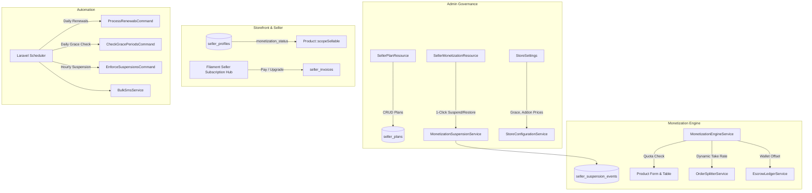

# B2Bhaat Seller Monetization Platform Implementation Plan

> **For agentic workers:** REQUIRED SUB-SKILL: Use superpowers:subagent-driven-development to implement this plan task-by-task. Steps use checkbox (`- [ ]`) syntax for tracking.

**Goal:** Transform B2Bhaat into a scalable, revenue-generating multi-vendor marketplace by implementing a plan-driven, 100% admin-configurable seller monetization engine (subscriptions, item listing quotas, dynamic channel commissions, one-click suspension with safe selective restoration, and automated billing).

**Architecture:** A modular monetization engine where super admins dynamically configure plans, commission rates, and quotas from Filament Admin. Sellers manage subscriptions, listing add-ons, and invoices in Filament Seller with support for MFS (bKash/Nagad), bank wire, and seller wallet auto-offset. Delinquent accounts trigger a two-tiered suspension engine that instantly isolates storefront products while preserving historical active snapshots for safe selective restoration upon payment.

**Architecture Diagram:**



**Tech Stack:** PHP 8.5, Laravel 12, Filament 3 Admin & Seller Panels, MySQL 8 / PostgreSQL, BulkSMSBD Gateway, Pest / PHPUnit test suite.

## Global Constraints

- PHP 8.5 with strict types and constructor property promotion.
- All monetary columns strictly use `DECIMAL(12, 2)` (no floating point).
- Zero hardcoded commission rates or pricing amounts; all values resolve dynamically from database or `StoreConfigurationService`.
- Zero deletion of historical financial or product data (immutable ledgers).
- Suspended sellers must retain access to `/seller` to pay invoices and fulfill pending pre-suspension customer orders.
- Safe selective product restoration: never restore products that were inactive prior to suspension or blocked by admin moderation (`blocked_at IS NOT NULL`).
- Follow Laravel Pint formatting: `vendor/bin/pint --dirty --format agent`.
- Verification command: `php artisan test --compact`.

---

### Task 1: Database Migrations & Eloquent Models

**Files:**
- Create: `database/migrations/2026_11_07_000001_create_seller_monetization_tables.php`
- Create: `app/Models/SellerPlan.php`
- Create: `app/Models/SellerSubscription.php`
- Create: `app/Models/SellerInvoice.php`
- Create: `app/Models/SellerPayment.php`
- Create: `app/Models/SellerSuspensionEvent.php`
- Modify: `app/Models/SellerProfile.php`
- Modify: `app/Models/Product.php`
- Modify: `app/Models/User.php`
- Test: `tests/Feature/SellerMonetizationSchemaTest.php`

**Interfaces:**
- Consumes: `users`, `seller_profiles`, `products`.
- Produces: `SellerPlan`, `SellerSubscription`, `SellerInvoice`, `SellerPayment`, `SellerSuspensionEvent` models with full casts and relationships.

- [ ] **Step 1: Write the failing schema test**

Create `tests/Feature/SellerMonetizationSchemaTest.php` asserting that `seller_plans`, `seller_subscriptions`, `seller_invoices`, `seller_payments`, and `seller_suspension_events` tables exist with expected columns, and models instantiate cleanly.

- [ ] **Step 2: Run test to verify it fails**

Run: `php artisan test --filter=SellerMonetizationSchemaTest --compact`
Expected: FAIL with "table does not exist".

- [ ] **Step 3: Create migration and Eloquent models**

Create migration `2026_11_07_000001_create_seller_monetization_tables.php` implementing the exact schema defined in Section 3 of the spec:
- `seller_plans` (`name`, `slug`, `subscription_price`, `billing_cycle_days`, `max_active_products`, `retail_commission_rate`, `wholesale_commission_rate`, `allow_listing_addons`, `is_default_free_plan`, `is_active`, `sort_order`).
- `seller_subscriptions` (`seller_id`, `plan_id`, `status`, `starts_at`, `ends_at`, `grace_period_ends_at`, `auto_renew`, `custom_product_limit`, `custom_retail_commission`, `custom_wholesale_commission`, `custom_subscription_price`, `admin_override_notes`).
- `seller_invoices` (`invoice_number`, `seller_id`, `subscription_id`, `invoice_type`, `subtotal`, `discount_amount`, `total_amount`, `status`, `due_date`, `paid_at`, `metadata`).
- `seller_payments` (`invoice_id`, `seller_id`, `amount`, `payment_method`, `transaction_reference`, `status`, `verified_by_user_id`, `verified_at`, `receipt_url`, `notes`).
- `seller_suspension_events` (`seller_id`, `trigger_type`, `snapshot_active_product_ids`, `restored_product_ids`, `suspended_at`, `restored_at`, `reason`, `action_by_user_id`).
- Add `monetization_status` to `seller_profiles`.
- Add `was_active_before_suspension` to `products`.

Create model classes in `app/Models/` with proper `$fillable`, `$casts`, and relationships (`User::hasMany(SellerSubscription::class)`, `SellerProfile::belongsTo(User::class)`, `SellerPlan::hasMany(SellerSubscription::class)`, etc.).

- [ ] **Step 4: Run migration and test to verify it passes**

Run: `php artisan migrate && php artisan test --filter=SellerMonetizationSchemaTest --compact`
Expected: PASS.

- [ ] **Step 5: Format code & commit**

Run: `vendor/bin/pint --dirty --format agent && git add . && git commit -m "feat(monetization): add database schema and models for seller monetization"`

---

### Task 2: Monetization Store Settings & Default Plan Seeder

**Files:**
- Create: `database/seeders/SellerPlanSeeder.php`
- Modify: `app/Services/Settings/StoreConfigurationService.php`
- Modify: `database/seeders/DatabaseSeeder.php`
- Test: `tests/Feature/SellerMonetizationSettingsAndSeedingTest.php`

**Interfaces:**
- Consumes: `seller_plans`, `store_settings`, `StoreConfigurationService`.
- Produces: Dynamic getter methods in `StoreConfigurationService` (`getMonetizationGraceDays()`, `getAddonPackPrice()`, etc.) and seeded starter plans (`free`, `growth`, `factory_pro`, `enterprise`).

- [ ] **Step 1: Write the failing settings & seeding test**

Create `tests/Feature/SellerMonetizationSettingsAndSeedingTest.php` asserting that:
1. `SellerPlanSeeder` seeds the 4 default tiers (Free @ ৳0, Growth @ ৳499, Factory Pro @ ৳1299, Enterprise @ ৳2999).
2. Existing approved sellers without subscriptions are automatically backfilled into the default Free plan.
3. `StoreConfigurationService` returns typed default values for monetization settings.

- [ ] **Step 2: Run test to verify it fails**

Run: `php artisan test --filter=SellerMonetizationSettingsAndSeedingTest --compact`
Expected: FAIL.

- [ ] **Step 3: Implement settings and seeder**

Add methods to `app/Services/Settings/StoreConfigurationService.php`:
- `isMonetizationEnabled(): bool`
- `getMonetizationGracePeriodDays(): int` (default 3)
- `getMonetizationPreExpiryNoticeDays(): int` (default 3)
- `isWalletAutoRenewAllowed(): bool` (default true)
- `getListingAddonPackSize(): int` (default 25)
- `getListingAddonPackPrice(): float` (default 250.00)
- `getCodDeficitGraceDays(): int` (default 7)
- `getBkashMerchantNumber(): ?string`
- `getNagadMerchantNumber(): ?string`

Create `database/seeders/SellerPlanSeeder.php`:
- Creates default plans with exact pricing, limits, and channel commission rates.
- Finds all existing approved `SellerProfile` records and generates an active `SellerSubscription` for the Free plan starting now.

- [ ] **Step 4: Run test to verify it passes**

Run: `php artisan db:seed --class=SellerPlanSeeder && php artisan test --filter=SellerMonetizationSettingsAndSeedingTest --compact`
Expected: PASS.

- [ ] **Step 5: Format code & commit**

Run: `vendor/bin/pint --dirty --format agent && git add . && git commit -m "feat(monetization): add monetization settings and plan seeder"`

---

### Task 3: Core Monetization Engine & Dynamic Commission Resolution

**Files:**
- Create: `app/Services/Monetization/MonetizationEngineService.php`
- Modify: `app/Services/Orders/OrderSplitterService.php:156-170`
- Test: `tests/Feature/MonetizationEngineServiceTest.php`

**Interfaces:**
- Consumes: `SellerSubscription`, `SellerPlan`, `Product`, `SalesChannel`, `User`.
- Produces: `resolveCommissionRate()`, `canActivateMoreProducts()`, `getActiveSubscription()`.

- [ ] **Step 1: Write the failing engine service test**

Create `tests/Feature/MonetizationEngineServiceTest.php` testing:
1. Commission resolution priority: Seller custom override -> Category override -> Plan rate -> Profile default.
2. Quota evaluation: seller with 15/15 products returns `canActivateMoreProducts() === false`.
3. Plan with `is_listing_limit_enabled = false` returns `true` (unlimited).
4. `OrderSplitterService` creates sub-orders using the rate resolved by `MonetizationEngineService`.

- [ ] **Step 2: Run test to verify it fails**

Run: `php artisan test --filter=MonetizationEngineServiceTest --compact`
Expected: FAIL.

- [ ] **Step 3: Implement MonetizationEngineService and inject into OrderSplitterService**

Create `app/Services/Monetization/MonetizationEngineService.php`:
- `getActiveSubscription(User $seller): ?SellerSubscription`
- `resolveCommissionRate(User $seller, Product $product, SalesChannel $channel): float`
- `canActivateMoreProducts(User $seller): bool`
- `getAllowedProductCount(User $seller): ?int`

Refactor lines 156–169 of `app/Services/Orders/OrderSplitterService.php`:
Replace hardcoded 4%/10% calculation with call to `$this->monetizationEngine->resolveCommissionRate($seller, $product, $channel)`.

- [ ] **Step 4: Run test to verify it passes**

Run: `php artisan test --filter=MonetizationEngineServiceTest --compact`
Expected: PASS.

- [ ] **Step 5: Format code & commit**

Run: `vendor/bin/pint --dirty --format agent && git add . && git commit -m "feat(monetization): implement core engine and dynamic order commission resolution"`

---

### Task 4: One-Click Suspension & Safe Selective Restoration Subsystem

**Files:**
- Create: `app/Services/Monetization/MonetizationSuspensionService.php`
- Modify: `app/Models/Product.php:258-264` (`scopeSellable`)
- Test: `tests/Feature/SellerSuspensionAndRestorationTest.php`

**Interfaces:**
- Consumes: `Product`, `SellerProfile`, `SellerSuspensionEvent`.
- Produces: `suspendSeller(User $seller, string $reason, ?User $actor)`, `restoreSeller(User $seller, ?User $actor)`.

- [ ] **Step 1: Write the failing suspension & selective restoration test**

Create `tests/Feature/SellerSuspensionAndRestorationTest.php` testing:
1. Setup a seller with 100 products (80 active, 20 inactive, 2 blocked by admin moderation).
2. Call `suspendSeller()`:
   - `monetization_status` becomes `'suspended'`.
   - Storefront `Product::sellable()->count()` drops to 0 immediately.
   - `seller_suspension_events` contains the exact 80 active IDs in JSON snapshot.
3. Call `restoreSeller()`:
   - Exactly the 78 non-moderated previously active products become `is_active = true`.
   - The 20 previously inactive products remain `is_active = false`.
   - The 2 admin-moderated products remain blocked (`blocked_at IS NOT NULL`).
   - `monetization_status` becomes `'active'`.

- [ ] **Step 2: Run test to verify it fails**

Run: `php artisan test --filter=SellerSuspensionAndRestorationTest --compact`
Expected: FAIL.

- [ ] **Step 3: Implement suspension service and update Product::scopeSellable**

Update `app/Models/Product.php` lines 258–264 to add monetization check:
```php
public function scopeSellable(Builder $query): Builder
{
    return $query->where($query->qualifyColumn('is_active'), true)
        ->whereNull($query->qualifyColumn('blocked_at'))
        ->whereHas('seller', fn (Builder $seller) => $seller->where('is_active', true)
            ->whereHas('sellerProfile', fn (Builder $profile) => $profile->where('is_approved', true)
                ->where('monetization_status', 'active')));
}
```

Create `app/Services/Monetization/MonetizationSuspensionService.php`:
- Implement `suspendSeller()` with active product ID snapshotting and transaction locking.
- Implement `restoreSeller()` with the safe selective restoration algorithm filtering snapshot IDs, respecting plan quota, and excluding admin-moderated items.

- [ ] **Step 4: Run test to verify it passes**

Run: `php artisan test --filter=SellerSuspensionAndRestorationTest --compact`
Expected: PASS.

- [ ] **Step 5: Format code & commit**

Run: `vendor/bin/pint --dirty --format agent && git add . && git commit -m "feat(monetization): implement one-click suspension and safe selective product restoration"`

---

### Task 5: Filament Admin Monetization Center

**Files:**
- Create: `app/Filament/Admin/Resources/SellerPlans/SellerPlanResource.php`
- Create: `app/Filament/Admin/Resources/SellerPlans/Pages/ListSellerPlans.php`
- Create: `app/Filament/Admin/Resources/SellerPlans/Pages/CreateSellerPlan.php`
- Create: `app/Filament/Admin/Resources/SellerPlans/Pages/EditSellerPlan.php`
- Create: `app/Filament/Admin/Resources/SellerMonetization/SellerMonetizationResource.php`
- Create: `app/Filament/Admin/Resources/SellerMonetization/Pages/ListSellerMonetizations.php`
- Modify: `app/Filament/Admin/Pages/StoreSettings.php`
- Test: `tests/Feature/AdminMonetizationPanelTest.php`

**Interfaces:**
- Consumes: `SellerPlan`, `SellerSubscription`, `SellerInvoice`, `MonetizationSuspensionService`.
- Produces: Admin UI for managing plans, viewing seller statuses, 1-click suspend/restore actions, grace extensions, and offline payments.

- [ ] **Step 1: Write the failing admin panel test**

Create `tests/Feature/AdminMonetizationPanelTest.php` verifying:
1. Super Admin can access `/admin/seller-plans` and create/edit plans with toggles.
2. Super Admin can view `/admin/seller-monetization`, filter by status (`suspended`, `grace_period`), and trigger the `suspend` and `restore` actions.
3. Super Admin can record offline payment and grant grace extension.

- [ ] **Step 2: Run test to verify it fails**

Run: `php artisan test --filter=AdminMonetizationPanelTest --compact`
Expected: FAIL.

- [ ] **Step 3: Implement Filament Admin resources and settings**

1. Create `SellerPlanResource` under navigation group 'Monetization & Plans':
   - Form schema with Section cards for Subscription Fee, Listing Limit, and Commission Rates.
   - Table columns with badges and sortable pricing.
2. Create `SellerMonetizationResource`:
   - Lists all sellers with current plan, used quota / limit, monetization status badge, and balance.
   - Action `suspend`: prompts reason modal, calls `MonetizationSuspensionService::suspendSeller()`.
   - Action `restore`: calls `MonetizationSuspensionService::restoreSeller()`.
   - Action `assignOverrides`: custom limit, commission, or price.
   - Action `recordOfflinePayment`: records MFS/Bank TrxID, marks invoice paid, restores seller.
   - Action `extendGrace`: adds N days to `grace_period_ends_at`.
3. Add Monetization Settings tab to `StoreSettings` page with inputs for grace days, addon prices, and MFS merchant numbers.

- [ ] **Step 4: Run test to verify it passes**

Run: `php artisan test --filter=AdminMonetizationPanelTest --compact`
Expected: PASS.

- [ ] **Step 5: Format code & commit**

Run: `vendor/bin/pint --dirty --format agent && git add . && git commit -m "feat(monetization): add filament admin monetization and plan management center"`

---

### Task 6: Filament Seller Billing Hub & Quota Protection

**Files:**
- Create: `app/Filament/Seller/Pages/SubscriptionBilling.php`
- Create: `resources/views/filament/seller/pages/subscription-billing.blade.php`
- Create: `app/Filament/Seller/Resources/SellerInvoices/SellerInvoiceResource.php`
- Modify: `app/Filament/Seller/Resources/Products/Pages/CreateProduct.php`
- Modify: `app/Filament/Seller/Resources/Products/Tables/ProductsTable.php`
- Modify: `app/Models/User.php:179-194` (`canAccessPanel`)
- Test: `tests/Feature/SellerBillingAndQuotaEnforcementTest.php`

**Interfaces:**
- Consumes: `MonetizationEngineService`, `SellerSubscription`, `SellerInvoice`, `SellerPayment`.
- Produces: Seller subscription dashboard, invoice payment desk, quota bar, and product publish lock.

- [ ] **Step 1: Write the failing seller billing & quota test**

Create `tests/Feature/SellerBillingAndQuotaEnforcementTest.php` asserting that:
1. Seller sees subscription status, quota usage, and invoice history in `/seller/subscription`.
2. Seller cannot publish a 16th product when on a 15-product quota plan.
3. Suspended seller can access `/seller/subscription` to view invoice and pay, but cannot publish products.
4. Seller can pay invoice using available seller wallet balance.

- [ ] **Step 2: Run test to verify it fails**

Run: `php artisan test --filter=SellerBillingAndQuotaEnforcementTest --compact`
Expected: FAIL.

- [ ] **Step 3: Implement seller billing hub and quota guards**

1. Create `SubscriptionBilling` Filament page under `/seller/subscription`:
   - Blade view with plan overview card, quota usage gauge, upgrade cards, and listing addon pack purchase.
2. In `CreateProduct.php`:
   - Check `MonetizationEngineService::canActivateMoreProducts()`. If false, hide/disable publish action and show notification.
3. In `ProductsTable.php`:
   - Add `beforeStateUpdated` check on `ToggleColumn::make('is_active')` verifying quota before enabling.
4. Update `User::canAccessPanel()` to ensure suspended sellers can still access `/seller` for billing and pre-existing order fulfillment, while seeing the restriction banner.
5. Implement wallet balance payment action in `SubscriptionBilling` / `SellerInvoiceResource`.

- [ ] **Step 4: Run test to verify it passes**

Run: `php artisan test --filter=SellerBillingAndQuotaEnforcementTest --compact`
Expected: PASS.

- [ ] **Step 5: Format code & commit**

Run: `vendor/bin/pint --dirty --format agent && git add . && git commit -m "feat(monetization): add seller billing hub and catalog quota protection"`

---

### Task 7: Automated Billing Scheduler & SMS Alerts

**Files:**
- Create: `app/Console/Commands/MonetizationProcessRenewalsCommand.php`
- Create: `app/Console/Commands/MonetizationCheckGracePeriodsCommand.php`
- Create: `app/Console/Commands/MonetizationEnforceSuspensionsCommand.php`
- Modify: `routes/console.php`
- Modify: `app/Services/Sms/OrderNotificationService.php`
- Test: `tests/Feature/MonetizationCronAndSmsAlertsTest.php`

**Interfaces:**
- Consumes: `routes/console.php`, `BulkSmsService`, `MonetizationSuspensionService`.
- Produces: Daily & hourly scheduled automation commands with BulkSMSBD alerts.

- [ ] **Step 1: Write the failing cron & notification test**

Create `tests/Feature/MonetizationCronAndSmsAlertsTest.php` asserting that:
1. `monetization:process-renewals` creates unpaid invoices for subscriptions expiring in <= 3 days, and auto-renews via wallet balance when enabled and sufficient.
2. `monetization:check-grace-periods` marks unpaid expired accounts as `grace_period` and sends warning SMS.
3. `monetization:enforce-suspensions` automatically calls `MonetizationSuspensionService::suspendSeller()` for accounts whose grace period has ended.

- [ ] **Step 2: Run test to verify it fails**

Run: `php artisan test --filter=MonetizationCronAndSmsAlertsTest --compact`
Expected: FAIL.

- [ ] **Step 3: Implement scheduled commands and SMS dispatchers**

1. Create `MonetizationProcessRenewalsCommand`:
   - Queries expiring subscriptions, creates `SellerInvoice`, executes atomic wallet deduction if auto-renew is on, dispatches SMS.
2. Create `MonetizationCheckGracePeriodsCommand`:
   - Transitions unpaid past-due accounts to `grace_period`, calculates `grace_period_ends_at`, dispatches grace alert SMS.
3. Create `MonetizationEnforceSuspensionsCommand`:
   - Queries accounts where `grace_period_ends_at < now()`, triggers `MonetizationSuspensionService::suspendSeller()`, dispatches suspension SMS.
4. Register all commands in `routes/console.php`.
5. Add SMS notification methods in `OrderNotificationService` for renewal reminder, grace warning, suspension, and restoration.

- [ ] **Step 4: Run test to verify it passes**

Run: `php artisan test --filter=MonetizationCronAndSmsAlertsTest --compact`
Expected: PASS.

- [ ] **Step 5: Format code & commit**

Run: `vendor/bin/pint --dirty --format agent && git add . && git commit -m "feat(monetization): add automated billing scheduler commands and sms notifications"`

---

### Task 8: End-to-End Regression & Full System Verification

**Files:**
- Create: `tests/Feature/MonetizationEndToEndRegressionTest.php`
- Modify: `docs/superpowers/specs/2026-11-06-seller-monetization-design.md`
- Test: All 633+ tests in `tests/`

**Interfaces:**
- Consumes: The entire B2Bhaat application.
- Produces: 100% test pass rate with zero regression across retail, wholesale, escrow, and courier logistics.

- [ ] **Step 1: Write comprehensive end-to-end regression test**

Create `tests/Feature/MonetizationEndToEndRegressionTest.php` covering the complete seller lifecycle:
- Seller signs up -> gets approved -> auto-assigned Free Plan.
- Seller upgrades to Growth Plan -> pays invoice via bKash TrxID -> verified by Admin -> quota increases from 15 to 75.
- Customer places retail & wholesale orders -> commission dynamically calculates based on Growth tier (7.5% / 3.0%).
- Subscription billing cycle ends -> grace period triggers -> grace expires -> one-click/auto suspension executes -> products hidden.
- Admin verifies payment -> safe selective restoration runs -> original 75 items reappear, leaving inactive and moderated items untouched.

- [ ] **Step 2: Run full test suite**

Run: `php artisan test --compact`
Expected: PASS (all tests passing, 0 failures).

- [ ] **Step 3: Run code style formatter**

Run: `vendor/bin/pint --format agent`

- [ ] **Step 4: Commit and finalize**

Run: `git add . && git commit -m "test(monetization): add comprehensive end-to-end regression test and verify clean test suite"`
