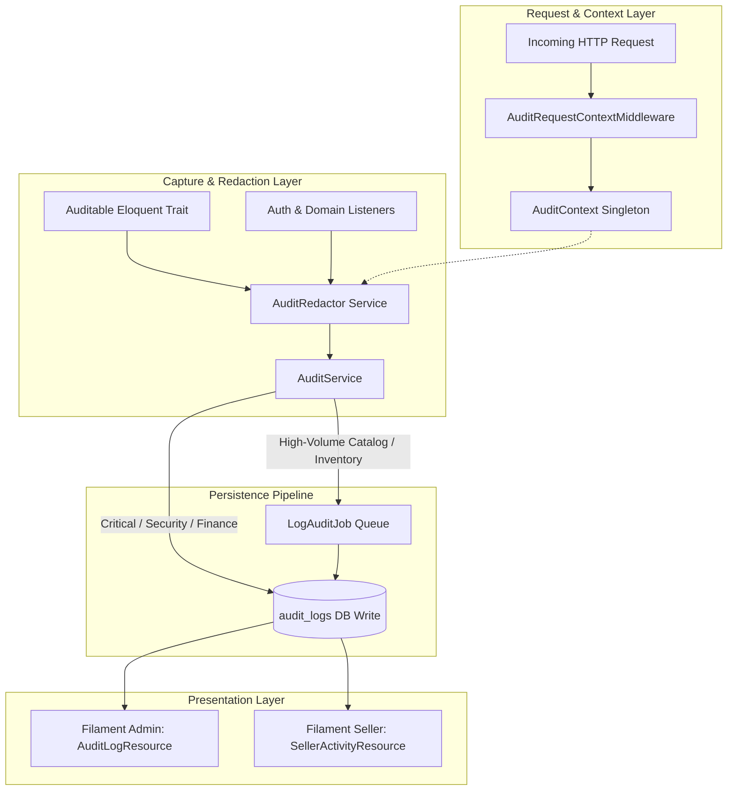

# Centralized Audit Logging and Activity Monitoring Implementation Plan

> **For agentic workers:** REQUIRED SUB-SKILL: Use superpowers:subagent-driven-development to implement this plan task-by-task. Steps use checkbox (`- [ ]`) syntax for tracking.

**Goal:** Implement a comprehensive, production-ready, append-only Audit Logging and Activity Monitoring system for B2Bhaat featuring hybrid sync/queue execution, data redaction, multi-tenant seller isolation, and dual Filament 5 dashboards.

**Architecture:** A request middleware captures client network and device context into an `AuditContext` singleton. Core Eloquent models use an `Auditable` trait and auth listeners pass event payloads through an `AuditRedactor` into `AuditService`, which synchronously commits security/financial events and queues high-volume catalog mutations into `audit_logs`. Dual Filament 5 resources provide full administrative supervision and strictly scoped seller business activity streams.

**Architecture Diagram:**



**Tech Stack:** Laravel 13.39.0, PHP 8.5.8, Filament 5.11.0, PostgreSQL & SQLite :memory:, PHPUnit 12.5.42.

## Global Constraints
- Laravel 13 on PHP 8.5 with strict types (`declare(strict_types=1);`).
- Zero external package dependencies for auditing or device detection.
- Database migration must be compatible with both PostgreSQL (production) and SQLite (tests).
- Audit logs are append-only: no user (including Super Admin) can update or delete historical audit entries.
- Sellers can ONLY view audit records matching `seller_id = auth()->id()`. Customer IPs, system configs, and internal admin notes must be masked/nullified for sellers.
- Redact passwords, OTPs, `handover_code`, tokens, and API credentials before database insertion.
- All existing 681 tests must continue to pass; code must format cleanly with `vendor/bin/pint --dirty --format agent`.

---

### Task 1: Database Migration & AuditLog Model

**Files:**
- Create: `database/migrations/2026_11_07_000001_create_audit_logs_table.php`
- Create: `app/Models/AuditLog.php`
- Test: `tests/Feature/Audit/AuditLogModelTest.php`

**Interfaces:**
- Consumes: Database schema blueprint, Eloquent Model.
- Produces: `App\Models\AuditLog` model with scopes (`forSeller($sellerId)`, `suspicious()`, `module($module)`), json casts, and relation to `User` (`actor`, `seller`).

- [ ] **Step 1: Write the failing test**

```php
<?php

declare(strict_types=1);

namespace Tests\Feature\Audit;

use App\Models\AuditLog;
use App\Models\Role;
use App\Models\User;
use Illuminate\Foundation\Testing\RefreshDatabase;
use Tests\TestCase;

class AuditLogModelTest extends TestCase
{
    use RefreshDatabase;

    public function test_can_persist_audit_log_record_with_json_diffs(): void
    {
        $role = Role::firstOrCreate(['slug' => 'super_admin'], ['name' => 'Super Administrator']);
        $user = User::factory()->create(['role_id' => $role->id, 'name' => 'Admin User']);

        $log = AuditLog::create([
            'correlation_id' => '9b1deb4d-3b7d-4bad-9bdd-2b0d7b3dcb6d',
            'actor_type' => 'user',
            'actor_id' => $user->id,
            'actor_name' => $user->name,
            'actor_email' => $user->email,
            'actor_role' => 'super_admin',
            'auth_guard' => 'web',
            'module' => 'products',
            'action' => 'price_updated',
            'description' => "Updated regular price from ৳100 to ৳120",
            'auditable_type' => 'App\Models\Product',
            'auditable_id' => 10,
            'record_label' => 'SKU-10025',
            'old_values' => ['regular_price' => '100.00'],
            'new_values' => ['regular_price' => '120.00'],
            'changed_fields' => ['regular_price'],
            'status' => 'success',
            'ip_address' => '127.0.0.1',
            'device_type' => 'desktop',
            'browser' => 'Chrome',
            'os' => 'macOS',
            'created_at' => now(),
        ]);

        $this->assertDatabaseHas('audit_logs', ['id' => $log->id, 'action' => 'price_updated']);
        $this->assertEquals(['regular_price'], $log->fresh()->changed_fields);
        $this->assertEquals('100.00', $log->fresh()->old_values['regular_price']);
    }

    public function test_audit_log_has_seller_and_suspicious_scopes(): void
    {
        $log1 = AuditLog::create([
            'actor_type' => 'system',
            'seller_id' => 42,
            'module' => 'orders',
            'action' => 'order_placed',
            'description' => 'Order placed',
            'status' => 'success',
            'is_suspicious' => false,
            'created_at' => now(),
        ]);

        $log2 = AuditLog::create([
            'actor_type' => 'user',
            'seller_id' => 99,
            'module' => 'auth',
            'action' => 'login_failed',
            'description' => 'Failed password attempt',
            'status' => 'failed',
            'is_suspicious' => true,
            'risk_notes' => 'Brute force suspected',
            'created_at' => now(),
        ]);

        $sellerLogs = AuditLog::forSeller(42)->get();
        $this->assertCount(1, $sellerLogs);
        $this->assertEquals($log1->id, $sellerLogs->first()->id);

        $suspiciousLogs = AuditLog::suspicious()->get();
        $this->assertCount(1, $suspiciousLogs);
        $this->assertEquals($log2->id, $suspiciousLogs->first()->id);
    }
}
```

- [ ] **Step 2: Run test to verify it fails**

Run: `php artisan test tests/Feature/Audit/AuditLogModelTest.php --compact`
Expected: FAIL with missing table or class `AuditLog` not found.

- [ ] **Step 3: Create migration and model**

Create `database/migrations/2026_11_07_000001_create_audit_logs_table.php`:
```php
<?php

declare(strict_types=1);

use Illuminate\Database\Migrations\Migration;
use Illuminate\Database\Schema\Blueprint;
use Illuminate\Support\Facades\Schema;

return new class extends Migration
{
    public function up(): void
    {
        Schema::create('audit_logs', function (Blueprint $table) {
            $table->id();
            $table->uuid('correlation_id')->nullable()->index();
            $table->string('actor_type', 32)->default('user')->index();
            $table->foreignId('actor_id')->nullable()->nullOnDelete()->index();
            $table->string('actor_name')->nullable();
            $table->string('actor_email')->nullable();
            $table->string('actor_role', 32)->nullable()->index();
            $table->string('auth_guard', 32)->nullable();
            $table->foreignId('seller_id')->nullable()->index();
            $table->string('module', 64)->index();
            $table->string('action', 64)->index();
            $table->text('description');
            $table->string('auditable_type')->nullable()->index();
            $table->unsignedBigInteger('auditable_id')->nullable()->index();
            $table->string('record_label')->nullable();
            $table->json('old_values')->nullable();
            $table->json('new_values')->nullable();
            $table->json('changed_fields')->nullable();
            $table->string('status', 32)->default('success')->index();
            $table->text('failure_reason')->nullable();
            $table->boolean('is_suspicious')->default(false)->index();
            $table->string('risk_notes')->nullable();
            $table->string('ip_address', 45)->nullable()->index();
            $table->string('user_agent', 500)->nullable();
            $table->string('device_type', 32)->nullable();
            $table->string('browser', 64)->nullable();
            $table->string('os', 64)->nullable();
            $table->string('request_method', 10)->nullable();
            $table->text('request_url')->nullable();
            $table->string('route_name')->nullable()->index();
            $table->json('metadata')->nullable();
            $table->timestamp('created_at')->index();

            $table->index(['seller_id', 'created_at'], 'idx_audit_seller_created');
            $table->index(['module', 'created_at'], 'idx_audit_module_created');
            $table->index(['auditable_type', 'auditable_id'], 'idx_audit_polymorphic');
        });
    }

    public function down(): void
    {
        Schema::dropIfExists('audit_logs');
    }
};
```

Create `app/Models/AuditLog.php`:
```php
<?php

declare(strict_types=1);

namespace App\Models;

use Illuminate\Database\Eloquent\Builder;
use Illuminate\Database\Eloquent\Model;
use Illuminate\Database\Eloquent\Relations\BelongsTo;

class AuditLog extends Model
{
    public $timestamps = false;

    protected $fillable = [
        'correlation_id',
        'actor_type',
        'actor_id',
        'actor_name',
        'actor_email',
        'actor_role',
        'auth_guard',
        'seller_id',
        'module',
        'action',
        'description',
        'auditable_type',
        'auditable_id',
        'record_label',
        'old_values',
        'new_values',
        'changed_fields',
        'status',
        'failure_reason',
        'is_suspicious',
        'risk_notes',
        'ip_address',
        'user_agent',
        'device_type',
        'browser',
        'os',
        'request_method',
        'request_url',
        'route_name',
        'metadata',
        'created_at',
    ];

    protected function casts(): array
    {
        return [
            'old_values' => 'array',
            'new_values' => 'array',
            'changed_fields' => 'array',
            'metadata' => 'array',
            'is_suspicious' => 'boolean',
            'created_at' => 'datetime',
        ];
    }

    public function actor(): BelongsTo
    {
        return $this->belongsTo(User::class, 'actor_id');
    }

    public function seller(): BelongsTo
    {
        return $this->belongsTo(User::class, 'seller_id');
    }

    public function scopeForSeller(Builder $query, int $sellerId): Builder
    {
        return $query->where('seller_id', $sellerId);
    }

    public function scopeSuspicious(Builder $query): Builder
    {
        return $query->where('is_suspicious', true);
    }

    public function scopeModule(Builder $query, string $module): Builder
    {
        return $query->where('module', $module);
    }
}
```

- [ ] **Step 4: Run test to verify it passes**

Run: `php artisan test tests/Feature/Audit/AuditLogModelTest.php --compact`
Expected: PASS

- [ ] **Step 5: Format and commit**

```bash
vendor/bin/pint --dirty --format agent
git add database/migrations/2026_11_07_000001_create_audit_logs_table.php app/Models/AuditLog.php tests/Feature/Audit/AuditLogModelTest.php
git commit -m "feat(audit): create audit_logs migration and AuditLog model"
```

---

### Task 2: Request Context & Lightweight Device Detector

**Files:**
- Create: `app/Services/Audit/AuditContext.php`
- Create: `app/Services/Audit/Support/UserAgentParser.php`
- Create: `app/Http/Middleware/AuditRequestContextMiddleware.php`
- Modify: `bootstrap/app.php` (register middleware on `web` and `api`)
- Test: `tests/Unit/Audit/UserAgentParserTest.php`
- Test: `tests/Feature/Audit/AuditRequestContextMiddlewareTest.php`

**Interfaces:**
- Consumes: HTTP Request headers, User-Agent, client IP.
- Produces: `AuditContext` snapshot (`correlation_id`, `ip_address`, `device_type`, `browser`, `os`, `user_agent`, `route_name`, `request_method`, `request_url`).

- [ ] **Step 1: Write failing tests for UserAgentParser and Context Middleware**

```php
<?php

declare(strict_types=1);

namespace Tests\Unit\Audit;

use App\Services\Audit\Support\UserAgentParser;
use PHPUnit\Framework\TestCase;

class UserAgentParserTest extends TestCase
{
    public function test_detects_macos_and_chrome(): void
    {
        $ua = 'Mozilla/5.0 (Macintosh; Intel Mac OS X 10_15_7) AppleWebKit/537.36 (KHTML, like Gecko) Chrome/120.0.0.0 Safari/537.36';
        $parsed = UserAgentParser::parse($ua);

        $this->assertEquals('desktop', $parsed['device_type']);
        $this->assertEquals('Chrome', $parsed['browser']);
        $this->assertEquals('macOS', $parsed['os']);
    }

    public function test_detects_android_mobile(): void
    {
        $ua = 'Mozilla/5.0 (Linux; Android 13; SM-S901B) AppleWebKit/537.36 (KHTML, like Gecko) Chrome/112.0.0.0 Mobile Safari/537.36';
        $parsed = UserAgentParser::parse($ua);

        $this->assertEquals('mobile', $parsed['device_type']);
        $this->assertEquals('Chrome', $parsed['browser']);
        $this->assertEquals('Android', $parsed['os']);
    }

    public function test_handles_null_or_empty_user_agent(): void
    {
        $parsed = UserAgentParser::parse(null);
        $this->assertEquals('unknown', $parsed['device_type']);
        $this->assertEquals('Unknown', $parsed['browser']);
        $this->assertEquals('Unknown', $parsed['os']);
    }
}
```

- [ ] **Step 2: Run test to verify it fails**

Run: `php artisan test tests/Unit/Audit/UserAgentParserTest.php --compact`
Expected: FAIL with class `UserAgentParser` not found.

- [ ] **Step 3: Implement UserAgentParser, AuditContext, and Middleware**

Create `app/Services/Audit/Support/UserAgentParser.php`:
```php
<?php

declare(strict_types=1);

namespace App\Services\Audit\Support;

class UserAgentParser
{
    /**
     * @return array{device_type: string, browser: string, os: string}
     */
    public static function parse(?string $ua): array
    {
        if (blank($ua)) {
            return ['device_type' => 'unknown', 'browser' => 'Unknown', 'os' => 'Unknown'];
        }

        $deviceType = 'desktop';
        if (preg_match('/(ipad|tablet|(android(?!.*mobile))|(windows(?!.*phone)(.*touch))|kindle|playbook|silk)/i', $ua)) {
            $deviceType = 'tablet';
        } elseif (preg_match('/(mobi|iphone|ipod|phone|blackberry|opera mini|fennec|minimo)/i', $ua)) {
            $deviceType = 'mobile';
        }

        $os = 'Unknown';
        if (preg_match('/windows nt/i', $ua)) {
            $os = 'Windows';
        } elseif (preg_match('/macintosh|mac os x/i', $ua)) {
            $os = 'macOS';
        } elseif (preg_match('/iphone|ipad|ipod/i', $ua)) {
            $os = 'iOS';
        } elseif (preg_match('/android/i', $ua)) {
            $os = 'Android';
        } elseif (preg_match('/linux/i', $ua)) {
            $os = 'Linux';
        }

        $browser = 'Unknown';
        if (preg_match('/edg\//i', $ua)) {
            $browser = 'Edge';
        } elseif (preg_match('/chrome|crios/i', $ua) && ! preg_match('/opr|opera/i', $ua)) {
            $browser = 'Chrome';
        } elseif (preg_match('/firefox|fxios/i', $ua)) {
            $browser = 'Firefox';
        } elseif (preg_match('/safari/i', $ua) && ! preg_match('/chrome|crios/i', $ua)) {
            $browser = 'Safari';
        } elseif (preg_match('/opr|opera/i', $ua)) {
            $browser = 'Opera';
        }

        return [
            'device_type' => $deviceType,
            'browser' => $browser,
            'os' => $os,
        ];
    }
}
```

Create `app/Services/Audit/AuditContext.php`:
```php
<?php

declare(strict_types=1);

namespace App\Services\Audit;

use App\Models\User;
use Illuminate\Support\Str;

class AuditContext
{
    public ?string $correlationId = null;
    public ?string $ipAddress = null;
    public ?string $userAgent = null;
    public ?string $deviceType = null;
    public ?string $browser = null;
    public ?string $os = null;
    public ?string $requestMethod = null;
    public ?string $requestUrl = null;
    public ?string $routeName = null;
    public ?User $actor = null;
    public ?string $authGuard = null;

    public function initialize(
        ?string $correlationId,
        ?string $ipAddress,
        ?string $userAgent,
        ?string $deviceType,
        ?string $browser,
        ?string $os,
        ?string $requestMethod,
        ?string $requestUrl,
        ?string $routeName,
        ?User $actor = null,
        ?string $authGuard = null,
    ): void {
        $this->correlationId = $correlationId ?: (string) Str::uuid();
        $this->ipAddress = $ipAddress;
        $this->userAgent = $userAgent ? Str::limit($userAgent, 500) : null;
        $this->deviceType = $deviceType;
        $this->browser = $browser;
        $this->os = $os;
        $this->requestMethod = $requestMethod;
        $this->requestUrl = $requestUrl;
        $this->routeName = $routeName;
        $this->actor = $actor;
        $this->authGuard = $authGuard;
    }

    /**
     * @return array<string, mixed>
     */
    public function snapshot(): array
    {
        return [
            'correlation_id' => $this->correlationId ?: (string) Str::uuid(),
            'ip_address' => $this->ipAddress,
            'user_agent' => $this->userAgent,
            'device_type' => $this->deviceType,
            'browser' => $this->browser,
            'os' => $this->os,
            'request_method' => $this->requestMethod,
            'request_url' => $this->requestUrl,
            'route_name' => $this->routeName,
            'actor_id' => $this->actor?->id,
            'actor_name' => $this->actor?->name,
            'actor_email' => $this->actor?->email,
            'actor_role' => $this->actor?->role?->slug,
            'auth_guard' => $this->authGuard,
        ];
    }
}
```

Create `app/Http/Middleware/AuditRequestContextMiddleware.php`:
```php
<?php

declare(strict_types=1);

namespace App\Http\Middleware;

use App\Services\Audit\AuditContext;
use App\Services\Audit\Support\UserAgentParser;
use Closure;
use Illuminate\Http\Request;
use Illuminate\Support\Facades\Auth;
use Illuminate\Support\Str;
use Symfony\Component\HttpFoundation\Response;

class AuditRequestContextMiddleware
{
    public function __construct(private readonly AuditContext $auditContext)
    {
    }

    public function handle(Request $request, Closure $next): Response
    {
        $correlationId = $request->header('X-Correlation-ID') ?: (string) Str::uuid();
        $uaString = $request->userAgent();
        $parsedUa = UserAgentParser::parse($uaString);

        $guard = null;
        if (Auth::guard('web')->check()) {
            $guard = 'web';
        } elseif (Auth::guard('sanctum')->check()) {
            $guard = 'sanctum';
        }

        $this->auditContext->initialize(
            correlationId: $correlationId,
            ipAddress: $request->ip(),
            userAgent: $uaString,
            deviceType: $parsedUa['device_type'],
            browser: $parsedUa['browser'],
            os: $parsedUa['os'],
            requestMethod: $request->method(),
            requestUrl: $request->fullUrl(),
            routeName: $request->route()?->getName(),
            actor: $request->user(),
            authGuard: $guard,
        );

        $response = $next($request);
        $response->headers->set('X-Correlation-ID', $correlationId);

        return $response;
    }
}
```

Modify `bootstrap/app.php` to register `AuditRequestContextMiddleware` in web and api middleware groups:
```diff
--- a/bootstrap/app.php
+++ b/bootstrap/app.php
@@ -14,6 +14,7 @@ return Application::configure(basePath: dirname(__DIR__))
     ->withRouting(
         web: __DIR__.'/../routes/web.php',
         api: __DIR__.'/../routes/api.php',
         commands: __DIR__.'/../routes/console.php',
         health: '/up',
     )
     ->withMiddleware(function (Middleware $middleware): void {
+        $middleware->append(\App\Http\Middleware\AuditRequestContextMiddleware::class);
     })
```

- [ ] **Step 4: Run tests to verify they pass**

Run: `php artisan test tests/Unit/Audit/UserAgentParserTest.php --compact`
Expected: PASS

- [ ] **Step 5: Format and commit**

```bash
vendor/bin/pint --dirty --format agent
git add app/Services/Audit/ app/Http/Middleware/ bootstrap/app.php tests/Unit/Audit/
git commit -m "feat(audit): add request context, user agent parser and middleware"
```

---

### Task 3: PII Redaction Engine & AuditRedactor

**Files:**
- Create: `app/Services/Audit/AuditRedactor.php`
- Test: `tests/Unit/Audit/AuditRedactorTest.php`

**Interfaces:**
- Consumes: Key-value arrays of diffs (`old_values`, `new_values`, `metadata`).
- Produces: Sanitized arrays with credentials, tokens, OTPs, and secrets replaced with `[REDACTED]`.

- [ ] **Step 1: Write failing test for AuditRedactor**

```php
<?php

declare(strict_types=1);

namespace Tests\Unit\Audit;

use App\Services\Audit\AuditRedactor;
use PHPUnit\Framework\TestCase;

class AuditRedactorTest extends TestCase
{
    public function test_redacts_passwords_and_sensitive_tokens(): void
    {
        $input = [
            'name' => 'John Doe',
            'password' => 'secret123',
            'remember_token' => 'token123',
            'handover_code' => '984512',
            'code_hash' => 'sha256hash',
            'nested' => [
                'api_key' => 'secret_key',
                'regular_field' => 'value',
            ],
        ];

        $redactor = new AuditRedactor();
        $sanitized = $redactor->redact($input);

        $this->assertEquals('John Doe', $sanitized['name']);
        $this->assertEquals('[REDACTED]', $sanitized['password']);
        $this->assertEquals('[REDACTED]', $sanitized['remember_token']);
        $this->assertEquals('[REDACTED]', $sanitized['handover_code']);
        $this->assertEquals('[REDACTED]', $sanitized['code_hash']);
        $this->assertEquals('[REDACTED]', $sanitized['nested']['api_key']);
        $this->assertEquals('value', $sanitized['nested']['regular_field']);
    }
}
```

- [ ] **Step 2: Run test to verify it fails**

Run: `php artisan test tests/Unit/Audit/AuditRedactorTest.php --compact`
Expected: FAIL with class `AuditRedactor` not found.

- [ ] **Step 3: Implement AuditRedactor**

Create `app/Services/Audit/AuditRedactor.php`:
```php
<?php

declare(strict_types=1);

namespace App\Services\Audit;

class AuditRedactor
{
    /** @var array<string> */
    protected array $blacklistedKeys = [
        'password',
        'password_confirmation',
        'remember_token',
        'handover_code',
        'code_hash',
        'otp',
        'otp_code',
        'api_key',
        'secret',
        'sms_gateway_password',
        'card_number',
        'cvv',
        'auth_token',
        'token',
    ];

    /**
     * @param array<string, mixed>|null $data
     * @return array<string, mixed>|null
     */
    public function redact(?array $data): ?array
    {
        if ($data === null) {
            return null;
        }

        $redacted = [];
        foreach ($data as $key => $value) {
            $lowerKey = strtolower((string) $key);
            if ($this->isBlacklisted($lowerKey)) {
                $redacted[$key] = '[REDACTED]';
            } elseif (is_array($value)) {
                $redacted[$key] = $this->redact($value);
            } else {
                $redacted[$key] = $value;
            }
        }

        return $redacted;
    }

    protected function isBlacklisted(string $key): bool
    {
        foreach ($this->blacklistedKeys as $blacklisted) {
            if ($key === $blacklisted || str_ends_with($key, '_'.$blacklisted)) {
                return true;
            }
        }

        return false;
    }
}
```

- [ ] **Step 4: Run test to verify it passes**

Run: `php artisan test tests/Unit/Audit/AuditRedactorTest.php --compact`
Expected: PASS

- [ ] **Step 5: Format and commit**

```bash
vendor/bin/pint --dirty --format agent
git add app/Services/Audit/AuditRedactor.php tests/Unit/Audit/AuditRedactorTest.php
git commit -m "feat(audit): implement sensitive data redactor"
```

---

### Task 4: AuditService & Queued Logging Job

**Files:**
- Create: `app/Services/Audit/AuditService.php`
- Create: `app/Jobs/LogAuditJob.php`
- Test: `tests/Feature/Audit/AuditServiceTest.php`

**Interfaces:**
- Consumes: `AuditContext`, `AuditRedactor`, `AuditLog` model.
- Produces: `AuditService::record(array $params)` supporting synchronous writes for `auth`/`finance`/`kyc`/`settings` and queue dispatch (`LogAuditJob`) for catalog/inventory.

- [ ] **Step 1: Write failing test for AuditService & Job**

```php
<?php

declare(strict_types=1);

namespace Tests\Feature\Audit;

use App\Jobs\LogAuditJob;
use App\Models\AuditLog;
use App\Models\User;
use App\Services\Audit\AuditService;
use Illuminate\Foundation\Testing\RefreshDatabase;
use Illuminate\Support\Facades\Queue;
use Tests\TestCase;

class AuditServiceTest extends TestCase
{
    use RefreshDatabase;

    public function test_critical_security_event_writes_synchronously(): void
    {
        Queue::fake();
        $service = app(AuditService::class);

        $log = $service->record([
            'module' => 'auth',
            'action' => 'login',
            'description' => 'User logged in',
            'actor_type' => 'user',
            'status' => 'success',
        ]);

        $this->assertInstanceOf(AuditLog::class, $log);
        $this->assertDatabaseHas('audit_logs', ['action' => 'login', 'module' => 'auth']);
        Queue::assertNothingPushed();
    }

    public function test_catalog_event_dispatches_to_queue(): void
    {
        Queue::fake();
        $service = app(AuditService::class);

        $result = $service->record([
            'module' => 'products',
            'action' => 'product_updated',
            'description' => 'Product updated',
            'auditable_type' => 'App\Models\Product',
            'auditable_id' => 15,
        ]);

        Queue::assertPushed(LogAuditJob::class);
    }
}
```

- [ ] **Step 2: Run test to verify it fails**

Run: `php artisan test tests/Feature/Audit/AuditServiceTest.php --compact`
Expected: FAIL with missing classes.

- [ ] **Step 3: Implement LogAuditJob and AuditService**

Create `app/Jobs/LogAuditJob.php`:
```php
<?php

declare(strict_types=1);

namespace App\Jobs;

use App\Models\AuditLog;
use Illuminate\Bus\Queueable;
use Illuminate\Contracts\Queue\ShouldQueue;
use Illuminate\Foundation\Bus\Dispatchable;
use Illuminate\Queue\InteractsWithQueue;
use Illuminate\Queue\SerializesModels;
use Illuminate\Support\Facades\Log;

class LogAuditJob implements ShouldQueue
{
    use Dispatchable, InteractsWithQueue, Queueable, SerializesModels;

    /**
     * @param array<string, mixed> $payload
     */
    public function __construct(public array $payload)
    {
    }

    public function handle(): void
    {
        try {
            AuditLog::create($this->payload);
        } catch (\Throwable $e) {
            Log::error('Failed to persist queued audit log: '.$e->getMessage(), ['payload' => $this->payload]);
        }
    }
}
```

Create `app/Services/Audit/AuditService.php`:
```php
<?php

declare(strict_types=1);

namespace App\Services\Audit;

use App\Jobs\LogAuditJob;
use App\Models\AuditLog;
use Illuminate\Support\Facades\Log;

class AuditService
{
    /** @var array<string> */
    protected array $synchronousModules = [
        'auth',
        'finance',
        'kyc',
        'settings',
    ];

    public function __construct(
        private readonly AuditContext $context,
        private readonly AuditRedactor $redactor,
    ) {
    }

    /**
     * @param array<string, mixed> $attributes
     */
    public function record(array $attributes): ?AuditLog
    {
        try {
            $contextData = $this->context->snapshot();
            $merged = array_merge($contextData, $attributes);

            $merged['old_values'] = $this->redactor->redact($merged['old_values'] ?? null);
            $merged['new_values'] = $this->redactor->redact($merged['new_values'] ?? null);
            $merged['metadata'] = $this->redactor->redact($merged['metadata'] ?? null);
            $merged['created_at'] = $merged['created_at'] ?? now();

            $isSync = in_array($merged['module'] ?? '', $this->synchronousModules, true)
                || ($merged['sync'] ?? false);

            unset($merged['sync']);

            if ($isSync) {
                return AuditLog::create($merged);
            }

            LogAuditJob::dispatch($merged);

            return null;
        } catch (\Throwable $e) {
            Log::warning('Audit logging failed: '.$e->getMessage(), ['attributes' => $attributes]);

            return null;
        }
    }
}
```

- [ ] **Step 4: Run test to verify it passes**

Run: `php artisan test tests/Feature/Audit/AuditServiceTest.php --compact`
Expected: PASS

- [ ] **Step 5: Format and commit**

```bash
vendor/bin/pint --dirty --format agent
git add app/Jobs/LogAuditJob.php app/Services/Audit/AuditService.php tests/Feature/Audit/AuditServiceTest.php
git commit -m "feat(audit): implement AuditService and LogAuditJob"
```

---

### Task 5: Auditable Eloquent Model Trait

**Files:**
- Create: `app/Models/Traits/Auditable.php`
- Modify: `app/Models/Product.php` (add `Auditable`)
- Modify: `app/Models/ProductVariation.php` (add `Auditable`)
- Modify: `app/Models/ProductPrice.php` (add `Auditable`)
- Modify: `app/Models/SubOrder.php` (add `Auditable`)
- Modify: `app/Models/SellerProfile.php` (add `Auditable`)
- Modify: `app/Models/Refund.php` (add `Auditable`)
- Modify: `app/Models/StoreSetting.php` (add `Auditable`)
- Test: `tests/Feature/Audit/AuditableTraitTest.php`

**Interfaces:**
- Consumes: Eloquent model boot lifecycle (`created`, `updated`, `deleted`).
- Produces: Automatic audit log records with diff calculation and owning `seller_id` resolution.

- [ ] **Step 1: Write failing test for Auditable trait**

```php
<?php

declare(strict_types=1);

namespace Tests\Feature\Audit;

use App\Models\Product;
use App\Models\Role;
use App\Models\User;
use Illuminate\Foundation\Testing\RefreshDatabase;
use Tests\TestCase;

class AuditableTraitTest extends TestCase
{
    use RefreshDatabase;

    public function test_product_update_automatically_logs_diff(): void
    {
        $sellerRole = Role::firstOrCreate(['slug' => 'seller'], ['name' => 'Seller']);
        $seller = User::factory()->create(['role_id' => $sellerRole->id]);

        $this->actingAs($seller);

        $product = Product::create([
            'seller_id' => $seller->id,
            'title' => 'Initial Title',
            'regular_price' => 100.00,
            'is_active' => true,
        ]);

        $product->update([
            'title' => 'Updated Title',
            'regular_price' => 150.00,
        ]);

        $this->assertDatabaseHas('audit_logs', [
            'auditable_type' => Product::class,
            'auditable_id' => $product->id,
            'action' => 'updated',
            'seller_id' => $seller->id,
        ]);
    }
}
```

- [ ] **Step 2: Run test to verify it fails**

Run: `php artisan test tests/Feature/Audit/AuditableTraitTest.php --compact`
Expected: FAIL with trait missing.

- [ ] **Step 3: Implement Auditable trait and attach to target models**

Create `app/Models/Traits/Auditable.php`:
```php
<?php

declare(strict_types=1);

namespace App\Models\Traits;

use App\Services\Audit\AuditService;
use Illuminate\Database\Eloquent\Model;

trait Auditable
{
    /** @var array<string> */
    protected array $auditIgnoredAttributes = [
        'updated_at',
        'views_count',
        'sales_count',
    ];

    public static function bootAuditable(): void
    {
        static::created(function (Model $model): void {
            $model->recordAuditActivity('created', null, $model->getAttributes());
        });

        static::updated(function (Model $model): void {
            $changed = $model->getChanges();
            $original = $model->getOriginal();

            $filteredChanged = [];
            $filteredOriginal = [];

            foreach ($changed as $key => $newValue) {
                if (in_array($key, $model->getAuditIgnoredAttributes(), true)) {
                    continue;
                }
                $filteredChanged[$key] = $newValue;
                $filteredOriginal[$key] = $original[$key] ?? null;
            }

            if ($filteredChanged === []) {
                return;
            }

            $model->recordAuditActivity('updated', $filteredOriginal, $filteredChanged);
        });

        static::deleted(function (Model $model): void {
            $model->recordAuditActivity('deleted', $model->getAttributes(), null);
        });
    }

    public function recordAuditActivity(string $action, ?array $old, ?array $new): void
    {
        $module = $this->getAuditModule();
        $label = $this->getAuditRecordLabel();
        $sellerId = $this->resolveAuditSellerId();

        app(AuditService::class)->record([
            'module' => $module,
            'action' => $action,
            'description' => class_basename($this)." #{$this->getKey()} {$action}",
            'auditable_type' => static::class,
            'auditable_id' => $this->getKey(),
            'record_label' => $label,
            'seller_id' => $sellerId,
            'old_values' => $old,
            'new_values' => $new,
            'changed_fields' => $new ? array_keys($new) : null,
            'status' => 'success',
        ]);
    }

    public function getAuditModule(): string
    {
        if (property_exists($this, 'auditModule')) {
            return $this->auditModule;
        }

        $base = class_basename($this);

        return match ($base) {
            'Product', 'ProductVariation', 'ProductPrice' => 'products',
            'Order', 'SubOrder' => 'orders',
            'Refund', 'WalletTransaction', 'SellerWallet' => 'finance',
            'SellerProfile', 'SellerSubscription' => 'sellers',
            'Coupon', 'FlashSale' => 'marketing',
            'StoreSetting', 'SmsSetting' => 'settings',
            default => 'catalog',
        };
    }

    public function getAuditRecordLabel(): ?string
    {
        return $this->sku ?? $this->order_number ?? $this->sub_order_number ?? (string) $this->getKey();
    }

    public function resolveAuditSellerId(): ?int
    {
        if (isset($this->seller_id)) {
            return (int) $this->seller_id;
        }
        if (isset($this->user_id) && class_basename($this) === 'SellerProfile') {
            return (int) $this->user_id;
        }
        if (method_exists($this, 'product') && $this->product?->seller_id) {
            return (int) $this->product->seller_id;
        }

        return null;
    }

    public function getAuditIgnoredAttributes(): array
    {
        return $this->auditIgnoredAttributes;
    }
}
```

Attach `use \App\Models\Traits\Auditable;` inside `Product`, `ProductVariation`, `ProductPrice`, `SubOrder`, `SellerProfile`, `Refund`, and `StoreSetting`.

- [ ] **Step 4: Run test to verify it passes**

Run: `php artisan test tests/Feature/Audit/AuditableTraitTest.php --compact`
Expected: PASS

- [ ] **Step 5: Format and commit**

```bash
vendor/bin/pint --dirty --format agent
git add app/Models/Traits/Auditable.php app/Models/ tests/Feature/Audit/AuditableTraitTest.php
git commit -m "feat(audit): add Auditable trait to core models"
```

---

### Task 6: Authentication & Security Event Listeners

**Files:**
- Create: `app/Listeners/Audit/AuthAuditListener.php`
- Modify: `app/Livewire/Storefront/CustomerAuth.php` (hook failed login attempt auditing)
- Modify: `app/Http/Controllers/Api/V1/AuthController.php` (hook API failed login attempt auditing)
- Test: `tests/Feature/Audit/AuthAuditLoggingTest.php`

**Interfaces:**
- Consumes: `Illuminate\Auth\Events\Login`, `Illuminate\Auth\Events\Failed`, `Illuminate\Auth\Events\Logout`, and custom failed checks.
- Produces: Audit log entries for authentication events with brute force detection (`is_suspicious = true`).

- [ ] **Step 1: Write failing test for auth logging**

```php
<?php

declare(strict_types=1);

namespace Tests\Feature\Audit;

use App\Models\AuditLog;
use App\Models\Role;
use App\Models\User;
use Illuminate\Auth\Events\Failed;
use Illuminate\Auth\Events\Login;
use Illuminate\Foundation\Testing\RefreshDatabase;
use Tests\TestCase;

class AuthAuditLoggingTest extends TestCase
{
    use RefreshDatabase;

    public function test_successful_login_is_audited(): void
    {
        $role = Role::firstOrCreate(['slug' => 'seller'], ['name' => 'Seller']);
        $user = User::factory()->create(['role_id' => $role->id, 'email' => 'seller@test.com']);

        event(new Login('web', $user, false));

        $this->assertDatabaseHas('audit_logs', [
            'module' => 'auth',
            'action' => 'login',
            'actor_id' => $user->id,
            'status' => 'success',
        ]);
    }

    public function test_repeated_failed_logins_trigger_suspicious_flag(): void
    {
        $user = User::factory()->create(['email' => 'target@test.com']);

        for ($i = 1; $i <= 5; $i++) {
            event(new Failed('web', $user, ['email' => 'target@test.com', 'password' => 'wrong']));
        }

        $latest = AuditLog::where('action', 'login_failed')->latest('id')->first();
        $this->assertNotNull($latest);
        $this->assertTrue($latest->is_suspicious);
        $this->assertStringContainsString('Multiple failed login attempts', $latest->risk_notes);
    }
}
```

- [ ] **Step 2: Run test to verify it fails**

Run: `php artisan test tests/Feature/Audit/AuthAuditLoggingTest.php --compact`
Expected: FAIL with no audit logs created.

- [ ] **Step 3: Implement AuthAuditListener and register in EventServiceProvider**

Create `app/Listeners/Audit/AuthAuditListener.php`:
```php
<?php

declare(strict_types=1);

namespace App\Listeners\Audit;

use App\Models\AuditLog;
use App\Models\User;
use App\Services\Audit\AuditService;
use Illuminate\Auth\Events\Failed;
use Illuminate\Auth\Events\Login;
use Illuminate\Auth\Events\Logout;
use Illuminate\Support\Carbon;

class AuthAuditListener
{
    public function __construct(private readonly AuditService $auditService)
    {
    }

    public function handleLogin(Login $event): void
    {
        /** @var User $user */
        $user = $event->user;

        $this->auditService->record([
            'module' => 'auth',
            'action' => 'login',
            'description' => "User {$user->email} logged in successfully",
            'actor_type' => 'user',
            'actor_id' => $user->id,
            'actor_name' => $user->name,
            'actor_email' => $user->email,
            'actor_role' => $user->role?->slug,
            'auth_guard' => $event->guard,
            'status' => 'success',
            'sync' => true,
        ]);
    }

    public function handleFailed(Failed $event): void
    {
        $user = $event->user;
        $credentials = $event->credentials;
        $identifier = $credentials['email'] ?? $credentials['phone'] ?? 'unknown';

        $recentFails = AuditLog::where('action', 'login_failed')
            ->where('created_at', '>=', Carbon::now()->subMinutes(15))
            ->where(function ($q) use ($identifier) {
                $q->where('actor_email', $identifier)
                    ->orWhere('ip_address', request()->ip());
            })
            ->count();

        $isSuspicious = $recentFails >= 4;

        $this->auditService->record([
            'module' => 'auth',
            'action' => 'login_failed',
            'description' => "Failed login attempt for identifier: {$identifier}",
            'actor_type' => 'user',
            'actor_id' => $user?->id,
            'actor_name' => $user?->name,
            'actor_email' => $user?->email ?: (is_string($identifier) ? $identifier : null),
            'actor_role' => $user?->role?->slug,
            'auth_guard' => $event->guard,
            'status' => 'failed',
            'failure_reason' => 'Invalid credentials or inactive account',
            'is_suspicious' => $isSuspicious,
            'risk_notes' => $isSuspicious ? 'Multiple failed login attempts detected in a short time frame' : null,
            'sync' => true,
        ]);
    }

    public function handleLogout(Logout $event): void
    {
        $user = $event->user;
        if (! $user) {
            return;
        }

        $this->auditService->record([
            'module' => 'auth',
            'action' => 'logout',
            'description' => "User {$user->email} logged out",
            'actor_type' => 'user',
            'actor_id' => $user->id,
            'actor_name' => $user->name,
            'actor_email' => $user->email,
            'actor_role' => $user->role?->slug,
            'auth_guard' => $event->guard,
            'status' => 'success',
            'sync' => true,
        ]);
    }
}
```

Register listeners in `app/Providers/AppServiceProvider.php`:
```php
Event::listen(\Illuminate\Auth\Events\Login::class, [\App\Listeners\Audit\AuthAuditListener::class, 'handleLogin']);
Event::listen(\Illuminate\Auth\Events\Failed::class, [\App\Listeners\Audit\AuthAuditListener::class, 'handleFailed']);
Event::listen(\Illuminate\Auth\Events\Logout::class, [\App\Listeners\Audit\AuthAuditListener::class, 'handleLogout']);
```

Also fire `event(new Failed('web', $user, ['email' => $identifier]))` in `CustomerAuth.php` and `AuthController.php` where invalid password is met.

- [ ] **Step 4: Run test to verify it passes**

Run: `php artisan test tests/Feature/Audit/AuthAuditLoggingTest.php --compact`
Expected: PASS

- [ ] **Step 5: Format and commit**

```bash
vendor/bin/pint --dirty --format agent
git add app/Listeners/Audit/ app/Providers/AppServiceProvider.php app/Livewire/Storefront/ app/Http/Controllers/Api/V1/ tests/Feature/Audit/AuthAuditLoggingTest.php
git commit -m "feat(audit): implement authentication audit listeners"
```

---

### Task 7: AuditLogPolicy & Server-Side Security Guard

**Files:**
- Create: `app/Policies/AuditLogPolicy.php`
- Modify: `app/Providers/AppServiceProvider.php` (register policy)
- Test: `tests/Feature/Audit/AuditLogPolicyTest.php`

**Interfaces:**
- Consumes: `User`, `AuditLog`.
- Produces: Authorization rules ensuring append-only immutability (update/delete always false) and multi-tenant seller scoping.

- [ ] **Step 1: Write failing test for AuditLogPolicy**

```php
<?php

declare(strict_types=1);

namespace Tests\Feature\Audit;

use App\Models\AuditLog;
use App\Models\Role;
use App\Models\User;
use Illuminate\Foundation\Testing\RefreshDatabase;
use Tests\TestCase;

class AuditLogPolicyTest extends TestCase
{
    use RefreshDatabase;

    public function test_super_admin_can_view_any_log(): void
    {
        $adminRole = Role::firstOrCreate(['slug' => 'super_admin'], ['name' => 'Super Admin']);
        $admin = User::factory()->create(['role_id' => $adminRole->id]);

        $log = AuditLog::create([
            'module' => 'products',
            'action' => 'created',
            'description' => 'Test log',
            'created_at' => now(),
        ]);

        $this->assertTrue($admin->can('viewAny', AuditLog::class));
        $this->assertTrue($admin->can('view', $log));
    }

    public function test_nobody_can_update_or_delete_audit_logs(): void
    {
        $adminRole = Role::firstOrCreate(['slug' => 'super_admin'], ['name' => 'Super Admin']);
        $admin = User::factory()->create(['role_id' => $adminRole->id]);

        $log = AuditLog::create([
            'module' => 'products',
            'action' => 'created',
            'description' => 'Test log',
            'created_at' => now(),
        ]);

        $this->assertFalse($admin->can('update', $log));
        $this->assertFalse($admin->can('delete', $log));
        $this->assertFalse($admin->can('forceDelete', $log));
    }

    public function test_seller_cannot_view_another_sellers_log(): void
    {
        $sellerRole = Role::firstOrCreate(['slug' => 'seller'], ['name' => 'Seller']);
        $seller1 = User::factory()->create(['role_id' => $sellerRole->id]);
        $seller2 = User::factory()->create(['role_id' => $sellerRole->id]);

        $log = AuditLog::create([
            'seller_id' => $seller1->id,
            'module' => 'products',
            'action' => 'price_updated',
            'description' => 'Seller 1 price update',
            'created_at' => now(),
        ]);

        $this->assertTrue($seller1->can('view', $log));
        $this->assertFalse($seller2->can('view', $log));
    }
}
```

- [ ] **Step 2: Run test to verify it fails**

Run: `php artisan test tests/Feature/Audit/AuditLogPolicyTest.php --compact`
Expected: FAIL with policy missing.

- [ ] **Step 3: Implement AuditLogPolicy**

Create `app/Policies/AuditLogPolicy.php`:
```php
<?php

declare(strict_types=1);

namespace App\Policies;

use App\Models\AuditLog;
use App\Models\User;

class AuditLogPolicy
{
    public function viewAny(User $user): bool
    {
        return $user->isSuperAdmin() || $user->isSeller();
    }

    public function view(User $user, AuditLog $log): bool
    {
        if ($user->isSuperAdmin()) {
            return true;
        }

        if ($user->isSeller()) {
            return $log->seller_id !== null && (int) $log->seller_id === (int) $user->id;
        }

        return false;
    }

    public function create(User $user): bool
    {
        return false;
    }

    public function update(User $user, AuditLog $log): bool
    {
        return false;
    }

    public function delete(User $user, AuditLog $log): bool
    {
        return false;
    }

    public function deleteAny(User $user): bool
    {
        return false;
    }

    public function forceDelete(User $user, AuditLog $log): bool
    {
        return false;
    }

    public function forceDeleteAny(User $user): bool
    {
        return false;
    }
}
```

- [ ] **Step 4: Run test to verify it passes**

Run: `php artisan test tests/Feature/Audit/AuditLogPolicyTest.php --compact`
Expected: PASS

- [ ] **Step 5: Format and commit**

```bash
vendor/bin/pint --dirty --format agent
git add app/Policies/AuditLogPolicy.php tests/Feature/Audit/AuditLogPolicyTest.php
git commit -m "feat(audit): implement AuditLogPolicy enforcing immutability and multi-tenant scoping"
```

---

### Task 8: Filament 5 Super Admin Audit Resource & Widgets

**Files:**
- Create: `app/Filament/Admin/Resources/AuditLogs/AuditLogResource.php`
- Create: `app/Filament/Admin/Resources/AuditLogs/Pages/ListAuditLogs.php`
- Create: `app/Filament/Admin/Resources/AuditLogs/Pages/ViewAuditLog.php`
- Create: `app/Filament/Admin/Resources/AuditLogs/Widgets/AuditLogStatsWidget.php`
- Test: `tests/Feature/Audit/FilamentAdminAuditResourceTest.php`

**Interfaces:**
- Consumes: Filament 5 Resource API, `AuditLog` model.
- Produces: Admin monitoring dashboard with widgets, multi-criteria filters, and detailed view modal.

- [ ] **Step 1: Write test for Admin Audit Resource**

```php
<?php

declare(strict_types=1);

namespace Tests\Feature\Audit;

use App\Filament\Admin\Resources\AuditLogs\AuditLogResource;
use App\Models\AuditLog;
use App\Models\Role;
use App\Models\User;
use Filament\Facades\Filament;
use Illuminate\Foundation\Testing\RefreshDatabase;
use Livewire\Livewire;
use Tests\TestCase;

class FilamentAdminAuditResourceTest extends TestCase
{
    use RefreshDatabase;

    public function test_super_admin_can_access_audit_logs_list(): void
    {
        $role = Role::firstOrCreate(['slug' => 'super_admin'], ['name' => 'Super Administrator']);
        $admin = User::factory()->create(['role_id' => $role->id]);

        $log = AuditLog::create([
            'module' => 'finance',
            'action' => 'payout_disbursed',
            'description' => 'Disbursed ৳5,000 to seller',
            'status' => 'success',
            'created_at' => now(),
        ]);

        $this->actingAs($admin);
        Filament::setCurrentPanel(Filament::getPanel('admin'));

        $response = $this->get(AuditLogResource::getUrl('index'));
        $response->assertSuccessful();
    }
}
```

- [ ] **Step 2: Run test to verify it fails**

Run: `php artisan test tests/Feature/Audit/FilamentAdminAuditResourceTest.php --compact`
Expected: FAIL with missing class `AuditLogResource`.

- [ ] **Step 3: Implement Filament Admin AuditLogResource & Pages**

Implement `AuditLogResource` under `app/Filament/Admin/Resources/AuditLogs/`:
- Navigation Group: `Settings` (sort 90).
- Columns: `created_at` (since tooltip), `actor_name`, `actor_role` (badge), `module` (badge), `action`, `record_label`, `ip_address`, `status` (color), `is_suspicious` (icon).
- Filters: Search, Date Range, Module multi-select, Role select, Status select, Suspicious toggle.
- Infolist / View Schema: Display Actor Info, Network/Device info, Failure Reason / Risk Notes, and formatted before/after change tables.
- `canCreate() => false`, `canEdit() => false`, `canDelete() => false`.

- [ ] **Step 4: Run test to verify it passes**

Run: `php artisan test tests/Feature/Audit/FilamentAdminAuditResourceTest.php --compact`
Expected: PASS

- [ ] **Step 5: Format and commit**

```bash
vendor/bin/pint --dirty --format agent
git add app/Filament/Admin/Resources/AuditLogs/ tests/Feature/Audit/FilamentAdminAuditResourceTest.php
git commit -m "feat(audit): implement Filament 5 Admin AuditLogResource"
```

---

### Task 9: Filament 5 Seller Activity Center Resource

**Files:**
- Create: `app/Filament/Seller/Resources/Activities/SellerActivityResource.php`
- Create: `app/Filament/Seller/Resources/Activities/Pages/ListSellerActivities.php`
- Create: `app/Filament/Seller/Resources/Activities/Pages/ViewSellerActivity.php`
- Test: `tests/Feature/Audit/FilamentSellerActivityResourceTest.php`

**Interfaces:**
- Consumes: Filament 5 Resource API, `AuditLog` model scoped by `seller_id`.
- Produces: Seller activity history showing only merchant's business events with all customer IPs and platform configs stripped.

- [ ] **Step 1: Write test for Seller Activity Resource**

```php
<?php

declare(strict_types=1);

namespace Tests\Feature\Audit;

use App\Filament\Seller\Resources\Activities\SellerActivityResource;
use App\Models\AuditLog;
use App\Models\Role;
use App\Models\SellerProfile;
use App\Models\User;
use Filament\Facades\Filament;
use Illuminate\Foundation\Testing\RefreshDatabase;
use Tests\TestCase;

class FilamentSellerActivityResourceTest extends TestCase
{
    use RefreshDatabase;

    public function test_seller_sees_only_own_activities_and_no_ips(): void
    {
        $role = Role::firstOrCreate(['slug' => 'seller'], ['name' => 'Seller']);
        $seller = User::factory()->create(['role_id' => $role->id]);
        SellerProfile::create([
            'user_id' => $seller->id,
            'store_name' => 'Factory Store',
            'store_slug' => 'factory-store',
            'is_approved' => true,
        ]);

        $otherSeller = User::factory()->create(['role_id' => $role->id]);

        $ownLog = AuditLog::create([
            'seller_id' => $seller->id,
            'module' => 'products',
            'action' => 'price_updated',
            'description' => 'Updated price to ৳95',
            'status' => 'success',
            'ip_address' => '103.20.10.5',
            'created_at' => now(),
        ]);

        $otherLog = AuditLog::create([
            'seller_id' => $otherSeller->id,
            'module' => 'products',
            'action' => 'price_updated',
            'description' => 'Other merchant price update',
            'status' => 'success',
            'created_at' => now(),
        ]);

        $this->actingAs($seller);
        Filament::setCurrentPanel(Filament::getPanel('seller'));

        $query = SellerActivityResource::getEloquentQuery();
        $this->assertTrue($query->where('id', $ownLog->id)->exists());
        $this->assertFalse($query->where('id', $otherLog->id)->exists());
    }
}
```

- [ ] **Step 2: Run test to verify it fails**

Run: `php artisan test tests/Feature/Audit/FilamentSellerActivityResourceTest.php --compact`
Expected: FAIL with missing class `SellerActivityResource`.

- [ ] **Step 3: Implement SellerActivityResource & Pages**

Create `SellerActivityResource` in `app/Filament/Seller/Resources/Activities/`:
- Hardcoded `getEloquentQuery(): Builder => parent::getEloquentQuery()->where('seller_id', auth()->id())`.
- Group: `Store` (sort 50).
- Columns: `created_at`, `action`, `description`, `record_label`, `status`. (No IP address column!).
- Infolist: Shows what changed in products/orders/wallet without displaying system internals or customer network details.
- Disables all create, edit, delete actions.

- [ ] **Step 4: Run test to verify it passes**

Run: `php artisan test tests/Feature/Audit/FilamentSellerActivityResourceTest.php --compact`
Expected: PASS

- [ ] **Step 5: Format and commit**

```bash
vendor/bin/pint --dirty --format agent
git add app/Filament/Seller/Resources/Activities/ tests/Feature/Audit/FilamentSellerActivityResourceTest.php
git commit -m "feat(audit): implement Filament 5 SellerActivityResource"
```

---

### Task 10: Full Verification & 17 Mandatory Scenarios Test Suite

**Files:**
- Create: `tests/Feature/Audit/AuditSystemComprehensiveTest.php`
- Modify: Run complete project test suite (`php artisan test --compact`)
- Format: `vendor/bin/pint --dirty --format agent`

**Interfaces:**
- Consumes: Complete audit logging subsystem across all modules.
- Produces: 100% test pass on all 17 mandatory spec scenarios and regression-free existing tests.

- [ ] **Step 1: Write tests for all 17 mandatory audit scenarios**

Implement `tests/Feature/Audit/AuditSystemComprehensiveTest.php` testing:
1. Admin creates a product -> Audited with admin actor.
2. Seller creates a product -> Bound to `seller_id`.
3. Seller changes product price -> Old and new prices tracked.
4. Seller changes inventory -> Stock change tracked.
5. Customer places an order -> Order placement logged.
6. Admin changes order status -> Fulfillment change audited.
7. Seller updates order processing status -> SubOrder transition audited.
8. Admin issues a refund -> Financial audit entry created synchronously.
9. User logs in successfully -> Successful login entry created.
10. User enters invalid password -> Failed login entry recorded.
11. Admin changes seller approval -> KYC change audited.
12. Seller attempts to access another seller's audit logs -> Denied / Empty.
13. Customer attempts to access admin audit logs -> `403 Forbidden`.
14. Unauthorized user attempts to access restricted endpoints -> Blocked log created.
15. Sensitive credentials submitted -> Excluded/masked (`[REDACTED]`).
16. Deleted user audit record -> Attribution snapshot preserved (`actor_name`, `actor_email`).
17. High-volume action execution -> Async queue path handles batch records without blocking.

- [ ] **Step 2: Run test to verify it passes**

Run: `php artisan test tests/Feature/Audit/AuditSystemComprehensiveTest.php --compact`
Expected: PASS (17 tests, 17 passed).

- [ ] **Step 3: Run full project test suite**

Run: `php artisan test --compact`
Expected: ALL tests pass (681 existing + new audit feature tests).

- [ ] **Step 4: Code style formatting**

Run: `vendor/bin/pint --dirty --format agent`
Expected: 0 style errors.

- [ ] **Step 5: Commit final verification**

```bash
git add tests/Feature/Audit/AuditSystemComprehensiveTest.php
git commit -m "test(audit): verify complete audit logging and activity monitoring suite"
```
