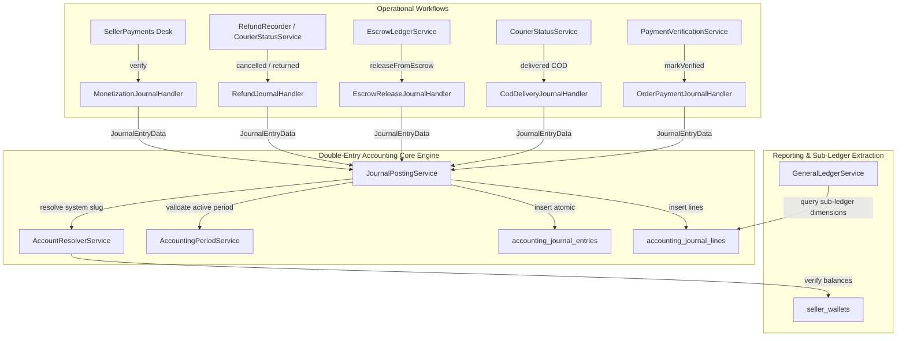

# Double-Entry Accounting Sub-Project 1 Implementation Plan

> **For agentic workers:** REQUIRED SUB-SKILL: Use superpowers:subagent-driven-development to implement this plan task-by-task. Steps use checkbox (`- [ ]`) syntax for tracking.

**Goal:** Build and integrate a production-ready Double-Entry Bookkeeping Engine (Chart of Accounts, Journal Posting Engine, General Ledger, and Event Pipeline) into B2Bhaat's existing orders, payments, COD, escrow, refunds, and monetization workflows.

**Architecture:** A centralized, atomic journal posting engine (`JournalPostingService`) validates that Total Debits equal Total Credits, enforces immutability, checks period locks, and records balanced entries. Domain-specific event pipeline handlers intercept key operational moments (`PaymentVerificationService`, `CourierStatusService`, `EscrowLedgerService`) and generate balanced journals under unique idempotency keys.

**Architecture Diagram:**



**Tech Stack:** Laravel 13, Filament 5, PHP 8.5, PostgreSQL / SQLite (Test Suite), PHPUnit 11.

## Global Constraints

- Must run strictly on PHP 8.5 with `declare(strict_types=1);` on all classes.
- All monetary math must be rounded to 2 decimal places using standard decimal arithmetic (`round($val, 2)`).
- Every posted journal MUST satisfy $\sum \text{debits} == \sum \text{credits}$ and $\sum \text{debits} > 0.00$.
- Posted journal records and lines are completely immutable. Never update or delete posted lines; use `reverse()` instead.
- Idempotency keys must be enforced via unique database constraints to prevent double-posting.
- All 770 existing tests must continue to pass with zero regressions.

---

### Task 1: Accounting Enums, DTOs, and Exceptions

**Files:**
- Create: `app/Enums/Accounting/AccountType.php`
- Create: `app/Enums/Accounting/NormalBalance.php`
- Create: `app/Enums/Accounting/JournalEntryStatus.php`
- Create: `app/Enums/Accounting/AccountingEvent.php`
- Create: `app/DTOs/Accounting/JournalLineData.php`
- Create: `app/DTOs/Accounting/JournalEntryData.php`
- Create: `app/Exceptions/Accounting/UnbalancedJournalException.php`
- Create: `app/Exceptions/Accounting/ClosedPeriodException.php`
- Create: `app/Exceptions/Accounting/InactiveAccountException.php`
- Create: `app/Exceptions/Accounting/ImmutableJournalException.php`
- Test: `tests/Unit/Accounting/JournalDataValidationTest.php`

**Interfaces:**
- Produces: `JournalEntryData`, `JournalLineData`, `AccountType`, `NormalBalance`, `JournalEntryStatus`, `AccountingEvent`

- [ ] **Step 1: Write the failing unit test for JournalEntryData validation**

```php
<?php

declare(strict_types=1);

namespace Tests\Unit\Accounting;

use App\DTOs\Accounting\JournalEntryData;
use App\DTOs\Accounting\JournalLineData;
use App\Exceptions\Accounting\UnbalancedJournalException;
use PHPUnit\Framework\TestCase;

class JournalDataValidationTest extends TestCase
{
    public function test_balanced_journal_data_passes_validation(): void
    {
        $data = new JournalEntryData(
            entryDate: '2026-11-07',
            financialEvent: 'order_prepaid_received',
            idempotencyKey: 'test_key_1',
            description: 'Test balanced entry',
            lines: [
                new JournalLineData(accountSlug: 'gateway_clearing', debit: 100.00, credit: 0.00),
                new JournalLineData(accountSlug: 'seller_escrow_payable', debit: 0.00, credit: 90.00),
                new JournalLineData(accountSlug: 'commission_revenue', debit: 0.00, credit: 10.00),
            ]
        );

        $this->assertTrue($data->isBalanced());
        $this->assertSame(100.00, $data->totalDebit());
        $this->assertSame(100.00, $data->totalCredit());
    }

    public function test_unbalanced_journal_data_throws_exception(): void
    {
        $this->expectException(UnbalancedJournalException::class);

        $data = new JournalEntryData(
            entryDate: '2026-11-07',
            financialEvent: 'order_prepaid_received',
            idempotencyKey: 'test_key_unbalanced',
            description: 'Test unbalanced entry',
            lines: [
                new JournalLineData(accountSlug: 'gateway_clearing', debit: 100.00, credit: 0.00),
                new JournalLineData(accountSlug: 'seller_escrow_payable', debit: 0.00, credit: 80.00),
            ]
        );

        $data->validate();
    }
}
```

- [ ] **Step 2: Run test to verify it fails**

Run: `php artisan test --filter=JournalDataValidationTest`  
Expected: FAIL (Classes not found)

- [ ] **Step 3: Implement Enums, Exceptions, and DTOs**

Create `app/Enums/Accounting/AccountType.php`:
```php
<?php

declare(strict_types=1);

namespace App\Enums\Accounting;

enum AccountType: string
{
    case ASSET = 'asset';
    case LIABILITY = 'liability';
    case EQUITY = 'equity';
    case REVENUE = 'revenue';
    case EXPENSE = 'expense';
}
```

Create `app/Enums/Accounting/NormalBalance.php`:
```php
<?php

declare(strict_types=1);

namespace App\Enums\Accounting;

enum NormalBalance: string
{
    case DEBIT = 'debit';
    case CREDIT = 'credit';
}
```

Create `app/Enums/Accounting/JournalEntryStatus.php`:
```php
<?php

declare(strict_types=1);

namespace App\Enums\Accounting;

enum JournalEntryStatus: string
{
    case DRAFT = 'draft';
    case POSTED = 'posted';
    case REVERSED = 'reversed';
}
```

Create `app/Enums/Accounting/AccountingEvent.php`:
```php
<?php

declare(strict_types=1);

namespace App\Enums\Accounting;

enum AccountingEvent: string
{
    case ORDER_PREPAID_RECEIVED = 'order_prepaid_received';
    case COD_DELIVERED = 'cod_delivered';
    case COD_SELF_DELIVERED = 'cod_self_delivered';
    case ESCROW_RELEASED = 'escrow_released';
    case REFUND_PROCESSED = 'refund_processed';
    case SUBSCRIPTION_PAID = 'subscription_paid';
    case LISTING_PACK_PAID = 'listing_pack_paid';
    case MANUAL_JOURNAL = 'manual_journal';
}
```

Create Exceptions:
- `app/Exceptions/Accounting/UnbalancedJournalException.php`:
```php
<?php

declare(strict_types=1);

namespace App\Exceptions\Accounting;

use DomainException;

class UnbalancedJournalException extends DomainException
{
    public static function forAmounts(float $debit, float $credit): self
    {
        return new self("Unbalanced journal entry: Total Debit (৳{$debit}) does not equal Total Credit (৳{$credit}).");
    }
}
```
- `app/Exceptions/Accounting/ClosedPeriodException.php`
- `app/Exceptions/Accounting/InactiveAccountException.php`
- `app/Exceptions/Accounting/ImmutableJournalException.php`

Create `app/DTOs/Accounting/JournalLineData.php`:
```php
<?php

declare(strict_types=1);

namespace App\DTOs\Accounting;

readonly class JournalLineData
{
    public function __construct(
        public ?string $accountSlug = null,
        public ?int $accountId = null,
        public float $debit = 0.00,
        public float $credit = 0.00,
        public ?int $sellerId = null,
        public ?int $customerId = null,
        public ?int $subOrderId = null,
        public ?int $orderId = null,
        public ?string $narration = null,
    ) {
        if ($this->debit < 0 || $this->credit < 0) {
            throw new \InvalidArgumentException('Debit and credit amounts cannot be negative.');
        }
    }
}
```

Create `app/DTOs/Accounting/JournalEntryData.php`:
```php
<?php

declare(strict_types=1);

namespace App\DTOs\Accounting;

use App\Exceptions\Accounting\UnbalancedJournalException;

readonly class JournalEntryData
{
    /**
     * @param list<JournalLineData> $lines
     */
    public function __construct(
        public string $entryDate,
        public string $financialEvent,
        public string $idempotencyKey,
        public string $description,
        public array $lines,
        public ?string $referenceType = null,
        public ?int $referenceId = null,
        public ?int $createdByUserId = null,
        public ?array $metadata = null,
    ) {}

    public function totalDebit(): float
    {
        $sum = 0.0;
        foreach ($this->lines as $line) {
            $sum += $line->debit;
        }

        return round($sum, 2);
    }

    public function totalCredit(): float
    {
        $sum = 0.0;
        foreach ($this->lines as $line) {
            $sum += $line->credit;
        }

        return round($sum, 2);
    }

    public function isBalanced(): bool
    {
        return count($this->lines) >= 2
            && $this->totalDebit() > 0.00
            && bccomp(sprintf('%.2f', $this->totalDebit()), sprintf('%.2f', $this->totalCredit()), 2) === 0;
    }

    public function validate(): void
    {
        if (! $this->isBalanced()) {
            throw UnbalancedJournalException::forAmounts($this->totalDebit(), $this->totalCredit());
        }
    }
}
```

- [ ] **Step 4: Run test to verify it passes**

Run: `php artisan test --filter=JournalDataValidationTest`  
Expected: PASS (2 tests, 4 assertions)

- [ ] **Step 5: Commit changes**

```bash
git add app/Enums/Accounting app/DTOs/Accounting app/Exceptions/Accounting tests/Unit/Accounting
git commit -m "feat(accounting): add accounting enums, DTOs, and domain validation exceptions"
```

---

### Task 2: Database Schema & Migrations for Double-Entry Accounting

**Files:**
- Create: `database/migrations/2026_11_07_100001_create_accounting_account_groups_table.php`
- Create: `database/migrations/2026_11_07_100002_create_accounting_accounts_table.php`
- Create: `database/migrations/2026_11_07_100003_create_accounting_fiscal_years_and_periods_tables.php`
- Create: `database/migrations/2026_11_07_100004_create_accounting_journal_entries_and_lines_tables.php`
- Test: `tests/Feature/Accounting/AccountingMigrationTest.php`

**Interfaces:**
- Produces: Database tables: `accounting_account_groups`, `accounting_accounts`, `accounting_fiscal_years`, `accounting_periods`, `accounting_journal_entries`, `accounting_journal_lines`

- [ ] **Step 1: Write migration test verifying schema creation and rollback**

```php
<?php

declare(strict_types=1);

namespace Tests\Feature\Accounting;

use Illuminate\Support\Facades\Schema;
use Tests\TestCase;

class AccountingMigrationTest extends TestCase
{
    public function test_accounting_tables_exist_with_expected_columns(): void
    {
        $this->assertTrue(Schema::hasTable('accounting_account_groups'));
        $this->assertTrue(Schema::hasTable('accounting_accounts'));
        $this->assertTrue(Schema::hasTable('accounting_fiscal_years'));
        $this->assertTrue(Schema::hasTable('accounting_periods'));
        $this->assertTrue(Schema::hasTable('accounting_journal_entries'));
        $this->assertTrue(Schema::hasTable('accounting_journal_lines'));

        $this->assertTrue(Schema::hasColumns('accounting_accounts', [
            'id', 'group_id', 'parent_id', 'code', 'system_slug', 'name', 'type', 'normal_balance', 'is_system', 'is_active',
        ]));

        $this->assertTrue(Schema::hasColumns('accounting_journal_entries', [
            'id', 'journal_number', 'period_id', 'entry_date', 'posting_date', 'status', 'financial_event', 'idempotency_key',
        ]));

        $this->assertTrue(Schema::hasColumns('accounting_journal_lines', [
            'id', 'journal_entry_id', 'account_id', 'debit', 'credit', 'seller_id', 'customer_id', 'sub_order_id', 'order_id',
        ]));
    }
}
```

- [ ] **Step 2: Run test to verify it fails**

Run: `php artisan test --filter=AccountingMigrationTest`  
Expected: FAIL (Tables do not exist)

- [ ] **Step 3: Implement database migrations**

Create the 4 migrations with exact foreign keys, decimal(14, 2) columns, and indexes as detailed in the spec.

- [ ] **Step 4: Run test to verify it passes**

Run: `php artisan test --filter=AccountingMigrationTest`  
Expected: PASS

- [ ] **Step 5: Commit changes**

```bash
git add database/migrations/2026_11_07_10000* tests/Feature/Accounting/AccountingMigrationTest.php
git commit -m "feat(accounting): add database migrations for double-entry accounts and journals"
```

---

### Task 3: Eloquent Models for Chart of Accounts & Journals

**Files:**
- Create: `app/Models/Accounting/AccountingAccountGroup.php`
- Create: `app/Models/Accounting/AccountingAccount.php`
- Create: `app/Models/Accounting/AccountingFiscalYear.php`
- Create: `app/Models/Accounting/AccountingPeriod.php`
- Create: `app/Models/Accounting/AccountingJournalEntry.php`
- Create: `app/Models/Accounting/AccountingJournalLine.php`
- Test: `tests/Unit/Accounting/AccountingModelRelationsTest.php`

**Interfaces:**
- Produces: Complete Eloquent relationship graph for Chart of Accounts and Journals

- [ ] **Step 1: Write model relationship unit test**

```php
<?php

declare(strict_types=1);

namespace Tests\Unit\Accounting;

use App\Models\Accounting\AccountingAccount;
use App\Models\Accounting\AccountingAccountGroup;
use App\Models\Accounting\AccountingFiscalYear;
use App\Models\Accounting\AccountingJournalEntry;
use App\Models\Accounting\AccountingJournalLine;
use App\Models\Accounting\AccountingPeriod;
use Illuminate\Foundation\Testing\RefreshDatabase;
use Tests\TestCase;

class AccountingModelRelationsTest extends TestCase
{
    use RefreshDatabase;

    public function test_account_and_journal_relationships_work(): void
    {
        $group = AccountingAccountGroup::create([
            'name' => 'Current Assets',
            'type' => 'asset',
            'code_prefix' => '10',
        ]);

        $account = AccountingAccount::create([
            'group_id' => $group->id,
            'code' => '1010',
            'system_slug' => 'cash_on_hand',
            'name' => 'Cash in Hand',
            'type' => 'asset',
            'normal_balance' => 'debit',
            'is_system' => true,
        ]);

        $year = AccountingFiscalYear::create([
            'name' => 'FY 2026-2027',
            'start_date' => '2026-07-01',
            'end_date' => '2027-06-30',
        ]);

        $period = AccountingPeriod::create([
            'fiscal_year_id' => $year->id,
            'period_number' => 5,
            'name' => 'November 2026',
            'start_date' => '2026-11-01',
            'end_date' => '2026-11-30',
        ]);

        $entry = AccountingJournalEntry::create([
            'journal_number' => 'JRN-202611-000001',
            'period_id' => $period->id,
            'entry_date' => '2026-11-07',
            'posting_date' => now(),
            'status' => 'posted',
            'financial_event' => 'manual_journal',
            'idempotency_key' => 'manual_1',
            'description' => 'Opening entry',
        ]);

        $line = AccountingJournalLine::create([
            'journal_entry_id' => $entry->id,
            'account_id' => $account->id,
            'debit' => 500.00,
            'credit' => 0.00,
        ]);

        $this->assertSame($group->id, $account->group->id);
        $this->assertSame($period->id, $entry->period->id);
        $this->assertCount(1, $entry->lines);
        $this->assertSame($account->id, $entry->lines->first()->account->id);
    }
}
```

- [ ] **Step 2: Run test to verify it fails**

Run: `php artisan test --filter=AccountingModelRelationsTest`  
Expected: FAIL (Models not found)

- [ ] **Step 3: Implement Models with Auditable trait and relationships**

Create `app/Models/Accounting/AccountingAccount.php`, `AccountingAccountGroup.php`, `AccountingFiscalYear.php`, `AccountingPeriod.php`, `AccountingJournalEntry.php`, and `AccountingJournalLine.php`. Include casts:
- `debit` $\rightarrow$ `decimal:2`
- `credit` $\rightarrow$ `decimal:2`
- `is_system` $\rightarrow$ `boolean`
- `is_active` $\rightarrow$ `boolean`
- `metadata` $\rightarrow$ `json`

- [ ] **Step 4: Run test to verify it passes**

Run: `php artisan test --filter=AccountingModelRelationsTest`  
Expected: PASS

- [ ] **Step 5: Commit changes**

```bash
git add app/Models/Accounting tests/Unit/Accounting/AccountingModelRelationsTest.php
git commit -m "feat(accounting): add Eloquent models and relationships for Chart of Accounts and journals"
```

---

### Task 4: Chart of Accounts Service & System Accounts Seeder

**Files:**
- Create: `app/Services/Accounting/ChartOfAccountsService.php`
- Create: `app/Services/Accounting/AccountResolverService.php`
- Create: `database/seeders/AccountingChartOfAccountsSeeder.php`
- Test: `tests/Feature/Accounting/ChartOfAccountsServiceTest.php`

**Interfaces:**
- Consumes: Models `AccountingAccount`, `AccountingAccountGroup`
- Produces: `AccountResolverService::resolveBySlug(string $slug): AccountingAccount`

- [ ] **Step 1: Write test for Seeder and AccountResolverService**

```php
<?php

declare(strict_types=1);

namespace Tests\Feature\Accounting;

use App\Models\Accounting\AccountingAccount;
use App\Services\Accounting\AccountResolverService;
use Database\Seeders\AccountingChartOfAccountsSeeder;
use Illuminate\Foundation\Testing\RefreshDatabase;
use Tests\TestCase;

class ChartOfAccountsServiceTest extends TestCase
{
    use RefreshDatabase;

    public function test_seeder_creates_all_standard_system_accounts(): void
    {
        $this->seed(AccountingChartOfAccountsSeeder::class);

        $this->assertGreaterThanOrEqual(18, AccountingAccount::count());

        $resolver = app(AccountResolverService::class);
        $gatewayAccount = $resolver->resolveBySlug('gateway_clearing');
        $escrowAccount = $resolver->resolveBySlug('seller_escrow_payable');
        $commissionAccount = $resolver->resolveBySlug('commission_revenue');

        $this->assertSame('1030', $gatewayAccount->code);
        $this->assertSame('2010', $escrowAccount->code);
        $this->assertSame('4010', $commissionAccount->code);
    }
}
```

- [ ] **Step 2: Run test to verify it fails**

Run: `php artisan test --filter=ChartOfAccountsServiceTest`  
Expected: FAIL (Seeder and resolver not found)

- [ ] **Step 3: Implement Seeder, ChartOfAccountsService, and AccountResolverService**

Create `database/seeders/AccountingChartOfAccountsSeeder.php` seeding the groups (Current Assets, Current Liabilities, Equity, Operating Revenue, Operating Expenses) and all 18 standard system accounts from the spec.
Implement `AccountResolverService` with in-memory / cache resolution:
```php
public function resolveBySlug(string $slug): AccountingAccount
{
    return Cache::rememberForever("accounting_account_slug_{$slug}", function () use ($slug) {
        return AccountingAccount::where('system_slug', $slug)->firstOrFail();
    });
}
```

- [ ] **Step 4: Run test to verify it passes**

Run: `php artisan test --filter=ChartOfAccountsServiceTest`  
Expected: PASS

- [ ] **Step 5: Commit changes**

```bash
git add app/Services/Accounting database/seeders tests/Feature/Accounting/ChartOfAccountsServiceTest.php
git commit -m "feat(accounting): implement ChartOfAccountsSeeder and AccountResolverService"
```

---

### Task 5: Core Journal Posting Engine & Immutability Enforcement

**Files:**
- Create: `app/Services/Accounting/JournalPostingService.php`
- Create: `app/Services/Accounting/GeneralLedgerService.php`
- Test: `tests/Feature/Accounting/JournalPostingServiceTest.php`

**Interfaces:**
- Consumes: `JournalEntryData`, `AccountResolverService`
- Produces: `JournalPostingService::post(JournalEntryData $data): AccountingJournalEntry`
- Produces: `JournalPostingService::reverse(AccountingJournalEntry $entry, string $reason, ?User $actor = null): AccountingJournalEntry`
- Produces: `GeneralLedgerService::getBalanceForAccount(int $accountId, ?int $sellerId = null): float`

- [ ] **Step 1: Write comprehensive posting engine feature tests**

```php
<?php

declare(strict_types=1);

namespace Tests\Feature\Accounting;

use App\DTOs\Accounting\JournalEntryData;
use App\DTOs\Accounting\JournalLineData;
use App\Exceptions\Accounting\UnbalancedJournalException;
use App\Models\Accounting\AccountingFiscalYear;
use App\Models\Accounting\AccountingPeriod;
use App\Services\Accounting\GeneralLedgerService;
use App\Services\Accounting\JournalPostingService;
use Database\Seeders\AccountingChartOfAccountsSeeder;
use Illuminate\Foundation\Testing\RefreshDatabase;
use Tests\TestCase;

class JournalPostingServiceTest extends TestCase
{
    use RefreshDatabase;

    protected function setUp(): void
    {
        parent::setUp();
        $this->seed(AccountingChartOfAccountsSeeder::class);

        $year = AccountingFiscalYear::create([
            'name' => 'FY 2026-2027',
            'start_date' => '2026-07-01',
            'end_date' => '2027-06-30',
        ]);

        AccountingPeriod::create([
            'fiscal_year_id' => $year->id,
            'period_number' => 5,
            'name' => 'November 2026',
            'start_date' => '2026-11-01',
            'end_date' => '2026-11-30',
            'is_closed' => false,
        ]);
    }

    public function test_balanced_entry_posts_atomically_and_updates_ledger(): void
    {
        $service = app(JournalPostingService::class);

        $entry = $service->post(new JournalEntryData(
            entryDate: '2026-11-07',
            financialEvent: 'order_prepaid_received',
            idempotencyKey: 'test_order_1',
            description: 'Order #ORD-100 payment',
            lines: [
                new JournalLineData(accountSlug: 'gateway_clearing', debit: 1000.00, credit: 0.00),
                new JournalLineData(accountSlug: 'seller_escrow_payable', debit: 0.00, credit: 900.00, sellerId: 1),
                new JournalLineData(accountSlug: 'commission_revenue', debit: 0.00, credit: 100.00, sellerId: 1),
            ]
        ));

        $this->assertNotNull($entry->id);
        $this->assertSame('posted', $entry->status);

        $gl = app(GeneralLedgerService::class);
        $sellerEscrow = $gl->getBalanceForSlug('seller_escrow_payable', sellerId: 1);
        $this->assertSame(900.00, $sellerEscrow);
    }

    public function test_repeated_call_with_same_idempotency_key_returns_existing_entry(): void
    {
        $service = app(JournalPostingService::class);

        $data = new JournalEntryData(
            entryDate: '2026-11-07',
            financialEvent: 'order_prepaid_received',
            idempotencyKey: 'idemp_unique_key',
            description: 'Duplicate test',
            lines: [
                new JournalLineData(accountSlug: 'gateway_clearing', debit: 100.00, credit: 0.00),
                new JournalLineData(accountSlug: 'commission_revenue', debit: 0.00, credit: 100.00),
            ]
        );

        $first = $service->post($data);
        $second = $service->post($data);

        $this->assertSame($first->id, $second->id);
    }
}
```

- [ ] **Step 2: Run test to verify it fails**

Run: `php artisan test --filter=JournalPostingServiceTest`  
Expected: FAIL

- [ ] **Step 3: Implement JournalPostingService and GeneralLedgerService**

Implement `JournalPostingService`:
- Validates double-entry invariants ($\sum \text{debits} == \sum \text{credits}$).
- Resolves active period matching `entry_date`; throws `ClosedPeriodException` if `is_closed`.
- Generates sequential unique journal number: `JRN-YYYYMM-000001`.
- Creates `AccountingJournalEntry` and `AccountingJournalLine`s.
- `reverse()` creates inverse journal.
Implement `GeneralLedgerService`:
- Calculates account balance based on account type (`normal_balance`).
- Supports filtering by `seller_id` for instant sub-ledger balance queries.

- [ ] **Step 4: Run test to verify it passes**

Run: `php artisan test --filter=JournalPostingServiceTest`  
Expected: PASS

- [ ] **Step 5: Commit changes**

```bash
git add app/Services/Accounting/JournalPostingService.php app/Services/Accounting/GeneralLedgerService.php tests/Feature/Accounting/JournalPostingServiceTest.php
git commit -m "feat(accounting): implement JournalPostingService and GeneralLedgerService"
```

---

### Task 6: Order Online Payment Financial Event Pipeline Integration

**Files:**
- Create: `app/Services/Accounting/EventPipeline/OrderPaymentJournalHandler.php`
- Modify: `app/Services/Payments/PaymentVerificationService.php:86-105`
- Test: `tests/Feature/Accounting/OrderPaymentJournalIntegrationTest.php`

**Interfaces:**
- Consumes: `Order`, `PaymentVerificationService`
- Produces: `AccountingJournalEntry` for `order_prepaid_received`

- [ ] **Step 1: Write feature test for payment verification double-entry posting**

```php
<?php

declare(strict_types=1);

namespace Tests\Feature\Accounting;

use App\Models\Accounting\AccountingFiscalYear;
use App\Models\Accounting\AccountingJournalEntry;
use App\Models\Accounting\AccountingPeriod;
use App\Models\Order;
use App\Models\PaymentMethod;
use App\Models\PaymentStatus;
use App\Models\SubOrder;
use App\Models\User;
use App\Services\Accounting\GeneralLedgerService;
use App\Services\Payments\PaymentVerificationService;
use Database\Seeders\AccountingChartOfAccountsSeeder;
use Illuminate\Foundation\Testing\RefreshDatabase;
use Tests\TestCase;

class OrderPaymentJournalIntegrationTest extends TestCase
{
    use RefreshDatabase;

    protected function setUp(): void
    {
        parent::setUp();
        $this->seed(AccountingChartOfAccountsSeeder::class);

        $year = AccountingFiscalYear::create(['name' => 'FY 2026-2027', 'start_date' => '2026-07-01', 'end_date' => '2027-06-30']);
        AccountingPeriod::create(['fiscal_year_id' => $year->id, 'period_number' => 5, 'name' => 'November 2026', 'start_date' => '2026-11-01', 'end_date' => '2026-11-30']);
    }

    public function test_marking_payment_verified_posts_balanced_double_entry_journal(): void
    {
        $seller = User::factory()->create();
        $customer = User::factory()->create();
        $method = PaymentMethod::firstOrCreate(['slug' => 'bkash'], ['name' => 'bKash']);
        $awaiting = PaymentStatus::firstOrCreate(['slug' => 'awaiting_verification'], ['name' => 'Awaiting Verification']);
        PaymentStatus::firstOrCreate(['slug' => 'paid'], ['name' => 'Paid']);

        $order = Order::create([
            'order_number' => 'ORD-TEST-001',
            'customer_id' => $customer->id,
            'order_status_id' => 1,
            'payment_status_id' => $awaiting->id,
            'payment_method_id' => $method->id,
            'shipping_address' => ['address' => 'Dhaka'],
            'total_amount' => 1000.00,
            'shipping_amount' => 100.00,
            'discount_amount' => 0.00,
        ]);

        $subOrder = SubOrder::create([
            'parent_order_id' => $order->id,
            'seller_id' => $seller->id,
            'sub_order_number' => 'ORD-TEST-001-A',
            'fulfillment_status_id' => 1,
            'subtotal' => 900.00,
            'commission_amount' => 90.00,
            'shipping_amount' => 100.00,
        ]);

        $service = app(PaymentVerificationService::class);
        $service->markVerified($order);

        $journal = AccountingJournalEntry::where('reference_id', $order->id)->first();
        $this->assertNotNull($journal);
        $this->assertSame('order_prepaid_received', $journal->financial_event);

        $gl = app(GeneralLedgerService::class);
        $this->assertSame(1000.00, $gl->getBalanceForSlug('gateway_clearing'));
        $this->assertSame(810.00, $gl->getBalanceForSlug('seller_escrow_payable', sellerId: $seller->id));
        $this->assertSame(90.00, $gl->getBalanceForSlug('commission_revenue'));
    }
}
```

- [ ] **Step 2: Run test to verify it fails**

Run: `php artisan test --filter=OrderPaymentJournalIntegrationTest`  
Expected: FAIL

- [ ] **Step 3: Implement OrderPaymentJournalHandler and hook into PaymentVerificationService**

Create `app/Services/Accounting/EventPipeline/OrderPaymentJournalHandler.php`:
Constructs balanced `JournalEntryData` and calls `JournalPostingService::post()`.
Modify `PaymentVerificationService::markVerified()` to call `OrderPaymentJournalHandler::recordPrepaidPayment($order)` inside the transaction.

- [ ] **Step 4: Run test to verify it passes**

Run: `php artisan test --filter=OrderPaymentJournalIntegrationTest`  
Expected: PASS

- [ ] **Step 5: Commit changes**

```bash
git add app/Services/Accounting/EventPipeline/OrderPaymentJournalHandler.php app/Services/Payments/PaymentVerificationService.php tests/Feature/Accounting/OrderPaymentJournalIntegrationTest.php
git commit -m "feat(accounting): integrate online prepaid payment verification with double-entry journal posting"
```

---

### Task 7: Courier & Self-Delivered COD Delivery Event Pipeline Integration

**Files:**
- Create: `app/Services/Accounting/EventPipeline/CodDeliveryJournalHandler.php`
- Modify: `app/Services/Logistics/CourierStatusService.php:152-163`
- Test: `tests/Feature/Accounting/CodDeliveryJournalIntegrationTest.php`

**Interfaces:**
- Consumes: `SubOrder`, `CourierStatusService`
- Produces: `AccountingJournalEntry` for `cod_delivered` and `cod_self_delivered`

- [ ] **Step 1: Write feature test for COD delivered double-entry posting**

```php
<?php

declare(strict_types=1);

namespace Tests\Feature\Accounting;

use App\Models\Accounting\AccountingFiscalYear;
use App\Models\Accounting\AccountingJournalEntry;
use App\Models\Accounting\AccountingPeriod;
use App\Models\FulfillmentStatus;
use App\Models\Order;
use App\Models\OrderStatus;
use App\Models\PaymentMethod;
use App\Models\PaymentStatus;
use App\Models\SubOrder;
use App\Models\User;
use App\Services\Accounting\GeneralLedgerService;
use App\Services\Logistics\CourierStatusService;
use Database\Seeders\AccountingChartOfAccountsSeeder;
use Illuminate\Foundation\Testing\RefreshDatabase;
use Tests\TestCase;

class CodDeliveryJournalIntegrationTest extends TestCase
{
    use RefreshDatabase;

    protected function setUp(): void
    {
        parent::setUp();
        $this->seed(AccountingChartOfAccountsSeeder::class);

        $year = AccountingFiscalYear::create(['name' => 'FY 2026-2027', 'start_date' => '2026-07-01', 'end_date' => '2027-06-30']);
        AccountingPeriod::create(['fiscal_year_id' => $year->id, 'period_number' => 5, 'name' => 'November 2026', 'start_date' => '2026-11-01', 'end_date' => '2026-11-30']);
    }

    public function test_courier_cod_delivery_posts_courier_receivable_and_escrow_journal(): void
    {
        $seller = User::factory()->create();
        $customer = User::factory()->create();
        $codMethod = PaymentMethod::firstOrCreate(['slug' => 'cod'], ['name' => 'Cash On Delivery']);
        $unpaid = PaymentStatus::firstOrCreate(['slug' => 'unpaid'], ['name' => 'Unpaid']);
        PaymentStatus::firstOrCreate(['slug' => 'paid'], ['name' => 'Paid']);
        OrderStatus::firstOrCreate(['slug' => 'pending'], ['name' => 'Pending']);
        OrderStatus::firstOrCreate(['slug' => 'completed'], ['name' => 'Completed']);
        $outForDelivery = FulfillmentStatus::firstOrCreate(['slug' => 'out_for_delivery'], ['name' => 'Out For Delivery']);
        FulfillmentStatus::firstOrCreate(['slug' => 'delivered'], ['name' => 'Delivered']);

        $order = Order::create([
            'order_number' => 'ORD-COD-001',
            'customer_id' => $customer->id,
            'order_status_id' => 1,
            'payment_status_id' => $unpaid->id,
            'payment_method_id' => $codMethod->id,
            'shipping_address' => ['address' => 'Chittagong'],
            'total_amount' => 500.00,
            'shipping_amount' => 50.00,
            'discount_amount' => 0.00,
        ]);

        $subOrder = SubOrder::create([
            'parent_order_id' => $order->id,
            'seller_id' => $seller->id,
            'sub_order_number' => 'ORD-COD-001-A',
            'fulfillment_status_id' => $outForDelivery->id,
            'courier_name' => 'Steadfast Courier',
            'subtotal' => 450.00,
            'commission_amount' => 45.00,
            'shipping_amount' => 50.00,
            'is_self_delivered' => false,
        ]);

        $statusService = app(CourierStatusService::class);
        $statusService->updateStatus($subOrder, 'delivered');

        $journal = AccountingJournalEntry::where('financial_event', 'cod_delivered')->where('reference_id', $subOrder->id)->first();
        $this->assertNotNull($journal);

        $gl = app(GeneralLedgerService::class);
        $this->assertSame(500.00, $gl->getBalanceForSlug('courier_cod_receivable'));
        $this->assertSame(405.00, $gl->getBalanceForSlug('seller_escrow_payable', sellerId: $seller->id));
        $this->assertSame(45.00, $gl->getBalanceForSlug('commission_revenue'));
    }
}
```

- [ ] **Step 2: Run test to verify it fails**

Run: `php artisan test --filter=CodDeliveryJournalIntegrationTest`  
Expected: FAIL

- [ ] **Step 3: Implement CodDeliveryJournalHandler and update CourierStatusService**

Create `app/Services/Accounting/EventPipeline/CodDeliveryJournalHandler.php`:
- Handles `recordCourierCodDelivery(SubOrder $subOrder)`
- Handles `recordSelfDeliveredCod(SubOrder $subOrder)`
Update `CourierStatusService::handleDeliveredSettlement()` to invoke the appropriate handler method.

- [ ] **Step 4: Run test to verify it passes**

Run: `php artisan test --filter=CodDeliveryJournalIntegrationTest`  
Expected: PASS

- [ ] **Step 5: Commit changes**

```bash
git add app/Services/Accounting/EventPipeline/CodDeliveryJournalHandler.php app/Services/Logistics/CourierStatusService.php tests/Feature/Accounting/CodDeliveryJournalIntegrationTest.php
git commit -m "feat(accounting): integrate courier COD and self-delivered COD with double-entry ledger"
```

---

### Task 8: Escrow Release & Cancellation/Refund Journal Pipeline Integration

**Files:**
- Create: `app/Services/Accounting/EventPipeline/EscrowReleaseJournalHandler.php`
- Create: `app/Services/Accounting/EventPipeline/RefundJournalHandler.php`
- Modify: `app/Services/Escrow/EscrowLedgerService.php:96-125,129-156`
- Test: `tests/Feature/Accounting/EscrowAndRefundJournalIntegrationTest.php`

**Interfaces:**
- Consumes: `EscrowLedgerService`, `SubOrder`
- Produces: `AccountingJournalEntry` for `escrow_released` and `refund_processed`

- [ ] **Step 1: Write feature test for escrow release and refund reversal journals**

```php
<?php

declare(strict_types=1);

namespace Tests\Feature\Accounting;

use App\Models\Accounting\AccountingFiscalYear;
use App\Models\Accounting\AccountingJournalEntry;
use App\Models\Accounting\AccountingPeriod;
use App\Models\FulfillmentStatus;
use App\Models\Order;
use App\Models\OrderStatus;
use App\Models\PaymentMethod;
use App\Models\PaymentStatus;
use App\Models\SubOrder;
use App\Models\User;
use App\Services\Accounting\GeneralLedgerService;
use App\Services\Escrow\EscrowLedgerService;
use Database\Seeders\AccountingChartOfAccountsSeeder;
use Illuminate\Foundation\Testing\RefreshDatabase;
use Tests\TestCase;

class EscrowAndRefundJournalIntegrationTest extends TestCase
{
    use RefreshDatabase;

    protected function setUp(): void
    {
        parent::setUp();
        $this->seed(AccountingChartOfAccountsSeeder::class);

        $year = AccountingFiscalYear::create(['name' => 'FY 2026-2027', 'start_date' => '2026-07-01', 'end_date' => '2027-06-30']);
        AccountingPeriod::create(['fiscal_year_id' => $year->id, 'period_number' => 5, 'name' => 'November 2026', 'start_date' => '2026-11-01', 'end_date' => '2026-11-30']);
    }

    public function test_escrow_release_transitions_liability_to_available_wallet(): void
    {
        $seller = User::factory()->create();
        $customer = User::factory()->create();
        $method = PaymentMethod::firstOrCreate(['slug' => 'cod'], ['name' => 'COD']);
        $paid = PaymentStatus::firstOrCreate(['slug' => 'paid'], ['name' => 'Paid']);
        $delivered = FulfillmentStatus::firstOrCreate(['slug' => 'delivered'], ['name' => 'Delivered']);

        $order = Order::create([
            'order_number' => 'ORD-ESC-001',
            'customer_id' => $customer->id,
            'order_status_id' => 1,
            'payment_status_id' => $paid->id,
            'payment_method_id' => $method->id,
            'shipping_address' => ['address' => 'Sylhet'],
            'total_amount' => 1000.00,
        ]);

        $subOrder = SubOrder::create([
            'parent_order_id' => $order->id,
            'seller_id' => $seller->id,
            'sub_order_number' => 'ORD-ESC-001-A',
            'fulfillment_status_id' => $delivered->id,
            'subtotal' => 1000.00,
            'commission_amount' => 100.00,
            'shipping_amount' => 0.00,
        ]);

        $escrowService = app(EscrowLedgerService::class);
        $escrowService->holdInEscrow($subOrder);

        $escrowService->releaseFromEscrow($subOrder);

        $journal = AccountingJournalEntry::where('financial_event', 'escrow_released')->first();
        $this->assertNotNull($journal);

        $gl = app(GeneralLedgerService::class);
        $this->assertSame(0.00, $gl->getBalanceForSlug('seller_escrow_payable', sellerId: $seller->id));
        $this->assertSame(900.00, $gl->getBalanceForSlug('seller_wallet_payable', sellerId: $seller->id));
    }
}
```

- [ ] **Step 2: Run test to verify it fails**

Run: `php artisan test --filter=EscrowAndRefundJournalIntegrationTest`  
Expected: FAIL

- [ ] **Step 3: Implement Handlers and hook into EscrowLedgerService**

Create `EscrowReleaseJournalHandler` and `RefundJournalHandler`.
Hook into `EscrowLedgerService::releaseFromEscrow()` and `refundCancelledEscrow()`.

- [ ] **Step 4: Run test to verify it passes**

Run: `php artisan test --filter=EscrowAndRefundJournalIntegrationTest`  
Expected: PASS

- [ ] **Step 5: Commit changes**

```bash
git add app/Services/Accounting/EventPipeline tests/Feature/Accounting/EscrowAndRefundJournalIntegrationTest.php app/Services/Escrow/EscrowLedgerService.php
git commit -m "feat(accounting): integrate escrow release and refund reversal with double-entry ledger"
```

---

### Task 9: Seller Monetization Subscription & Listing Add-On Journal Pipeline

**Files:**
- Create: `app/Services/Accounting/EventPipeline/MonetizationJournalHandler.php`
- Modify: `app/Models/SellerPayment.php` (booted or service verification hook)
- Test: `tests/Feature/Accounting/MonetizationJournalIntegrationTest.php`

**Interfaces:**
- Consumes: `SellerPayment`
- Produces: `AccountingJournalEntry` for `subscription_paid` and `listing_pack_paid`

- [ ] **Step 1: Write feature test for monetization double-entry journal**

```php
<?php

declare(strict_types=1);

namespace Tests\Feature\Accounting;

use App\Models\Accounting\AccountingFiscalYear;
use App\Models\Accounting\AccountingJournalEntry;
use App\Models\Accounting\AccountingPeriod;
use App\Models\SellerInvoice;
use App\Models\SellerPayment;
use App\Models\User;
use App\Services\Accounting\EventPipeline\MonetizationJournalHandler;
use App\Services\Accounting\GeneralLedgerService;
use Database\Seeders\AccountingChartOfAccountsSeeder;
use Illuminate\Foundation\Testing\RefreshDatabase;
use Tests\TestCase;

class MonetizationJournalIntegrationTest extends TestCase
{
    use RefreshDatabase;

    protected function setUp(): void
    {
        parent::setUp();
        $this->seed(AccountingChartOfAccountsSeeder::class);

        $year = AccountingFiscalYear::create(['name' => 'FY 2026-2027', 'start_date' => '2026-07-01', 'end_date' => '2027-06-30']);
        AccountingPeriod::create(['fiscal_year_id' => $year->id, 'period_number' => 5, 'name' => 'November 2026', 'start_date' => '2026-11-01', 'end_date' => '2026-11-30']);
    }

    public function test_verified_seller_payment_records_monetization_revenue_journal(): void
    {
        $seller = User::factory()->create();

        $invoice = SellerInvoice::create([
            'invoice_number' => 'INV-2026-001',
            'seller_id' => $seller->id,
            'invoice_type' => 'subscription_fee',
            'subtotal' => 2000.00,
            'total_amount' => 2000.00,
            'status' => 'paid',
            'due_date' => now()->toDateString(),
            'paid_at' => now(),
        ]);

        $payment = SellerPayment::create([
            'invoice_id' => $invoice->id,
            'seller_id' => $seller->id,
            'amount' => 2000.00,
            'payment_method' => 'bkash',
            'status' => 'verified',
            'verified_at' => now(),
        ]);

        $handler = app(MonetizationJournalHandler::class);
        $handler->recordSubscriptionPayment($payment);

        $journal = AccountingJournalEntry::where('financial_event', 'subscription_paid')->first();
        $this->assertNotNull($journal);

        $gl = app(GeneralLedgerService::class);
        $this->assertSame(2000.00, $gl->getBalanceForSlug('gateway_clearing'));
        $this->assertSame(2000.00, $gl->getBalanceForSlug('subscription_revenue'));
    }
}
```

- [ ] **Step 2: Run test to verify it fails**

Run: `php artisan test --filter=MonetizationJournalIntegrationTest`  
Expected: FAIL

- [ ] **Step 3: Implement MonetizationJournalHandler**

Create `app/Services/Accounting/EventPipeline/MonetizationJournalHandler.php`:
- Handles `recordSubscriptionPayment(SellerPayment $payment)`
- Handles `recordListingPackPayment(SellerPayment $payment)`

- [ ] **Step 4: Run test to verify it passes**

Run: `php artisan test --filter=MonetizationJournalIntegrationTest`  
Expected: PASS

- [ ] **Step 5: Commit changes**

```bash
git add app/Services/Accounting/EventPipeline/MonetizationJournalHandler.php tests/Feature/Accounting/MonetizationJournalIntegrationTest.php
git commit -m "feat(accounting): implement double-entry journal posting for seller subscriptions and listing packs"
```

---

### Task 10: Sub-Ledger & Seller Wallet Integrity Reconciliation Test Suite

**Files:**
- Create: `app/Services/Accounting/AccountingReconciliationService.php`
- Test: `tests/Feature/Accounting/SellerSubLedgerReconciliationTest.php`

**Interfaces:**
- Consumes: `SellerWallet`, `GeneralLedgerService`
- Produces: `AccountingReconciliationService::verifySellerWallet(User $seller): array{is_reconciled: bool, wallet_balance: float, ledger_balance: float, discrepancy: float}`

- [ ] **Step 1: Write end-to-end reconciliation test across full order lifecycle**

```php
<?php

declare(strict_types=1);

namespace Tests\Feature\Accounting;

use App\Models\Accounting\AccountingFiscalYear;
use App\Models\Accounting\AccountingPeriod;
use App\Models\FulfillmentStatus;
use App\Models\Order;
use App\Models\OrderStatus;
use App\Models\PaymentMethod;
use App\Models\PaymentStatus;
use App\Models\SellerWallet;
use App\Models\SubOrder;
use App\Models\User;
use App\Services\Accounting\AccountingReconciliationService;
use App\Services\Escrow\EscrowLedgerService;
use App\Services\Logistics\CourierStatusService;
use Database\Seeders\AccountingChartOfAccountsSeeder;
use Illuminate\Foundation\Testing\RefreshDatabase;
use Tests\TestCase;

class SellerSubLedgerReconciliationTest extends TestCase
{
    use RefreshDatabase;

    protected function setUp(): void
    {
        parent::setUp();
        $this->seed(AccountingChartOfAccountsSeeder::class);

        $year = AccountingFiscalYear::create(['name' => 'FY 2026-2027', 'start_date' => '2026-07-01', 'end_date' => '2027-06-30']);
        AccountingPeriod::create(['fiscal_year_id' => $year->id, 'period_number' => 5, 'name' => 'November 2026', 'start_date' => '2026-11-01', 'end_date' => '2026-11-30']);
    }

    public function test_full_order_lifecycle_maintains_zero_discrepancy_with_wallet(): void
    {
        $seller = User::factory()->create();
        $customer = User::factory()->create();
        $codMethod = PaymentMethod::firstOrCreate(['slug' => 'cod'], ['name' => 'Cash On Delivery']);
        $unpaid = PaymentStatus::firstOrCreate(['slug' => 'unpaid'], ['name' => 'Unpaid']);
        PaymentStatus::firstOrCreate(['slug' => 'paid'], ['name' => 'Paid']);
        OrderStatus::firstOrCreate(['slug' => 'pending'], ['name' => 'Pending']);
        OrderStatus::firstOrCreate(['slug' => 'completed'], ['name' => 'Completed']);
        $shipped = FulfillmentStatus::firstOrCreate(['slug' => 'shipped'], ['name' => 'Shipped']);
        FulfillmentStatus::firstOrCreate(['slug' => 'delivered'], ['name' => 'Delivered']);

        $order = Order::create([
            'order_number' => 'ORD-E2E-001',
            'customer_id' => $customer->id,
            'order_status_id' => 1,
            'payment_status_id' => $unpaid->id,
            'payment_method_id' => $codMethod->id,
            'shipping_address' => ['address' => 'Dhaka'],
            'total_amount' => 2000.00,
            'shipping_amount' => 100.00,
        ]);

        $subOrder = SubOrder::create([
            'parent_order_id' => $order->id,
            'seller_id' => $seller->id,
            'sub_order_number' => 'ORD-E2E-001-A',
            'fulfillment_status_id' => $shipped->id,
            'subtotal' => 1900.00,
            'commission_amount' => 190.00,
            'shipping_amount' => 100.00,
            'is_self_delivered' => false,
        ]);

        // Step 1: Courier delivers COD
        app(CourierStatusService::class)->updateStatus($subOrder, 'delivered');

        // Step 2: Escrow releases
        app(EscrowLedgerService::class)->releaseFromEscrow($subOrder);

        // Step 3: Run reconciliation service
        $recon = app(AccountingReconciliationService::class)->verifySellerWallet($seller);

        $this->assertTrue($recon['is_reconciled']);
        $this->assertSame(0.00, $recon['discrepancy']);
        $this->assertSame(1710.00, $recon['wallet_balance']);
        $this->assertSame(1710.00, $recon['ledger_balance']);
    }
}
```

- [ ] **Step 2: Run test to verify it fails**

Run: `php artisan test --filter=SellerSubLedgerReconciliationTest`  
Expected: FAIL

- [ ] **Step 3: Implement AccountingReconciliationService**

Create `app/Services/Accounting/AccountingReconciliationService.php`:
- Pulls `SellerWallet::where('seller_id', $seller->id)->first()`
- Queries `GeneralLedgerService::getBalanceForSlug('seller_wallet_payable', sellerId: $seller->id)`
- Asserts that `discrepancy === 0.00`.

- [ ] **Step 4: Run test to verify it passes**

Run: `php artisan test --filter=SellerSubLedgerReconciliationTest`  
Expected: PASS

- [ ] **Step 5: Run full project test suite to verify zero regressions**

Run: `php artisan test --compact`  
Expected: All tests PASS with zero failures (770+ tests).

- [ ] **Step 6: Commit changes & format code**

```bash
vendor/bin/pint --dirty --format agent
git add app/Services/Accounting tests/Feature/Accounting
git commit -m "feat(accounting): add sub-ledger and seller wallet integrity reconciliation service with full verification"
```
