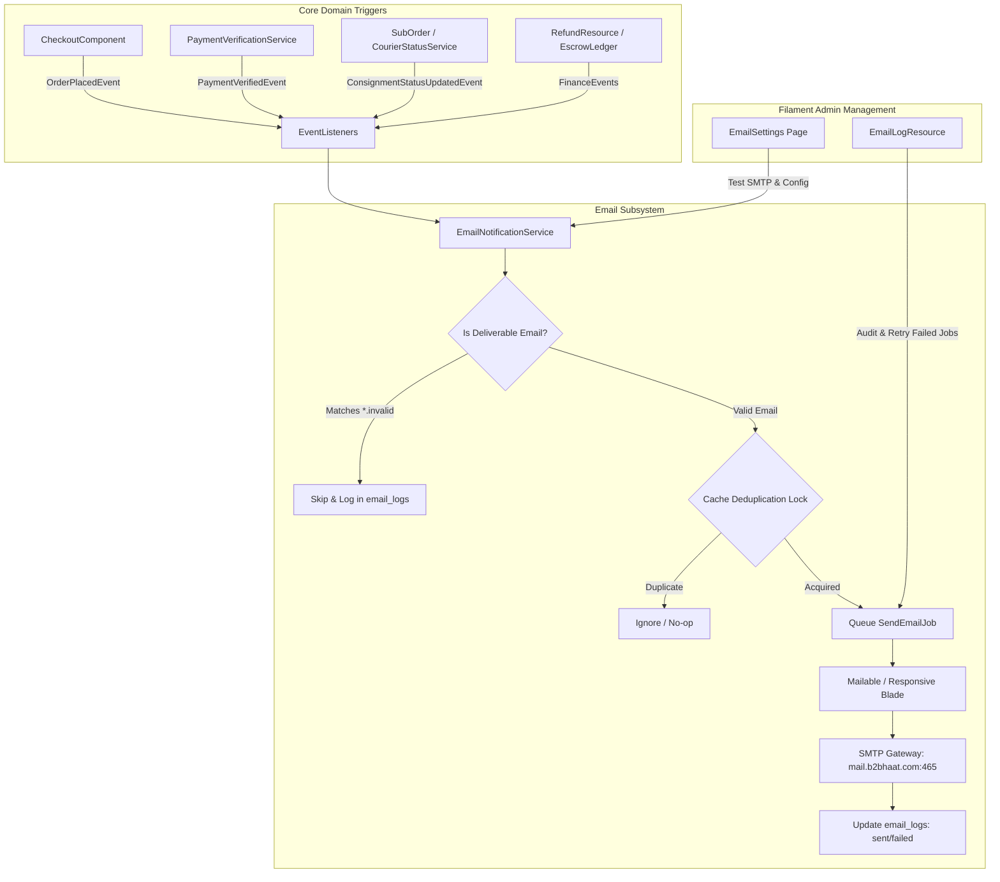

# Email Notification System Implementation Plan

> **For agentic workers:** REQUIRED SUB-SKILL: Use superpowers:subagent-driven-development to implement this plan task-by-task. Steps use checkbox (`- [ ]`) syntax for tracking.

**Goal:** Implement a centralized, scalable, multi-vendor email notification system for B2B Haat that handles customer order confirmations, seller consignment dispatch alerts, logistics tracking updates, financial settlements (refunds & payouts), and merchant KYC decisions via queued SMTP with database logging and deduplication.

**Architecture:** Domain events triggered safely after transaction commit (`DB::afterCommit`) invoke dedicated listeners that route through a centralized `EmailNotificationService`. Deliverable email addresses are filtered (gracefully skipping synthetic `guest.b2bhaat.invalid` accounts), duplicate sends are blocked via atomic cache locks, and responsive table-based Blade Mailables are rendered and dispatched via a dedicated `emails` database queue with full delivery auditing in `email_logs`.

**Architecture Diagram:**



**Tech Stack:** Laravel 13.39.0, PHP 8.5, Symfony Mailer (SMTP / SMTPS port 465 SSL), Filament 5.11, Livewire 3, MySQL/SQLite database queue.

## Global Constraints

- Never hardcode SMTP credentials; rely strictly on `.env` and `config/mail.php`.
- Port 465 with SSL requires `MAIL_SCHEME=smtps` or automatic scheme fallback in `config/mail.php`.
- Must never send emails to synthetic guest domains ending in `.invalid` (`guest+<uuid>@guest.b2bhaat.invalid`).
- Customer order confirmations must be aggregated into **1 email** across all vendors in the checkout.
- Seller consignment notifications must isolate data: sellers receive **only** their own products and subtotals.
- Every email send must be queued (`ShouldQueue`) and dispatched only after database commit (`DB::afterCommit`).
- All code must pass `vendor/bin/pint --dirty --format agent` and test with `php artisan test --compact`.

---

### Task 1: Email Database Infrastructure & SMTP Configuration

**Files:**
- Create: `database/migrations/2026_11_07_000001_create_email_logs_and_templates_tables.php`
- Create: `app/Models/EmailLog.php`
- Create: `app/Models/EmailTemplate.php`
- Modify: `config/mail.php`
- Test: `tests/Feature/Email/EmailInfrastructureTest.php`

**Interfaces:**
- Consumes: `config('mail')`
- Produces: `EmailLog` Eloquent model with statuses `pending`, `sent`, `failed`, `skipped`, and `EmailTemplate` model.

- [ ] **Step 1: Write the failing test for email logs, templates, and SMTP scheme configuration**

```php
<?php

namespace Tests\Feature\Email;

use App\Models\EmailLog;
use App\Models\EmailTemplate;
use Illuminate\Foundation\Testing\RefreshDatabase;
use Tests\TestCase;

class EmailInfrastructureTest extends TestCase
{
    use RefreshDatabase;

    public function test_email_logs_table_persists_delivery_status(): void
    {
        $log = EmailLog::create([
            'recipient_email' => 'buyer@example.com',
            'recipient_name' => 'John Doe',
            'subject' => 'Order Confirmation #ORD-12345',
            'template_key' => 'order_confirmation',
            'mailable_class' => 'App\Mail\Customer\OrderConfirmationMail',
            'status' => 'sent',
            'sent_at' => now(),
        ]);

        $this->assertDatabaseHas('email_logs', [
            'id' => $log->id,
            'recipient_email' => 'buyer@example.com',
            'status' => 'sent',
        ]);
    }

    public function test_mail_config_supports_smtps_for_port_465(): void
    {
        $this->assertEquals('smtp', config('mail.mailers.smtp.transport'));
    }
}
```

- [ ] **Step 2: Run test to confirm failure**

Run: `php artisan test --filter=EmailInfrastructureTest --compact`  
Expected: FAIL (`email_logs` table does not exist).

- [ ] **Step 3: Create migration and models for EmailLog and EmailTemplate**

Create `database/migrations/2026_11_07_000001_create_email_logs_and_templates_tables.php` with:
- `email_logs`: `id`, `recipient_email`, `recipient_name`, `subject`, `template_key`, `mailable_class`, `status` (`pending`, `sent`, `failed`, `skipped`), `error_message`, `retries_count`, `related_type`, `related_id`, `sent_at`, `timestamps`.
- `email_templates`: `id`, `key` (unique), `name`, `subject_en`, `subject_bn`, `content_en`, `content_bn`, `placeholders` (json), `is_active`, `timestamps`.

Update `config/mail.php` smtp configuration to automatically set `'scheme' => env('MAIL_SCHEME', env('MAIL_ENCRYPTION') === 'ssl' ? 'smtps' : null)`.

- [ ] **Step 4: Run test to confirm it passes**

Run: `php artisan test --filter=EmailInfrastructureTest --compact`  
Expected: PASS.

---

### Task 2: Centralized Email Service & Base Mailable Architecture

**Files:**
- Create: `app/Services/Email/EmailRecipientResolver.php`
- Create: `app/Services/Email/EmailNotificationService.php`
- Create: `app/Mail/BaseMailable.php`
- Create: `resources/views/emails/layouts/master.blade.php`
- Create: `resources/views/components/email/button.blade.php`
- Create: `resources/views/components/email/order-table.blade.php`
- Test: `tests/Feature/Email/EmailServiceTest.php`

**Interfaces:**
- Consumes: `EmailRecipientResolver::isDeliverable(string $email): bool`
- Produces: `EmailNotificationService::send(string $recipientEmail, BaseMailable $mailable, string $templateKey, ?Model $related = null): bool`

- [ ] **Step 1: Write failing test for EmailRecipientResolver and EmailNotificationService**

```php
<?php

namespace Tests\Feature\Email;

use App\Services\Email\EmailNotificationService;
use App\Services\Email\EmailRecipientResolver;
use Illuminate\Foundation\Testing\RefreshDatabase;
use Tests\TestCase;

class EmailServiceTest extends TestCase
{
    use RefreshDatabase;

    public function test_rejects_synthetic_guest_invalid_domains(): void
    {
        $resolver = app(EmailRecipientResolver::class);

        $this->assertFalse($resolver->isDeliverable('guest+12345@guest.b2bhaat.invalid'));
        $this->assertFalse($resolver->isDeliverable('invalid-email-string'));
        $this->assertTrue($resolver->isDeliverable('realbuyer@gmail.com'));
    }
}
```

- [ ] **Step 2: Run test to confirm failure**

Run: `php artisan test --filter=EmailServiceTest --compact`  
Expected: FAIL (`EmailRecipientResolver` does not exist).

- [ ] **Step 3: Implement EmailRecipientResolver, EmailNotificationService, and master email layout**

1. Create `app/Services/Email/EmailRecipientResolver.php` with RFC email validation and `.invalid` / `guest.b2bhaat.invalid` rejection.
2. Create `app/Mail/BaseMailable.php` extending `Illuminate\Mail\Mailable` with `ShouldQueue`, default from address, and view bindings.
3. Create `resources/views/emails/layouts/master.blade.php` (responsive 600px table with B2B Haat Navy & Emerald branding).
4. Create `app/Services/Email/EmailNotificationService.php` implementing deduplication via `Cache::add()`, logging via `EmailLog`, and queue dispatching.

- [ ] **Step 4: Run test to confirm it passes**

Run: `php artisan test --filter=EmailServiceTest --compact`  
Expected: PASS.

---

### Task 3: Customer Order Confirmation & Tokenized Invoicing

**Files:**
- Create: `app/Events/Orders/OrderPlacedEvent.php`
- Create: `app/Mail/Customer/OrderConfirmationMail.php`
- Create: `resources/views/emails/customer/order-confirmation.blade.php`
- Create: `app/Listeners/Orders/SendOrderConfirmationEmailListener.php`
- Modify: `app/Livewire/Storefront/CheckoutComponent.php`
- Test: `tests/Feature/Email/OrderConfirmationEmailTest.php`

**Interfaces:**
- Consumes: `Order` with `subOrders.items.product`, `invoice_token`, `tracking_token`
- Produces: Aggregated customer order confirmation email with multi-vendor breakdown.

- [ ] **Step 1: Write failing test for customer order confirmation**

```php
<?php

namespace Tests\Feature\Email;

use App\Mail\Customer\OrderConfirmationMail;
use App\Models\Order;
use App\Models\User;
use Illuminate\Foundation\Testing\RefreshDatabase;
use Illuminate\Support\Facades\Mail;
use Tests\TestCase;

class OrderConfirmationEmailTest extends TestCase
{
    use RefreshDatabase;

    public function test_dispatches_single_aggregated_email_for_multivendor_order(): void
    {
        Mail::fake();

        $customer = User::factory()->create(['email' => 'customer@retail.com']);
        $order = Order::factory()->create([
            'customer_id' => $customer->id,
            'order_number' => 'ORD-20261107-123456',
            'total_amount' => 1500.00,
        ]);

        event(new \App\Events\Orders\OrderPlacedEvent($order));

        Mail::assertQueued(OrderConfirmationMail::class, function ($mail) {
            return $mail->hasTo('customer@retail.com');
        });
    }

    public function test_skips_synthetic_guest_email_without_exception(): void
    {
        Mail::fake();

        $guest = User::factory()->create(['email' => 'guest+uuid@guest.b2bhaat.invalid']);
        $order = Order::factory()->create(['customer_id' => $guest->id]);

        event(new \App\Events\Orders\OrderPlacedEvent($order));

        Mail::assertNothingQueued();
    }
}
```

- [ ] **Step 2: Run test to confirm failure**

Run: `php artisan test --filter=OrderConfirmationEmailTest --compact`  
Expected: FAIL (`OrderPlacedEvent` does not exist).

- [ ] **Step 3: Implement OrderPlacedEvent, OrderConfirmationMail, and listener**

1. Create `app/Events/Orders/OrderPlacedEvent.php`.
2. Create `app/Mail/Customer/OrderConfirmationMail.php` rendering `emails.customer.order-confirmation`.
3. In `resources/views/emails/customer/order-confirmation.blade.php`, render customer greeting, order number, vendor-grouped item table, total breakdown, invoice voucher button (`/invoice/{token}`), and tracking button (`/track/{token}`).
4. Create `app/Listeners/Orders/SendOrderConfirmationEmailListener.php` with `EmailRecipientResolver` check and `EmailNotificationService` dispatch.
5. In `app/Livewire/Storefront/CheckoutComponent.php`, fire `event(new OrderPlacedEvent($order))` after order creation inside `DB::afterCommit`.

- [ ] **Step 4: Run test to confirm it passes**

Run: `php artisan test --filter=OrderConfirmationEmailTest --compact`  
Expected: PASS.

---

### Task 4: Seller Consignment & Packing Slip Notifications

**Files:**
- Create: `app/Mail/Seller/NewConsignmentOrderMail.php`
- Create: `resources/views/emails/seller/new-consignment.blade.php`
- Create: `app/Listeners/Orders/SendSellerNewConsignmentEmailListener.php`
- Modify: `app/Services/Payments/PaymentVerificationService.php`
- Modify: `app/Livewire/Storefront/CheckoutComponent.php`
- Test: `tests/Feature/Email/SellerConsignmentEmailTest.php`

**Interfaces:**
- Consumes: `SubOrder` with `items.product`, `seller`
- Produces: Strict vendor-isolated consignment email with packing slip link.

- [ ] **Step 1: Write failing test verifying vendor data isolation**

```php
<?php

namespace Tests\Feature\Email;

use App\Mail\Seller\NewConsignmentOrderMail;
use App\Models\Order;
use App\Models\SubOrder;
use App\Models\User;
use Illuminate\Foundation\Testing\RefreshDatabase;
use Illuminate\Support\Facades\Mail;
use Tests\TestCase;

class SellerConsignmentEmailTest extends TestCase
{
    use RefreshDatabase;

    public function test_each_vendor_receives_only_their_sub_order(): void
    {
        Mail::fake();

        $sellerA = User::factory()->create(['email' => 'sellerA@factory.com']);
        $sellerB = User::factory()->create(['email' => 'sellerB@mill.com']);
        $order = Order::factory()->create();

        $subOrderA = SubOrder::factory()->create(['parent_order_id' => $order->id, 'seller_id' => $sellerA->id]);
        $subOrderB = SubOrder::factory()->create(['parent_order_id' => $order->id, 'seller_id' => $sellerB->id]);

        $listener = app(\App\Listeners\Orders\SendSellerNewConsignmentEmailListener::class);
        $listener->handle(new \App\Events\Orders\OrderPlacedEvent($order));

        Mail::assertQueued(NewConsignmentOrderMail::class, 2);
        Mail::assertQueued(NewConsignmentOrderMail::class, fn ($m) => $m->hasTo('sellerA@factory.com'));
        Mail::assertQueued(NewConsignmentOrderMail::class, fn ($m) => $m->hasTo('sellerB@mill.com'));
    }
}
```

- [ ] **Step 2: Run test to confirm failure**

Run: `php artisan test --filter=SellerConsignmentEmailTest --compact`  
Expected: FAIL.

- [ ] **Step 3: Implement NewConsignmentOrderMail and listener**

1. Create `app/Mail/Seller/NewConsignmentOrderMail.php` accepting `$subOrder`.
2. In `resources/views/emails/seller/new-consignment.blade.php`, display only `$subOrder->items`, net payable amount, shipping responsibility, and CTA button pointing to `/seller/sub-orders/{id}`.
3. Hook listener to trigger immediately on COD checkout, or upon payment verification in `PaymentVerificationService::markVerified`.

- [ ] **Step 4: Run test to confirm it passes**

Run: `php artisan test --filter=SellerConsignmentEmailTest --compact`  
Expected: PASS.

---

### Task 5: Order Lifecycle & Tracking Updates (Shipped & Delivered)

**Files:**
- Create: `app/Events/Orders/ConsignmentStatusUpdatedEvent.php`
- Create: `app/Mail/Customer/ParcelStatusUpdateMail.php`
- Create: `resources/views/emails/customer/parcel-status-update.blade.php`
- Create: `app/Listeners/Orders/SendParcelTrackingEmailListener.php`
- Modify: `app/Models/SubOrder.php`
- Test: `tests/Feature/Email/ParcelTrackingEmailTest.php`

**Interfaces:**
- Consumes: `SubOrder`, `statusSlug`, courier name, tracking number
- Produces: Customer status update email for `shipped`, `out_for_delivery`, `delivered`.

- [ ] **Step 1: Write failing test for parcel status update**

```php
<?php

namespace Tests\Feature\Email;

use App\Mail\Customer\ParcelStatusUpdateMail;
use App\Models\SubOrder;
use App\Models\User;
use Illuminate\Foundation\Testing\RefreshDatabase;
use Illuminate\Support\Facades\Mail;
use Tests\TestCase;

class ParcelTrackingEmailTest extends TestCase
{
    use RefreshDatabase;

    public function test_sends_email_when_consignment_is_shipped(): void
    {
        Mail::fake();

        $customer = User::factory()->create(['email' => 'buyer@b2bhaat.com']);
        $subOrder = SubOrder::factory()->create();
        $subOrder->order->update(['customer_id' => $customer->id]);

        event(new \App\Events\Orders\ConsignmentStatusUpdatedEvent($subOrder, 'shipped'));

        Mail::assertQueued(ParcelStatusUpdateMail::class, function ($mail) {
            return $mail->hasTo('buyer@b2bhaat.com');
        });
    }
}
```

- [ ] **Step 2: Run test to confirm failure**

Run: `php artisan test --filter=ParcelTrackingEmailTest --compact`  
Expected: FAIL.

- [ ] **Step 3: Implement ConsignmentStatusUpdatedEvent, ParcelStatusUpdateMail, and listener**

1. Create `app/Events/Orders/ConsignmentStatusUpdatedEvent.php`.
2. In `app/Models/SubOrder.php::booted()`, fire event when `fulfillment_status_id` changes inside `DB::afterCommit`.
3. In `SendParcelTrackingEmailListener`, filter for buyer-facing statuses (`shipped`, `out_for_delivery`, `delivered`, `cancelled`).

- [ ] **Step 4: Run test to confirm it passes**

Run: `php artisan test --filter=ParcelTrackingEmailTest --compact`  
Expected: PASS.

---

### Task 6: Financial Notifications (Refunds & Payouts)

**Files:**
- Create: `app/Events/Finance/RefundSettledEvent.php`
- Create: `app/Events/Finance/PayoutStatusUpdatedEvent.php`
- Create: `app/Mail/Customer/RefundSettledMail.php`
- Create: `app/Mail/Seller/PayoutStatusMail.php`
- Create: `resources/views/emails/customer/refund-settled.blade.php`
- Create: `resources/views/emails/seller/payout-status.blade.php`
- Modify: `app/Filament/Admin/Resources/Refunds/RefundResource.php`
- Modify: `app/Services/Escrow/EscrowLedgerService.php`
- Test: `tests/Feature/Email/FinanceEmailTest.php`

- [ ] **Step 1: Write failing test for refund and payout emails**

```php
<?php

namespace Tests\Feature\Email;

use App\Mail\Customer\RefundSettledMail;
use App\Mail\Seller\PayoutStatusMail;
use App\Models\Refund;
use App\Models\WalletTransaction;
use Illuminate\Foundation\Testing\RefreshDatabase;
use Illuminate\Support\Facades\Mail;
use Tests\TestCase;

class FinanceEmailTest extends TestCase
{
    use RefreshDatabase;

    public function test_customer_receives_email_when_refund_is_marked_paid(): void
    {
        Mail::fake();

        $refund = Refund::factory()->create(['status' => 'paid', 'method' => 'bkash', 'reference' => 'TRX998877']);

        event(new \App\Events\Finance\RefundSettledEvent($refund));

        Mail::assertQueued(RefundSettledMail::class);
    }
}
```

- [ ] **Step 2: Run test to confirm failure**

Run: `php artisan test --filter=FinanceEmailTest --compact`  
Expected: FAIL.

- [ ] **Step 3: Implement events, mailables, and dispatching in RefundResource and EscrowLedgerService**

1. Trigger `RefundSettledEvent` when admin marks a refund paid in `RefundResource::table()`.
2. Trigger `PayoutStatusUpdatedEvent` when `EscrowLedgerService::disbursePayout` or `rejectPayout` executes.

- [ ] **Step 4: Run test to confirm it passes**

Run: `php artisan test --filter=FinanceEmailTest --compact`  
Expected: PASS.

---

### Task 7: Merchant KYC & Wholesale Verification

**Files:**
- Create: `app/Events/Sellers/SellerRegisteredEvent.php`
- Create: `app/Events/Sellers/SellerKycDecidedEvent.php`
- Create: `app/Mail/Seller/SellerRegistrationReceivedMail.php`
- Create: `app/Mail/Seller/SellerKycDecisionMail.php`
- Create: `resources/views/emails/seller/registration-received.blade.php`
- Create: `resources/views/emails/seller/kyc-decision.blade.php`
- Modify: `app/Livewire/Storefront/BecomeSeller.php`
- Modify: `app/Services/Kyc/ApplicationReviewService.php`
- Test: `tests/Feature/Email/SellerKycEmailTest.php`

- [ ] **Step 1: Write failing test for seller registration and approval emails**
- [ ] **Step 2: Run test to confirm failure**
- [ ] **Step 3: Implement events, mailables, and hook into BecomeSeller and ApplicationReviewService**
- [ ] **Step 4: Run test to confirm it passes**

---

### Task 8: Flash Sale Campaign Notifications

**Files:**
- Create: `app/Events/Promotions/FlashSaleSubmissionDecidedEvent.php`
- Create: `app/Mail/Seller/FlashSaleSubmissionStatusMail.php`
- Create: `resources/views/emails/seller/flash-sale-status.blade.php`
- Modify: `app/Filament/Admin/Resources/FlashSales/RelationManagers/SubmissionsRelationManager.php`
- Test: `tests/Feature/Email/FlashSaleEmailTest.php`

- [ ] **Step 1: Write failing test for flash sale submission decision emails**
- [ ] **Step 2: Run test to confirm failure**
- [ ] **Step 3: Implement event, mailable, and hook into SubmissionsRelationManager approve/reject/revision actions**
- [ ] **Step 4: Run test to confirm it passes**

---

### Task 9: Filament Admin Email Management

**Files:**
- Create: `app/Filament/Admin/Pages/EmailSettings.php`
- Create: `resources/views/filament/admin/pages/email-settings.blade.php`
- Create: `app/Filament/Admin/Resources/EmailLogs/EmailLogResource.php`
- Create: `app/Filament/Admin/Resources/EmailLogs/Pages/ListEmailLogs.php`
- Test: `tests/Feature/Email/AdminEmailManagementTest.php`

**Interfaces:**
- Produces: `/admin/email-settings` (global switch, test email diagnostic tool) and `/admin/email-logs` (delivery status table with retry action).

- [ ] **Step 1: Write failing test for admin email settings and logs authorization**
- [ ] **Step 2: Run test to confirm failure**
- [ ] **Step 3: Implement EmailSettings page and EmailLogResource in Filament Admin**
- [ ] **Step 4: Run test to confirm it passes**

---

### Task 10: End-to-End Verification & Code Formatting

**Files:**
- Create: `tests/Feature/Email/EndToEndEmailLifecycleTest.php`
- Modify: Code styling across modified files

- [ ] **Step 1: Write comprehensive end-to-end integration test covering checkout -> order email -> multi-vendor seller dispatch -> shipment update**
- [ ] **Step 2: Run full test suite: `php artisan test --compact`**
- [ ] **Step 3: Format code with Laravel Pint: `vendor/bin/pint --dirty --format agent`**
