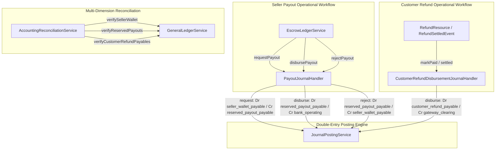

# Sub-Project 2 Implementation Plan: Ledger-Backed Seller Wallet, Payout Lifecycle & Customer Refund Settlements

> **For agentic workers:** REQUIRED SUB-SKILL: Use superpowers:subagent-driven-development to implement this plan task-by-task. Steps use checkbox (`- [ ]`) syntax for tracking.

**Goal:** Implement double-entry accounting for the seller payout lifecycle (reservation, disbursement, rejection), customer refund disbursement, and multi-dimension financial reconciliation (reserved payouts and customer refund payables) on the active `feature/double-entry-accounting-subproject-2` branch.

**Architecture Diagram:**

---

## Global Constraints
- Strictly PHP 8.5 with `declare(strict_types=1);` on all classes.
- All monetary math rounded to 2 decimal places using standard decimal arithmetic (`round($val, 2)`).
- Every posted journal entry MUST satisfy $\sum \text{Debit} == \sum \text{Credit} > 0.00$.
- Posted entries are strictly immutable.
- Idempotency keys must be enforced to prevent duplicate postings.
- All 853 existing tests must continue to pass with zero regressions.

---

### Task 1: AccountingEvent Enum Expansion

**Files:**
- Modify: `app/Enums/Accounting/AccountingEvent.php`
- Test: `tests/Unit/Accounting/SubProject2AccountingEventTest.php`

- [ ] **Step 1: Write unit test for new enum cases**
- [ ] **Step 2: Run test to verify it fails**
- [ ] **Step 3: Add enum cases to `AccountingEvent`**
  - `PAYOUT_REQUESTED = 'payout_requested'`
  - `PAYOUT_DISBURSED = 'payout_disbursed'`
  - `PAYOUT_REJECTED = 'payout_rejected'`
  - `CUSTOMER_REFUND_DISBURSED = 'customer_refund_disbursed'`
- [ ] **Step 4: Verify test passes**
- [ ] **Step 5: Commit changes**

---

### Task 2: Payout Journal Pipeline (`PayoutJournalHandler`)

**Files:**
- Create: `app/Services/Accounting/EventPipeline/PayoutJournalHandler.php`
- Test: `tests/Feature/Accounting/PayoutJournalIntegrationTest.php`

**Interfaces:**
- Consumes: `WalletTransaction`
- Produces: `AccountingJournalEntry`

- [ ] **Step 1: Write integration tests for payout journal handlers**
  - Request: Debits `seller_wallet_payable`, credits `reserved_payout_payable` (both with seller ID).
  - Disbursement: Debits `reserved_payout_payable` (seller ID), credits `bank_operating` (or gateway clearing).
  - Rejection: Debits `reserved_payout_payable`, credits `seller_wallet_payable` (both with seller ID).
  - Idempotency: Duplicate calls return existing entry.
  - Zero/negative amount and unseeded account guards.
- [ ] **Step 2: Run test to verify it fails**
- [ ] **Step 3: Implement `PayoutJournalHandler`**
- [ ] **Step 4: Verify test passes**
- [ ] **Step 5: Commit changes**

---

### Task 3: EscrowLedgerService Payout Lifecycle Integration

**Files:**
- Modify: `app/Services/Escrow/EscrowLedgerService.php`
- Test: `tests/Feature/Accounting/EscrowLedgerPayoutIntegrationTest.php`

- [ ] **Step 1: Write feature test asserting full lifecycle via `EscrowLedgerService`**
  - Calling `requestPayout()` updates wallet and records double-entry reservation journal.
  - Calling `disbursePayout()` updates transaction and records double-entry disbursement journal.
  - Calling `rejectPayout()` updates transaction, restores wallet, and records rejection reversal journal.
- [ ] **Step 2: Run test to verify it fails**
- [ ] **Step 3: Wire `PayoutJournalHandler` into `requestPayout()`, `disbursePayout()`, and `rejectPayout()`**
- [ ] **Step 4: Verify test passes and run full escrow test suite**
- [ ] **Step 5: Commit changes**

---

### Task 4: Customer Refund Disbursement Journal Pipeline

**Files:**
- Create: `app/Services/Accounting/EventPipeline/CustomerRefundDisbursementJournalHandler.php`
- Modify: `app/Filament/Admin/Resources/Refunds/RefundResource.php` / `app/Listeners/Finance/SendRefundSettledEmailListener.php`
- Test: `tests/Feature/Accounting/CustomerRefundDisbursementJournalIntegrationTest.php`

- [ ] **Step 1: Write feature test for customer refund disbursement**
  - Settling a pending refund debits `customer_refund_payable` and credits the appropriate liquid asset account (`gateway_clearing` for MFS, `bank_operating` for bank, `cash_on_hand` for cash).
  - Idempotency guard prevents duplicate postings.
- [ ] **Step 2: Run test to verify it fails**
- [ ] **Step 3: Implement `CustomerRefundDisbursementJournalHandler` and wire into refund settlement**
- [ ] **Step 4: Verify test passes**
- [ ] **Step 5: Commit changes**

---

### Task 5: Multi-Dimension Reconciliation Expansion

**Files:**
- Modify: `app/Services/Accounting/AccountingReconciliationService.php`
- Test: `tests/Feature/Accounting/SubProject2ReconciliationTest.php`

- [ ] **Step 1: Write feature test for extended reconciliation**
  - `verifyReservedPayouts()` matches sum of pending payout transactions with GL balance of `reserved_payout_payable`.
  - `verifyCustomerRefundPayables()` matches sum of pending refunds with GL balance of `customer_refund_payable`.
  - `verifySellerWallet()` includes reserved payout verification.
- [ ] **Step 2: Run test to verify it fails**
- [ ] **Step 3: Implement new methods in `AccountingReconciliationService`**
- [ ] **Step 4: Verify test passes and run all accounting tests**
- [ ] **Step 5: Commit changes**

---

### Task 6: Final Whole-SubProject Review & Regression Verification

- [ ] **Step 1: Run Pint code formatter**
- [ ] **Step 2: Run entire test suite (`php artisan test --compact`)**
- [ ] **Step 3: Dispatch final whole-branch code reviewer**
- [ ] **Step 4: Resolve any findings and finalize branch**
