# Financial Statements (Income Statement & Balance Sheet) Implementation Plan

> **For agentic workers:** REQUIRED SUB-SKILL: Use superpowers:subagent-driven-development to implement this plan task-by-task. Steps use checkbox (`- [ ]`) syntax for tracking.

**Goal:** Implement formal, GAAP/IFRS-compliant executive financial reporting for B2Bhaat: the **Income Statement (P&L)** (`/admin/income-statement`) and the **Balance Sheet** (`/admin/balance-sheet`), driven by a strict 100% backend calculation engine (`FinancialStatementService`) with tabular density, CSV streaming export, and letter-head print styles.

**Architecture:** A dedicated backend service `FinancialStatementService` executes all aggregate calculations, operating margins, equity rollups, and equilibrium validation at the database level with strict 2-decimal precision. Two native Filament 3 admin pages (`IncomeStatementPage` and `BalanceSheetPage`) render the pre-calculated reports with executive KPI cards, date presets, itemized financial tables, CSV exports, and `@media print` audit styling.

**Architecture Diagram:**

```mermaid
graph TD
    subgraph "Double-Entry General Ledger (Database)"
        AJE[accounting_journal_entries]
        AJL[accounting_journal_lines]
        AA[accounting_accounts]
        AAG[accounting_account_groups]
    end

    subgraph "Backend Calculation Engine (100% Backend Math)"
        FSS[FinancialStatementService]
        FSS -->|query range| AJL
        FSS -->|join accounts & types| AA
        FSS -->|calculate revenues, expenses, net income, margin %| IS_DATA[Income Statement Data DTO]
        FSS -->|calculate assets, liabilities, rolled equity, discrepancy| BS_DATA[Balance Sheet Data DTO]
    end

    subgraph "Filament 3 Admin Surfaces (/admin)"
        ISP[IncomeStatementPage: /admin/income-statement] -->|receives pre-calculated| IS_DATA
        BSP[BalanceSheetPage: /admin/balance-sheet] -->|receives pre-calculated| BS_DATA
        
        ISP -->|exportCsv| IS_CSV[Streamed CSV with BOM]
        ISP -->|print| IS_PRINT[A4 Letter-head Print Layout]
        
        BSP -->|exportCsv| BS_CSV[Streamed CSV with BOM]
        BSP -->|print| BS_PRINT[A4 Letter-head Print Layout]
    end
```

**Tech Stack:** PHP 8.5 (`declare(strict_types=1);`), Laravel 13, Filament 3 / Livewire 3, Tailwind CSS (Operate Mode Impeccable Craft), PHPUnit 11.

## Global Constraints

- Must run strictly on PHP 8.5 with `declare(strict_types=1);` on all classes.
- Zero frontend arithmetic: all calculations, subtotals, margins, net income, equity rollups, and equilibrium checks must be executed in `FinancialStatementService`.
- All monetary arithmetic must use 2 decimal places with strict decimal rounding (`round($val, 2)`).
- All monetary output must use BDT currency (`৳`) with tabular monospace formatting (`font-mono tracking-tight text-right`).
- Immutability: Financial statement pages are strictly read-only audit surfaces with access restricted to Super Admin (`$user->isSuperAdmin()`).
- All existing 942 tests must continue to pass with zero regressions.

---

### Task 1: Backend Financial Statement Calculation Engine (`FinancialStatementService`) & Unit Tests

**Files:**
- Create: `app/Services/Accounting/FinancialStatementService.php`
- Test: `tests/Unit/Accounting/FinancialStatementServiceTest.php`

**Interfaces:**
- Consumes: `App\Models\Accounting\AccountingAccount`, `App\Models\Accounting\AccountingJournalLine`, `App\Models\Accounting\AccountingJournalEntry`, `App\Enums\Accounting\AccountType`.
- Produces: `FinancialStatementService::getIncomeStatement(?string $startDate, ?string $endDate): array`, `FinancialStatementService::getBalanceSheet(?string $asOfDate): array`.

- [ ] **Step 1: Write the failing unit tests for `FinancialStatementService`**

Create `tests/Unit/Accounting/FinancialStatementServiceTest.php` testing:
- Accurate calculation of Operating Revenues (`4000` series), Operating Expenses (`5000` series), Net Operating Income, and Operating Margin %.
- Handling of zero revenue without division-by-zero errors.
- Date range filtering (`startDate` and `endDate`) on `journal_date`.
- Accurate aggregation of Assets (`1000` series) and Liabilities (`2000` series) as of a specific date.
- Dynamic rollup of cumulative Net Income into Equity (`3000` series) so that $\text{Total Assets} == \text{Total Liabilities} + \text{Total Equity}$ ($|\text{Discrepancy}| < 0.01$).
- Strict point-in-time filtering for the Balance Sheet (`asOfDate`).

- [ ] **Step 2: Run test to verify failure**

Run: `php artisan test tests/Unit/Accounting/FinancialStatementServiceTest.php`
Expected: FAIL with "Class FinancialStatementService not found".

- [ ] **Step 3: Implement `FinancialStatementService`**

Create `app/Services/Accounting/FinancialStatementService.php`:
- Implement `getIncomeStatement(?string $startDate = null, ?string $endDate = null): array`:
  - Resolve default dates if null: start of current month to end of current month.
  - Query lines for `AccountType::REVENUE` accounts where `journal_date` between boundaries:
    $\text{Amount} = \sum(\text{credit}) - \sum(\text{debit})$.
  - Query lines for `AccountType::EXPENSE` accounts where `journal_date` between boundaries:
    $\text{Amount} = \sum(\text{debit}) - \sum(\text{credit})$.
  - Compute `net_income = round($totalRevenues - $totalExpenses, 2)`.
  - Compute `operating_margin_percentage = $totalRevenues > 0 ? round(($netIncome / $totalRevenues) * 100, 2) : 0.00`.
  - Format all figures into pre-calculated strings (`৳X.XX` or signed `+৳X.XX` / `-৳X.XX`).
- Implement `getBalanceSheet(?string $asOfDate = null): array`:
  - Resolve default date if null: `now()->toDateString()`.
  - Query lines for `AccountType::ASSET` accounts where `journal_date <= $asOfDate`:
    $\text{Amount} = \sum(\text{debit}) - \sum(\text{credit})$.
  - Query lines for `AccountType::LIABILITY` accounts where `journal_date <= $asOfDate`:
    $\text{Amount} = \sum(\text{credit}) - \sum(\text{debit})$.
  - Query owner capital accounts (`AccountType::EQUITY`) where `journal_date <= $asOfDate`:
    $\text{Amount} = \sum(\text{credit}) - \sum(\text{debit})$.
  - Calculate cumulative Net Income up to `$asOfDate`:
    $\text{Cumulative Net Income} = \sum(\text{Revenues up to asOfDate}) - \sum(\text{Expenses up to asOfDate})$.
  - Compute `total_equity = round($ownerEquity + $cumulativeNetIncome, 2)`.
  - Compute `total_liabilities_and_equity = round($totalLiabilities + $totalEquity, 2)`.
  - Compute `discrepancy = round($totalAssets - $totalLiabilitiesAndEquity, 2)`.
  - Set `is_balanced = abs($discrepancy) < 0.01`.
  - Return sealed, fully-formatted data array.

- [ ] **Step 4: Run unit tests to verify pass**

Run: `php artisan test tests/Unit/Accounting/FinancialStatementServiceTest.php`
Expected: PASS with 100% assertions green.

- [ ] **Step 5: Run Pint & Commit**

Run: `vendor/bin/pint --dirty --format agent`
Commit: `git commit -am "feat(accounting): implement FinancialStatementService calculation engine with full unit tests"`

---

### Task 2: Income Statement (Profit & Loss) Filament Page & Feature Tests

**Files:**
- Create: `app/Filament/Admin/Pages/IncomeStatementPage.php`
- Create: `resources/views/filament/admin/pages/income-statement-page.blade.php`
- Test: `tests/Feature/Accounting/IncomeStatementPageTest.php`

**Interfaces:**
- Consumes: `FinancialStatementService::getIncomeStatement()`
- Produces: Livewire `/admin/income-statement` route, `exportCsv()` streamed response, `@media print` layout.

- [ ] **Step 1: Write feature tests for `IncomeStatementPage`**

Create `tests/Feature/Accounting/IncomeStatementPageTest.php`:
- `test_super_admin_can_access_income_statement_page()`
- `test_non_admin_cannot_access_income_statement_page()`
- `test_income_statement_page_renders_kpi_cards_and_statement_table()`
- `test_income_statement_page_presets_update_date_boundaries()`
- `test_income_statement_page_exports_valid_csv_stream()`

- [ ] **Step 2: Run test to verify failure**

Run: `php artisan test tests/Feature/Accounting/IncomeStatementPageTest.php`
Expected: FAIL with route/class not found.

- [ ] **Step 3: Implement `IncomeStatementPage` and Blade View**

- Create `app/Filament/Admin/Pages/IncomeStatementPage.php`:
  - Extends `Filament\Pages\Page`.
  - Navigation group `'Accounting'`, sort `4`, label `'Income Statement (P&L)'`, slug `'income-statement'`, icon `Heroicon::OutlinedPresentationChartLine`.
  - Authorization: `canAccess()` verifies `$user?->isSuperAdmin()`.
  - Public properties: `$startDate`, `$endDate`, `$preset = 'month'`.
  - Methods: `mount()`, `setPreset(string $preset)`, `updatedStartDate()`, `updatedEndDate()`, `getStatementData(): array`, `exportCsv(): StreamedResponse`.
- Create `resources/views/filament/admin/pages/income-statement-page.blade.php`:
  - 4 Executive KPI cards: Total Revenue (emerald), Total Expenses (rose), Net Income (dynamic emerald/rose), Operating Margin (indigo).
  - Date filter bar: Preset buttons (This Month, Last Month, This Quarter, This Year, All Time) + `<x-filament::input.wrapper>` date pickers.
  - Statement table with Operating Revenues (4000 series), Operating Expenses (5000 series), Subtotals, and Net Income banner.
  - Action buttons: Print statement (`window.print()`), Export CSV (`exportCsv`).
  - `@media print` CSS block formatting for clean letter-head presentation.

- [ ] **Step 4: Run tests to verify pass**

Run: `php artisan test tests/Feature/Accounting/IncomeStatementPageTest.php`
Expected: PASS with all tests green.

- [ ] **Step 5: Run Pint & Commit**

Run: `vendor/bin/pint --dirty --format agent`
Commit: `git commit -am "feat(accounting): implement Income Statement (P&L) Filament page with CSV export and print view"`

---

### Task 3: Balance Sheet Filament Page & Feature Tests

**Files:**
- Create: `app/Filament/Admin/Pages/BalanceSheetPage.php`
- Create: `resources/views/filament/admin/pages/balance-sheet-page.blade.php`
- Test: `tests/Feature/Accounting/BalanceSheetPageTest.php`

**Interfaces:**
- Consumes: `FinancialStatementService::getBalanceSheet()`
- Produces: Livewire `/admin/balance-sheet` route, `exportCsv()` streamed response, `@media print` layout.

- [ ] **Step 1: Write feature tests for `BalanceSheetPage`**

Create `tests/Feature/Accounting/BalanceSheetPageTest.php`:
- `test_super_admin_can_access_balance_sheet_page()`
- `test_non_admin_cannot_access_balance_sheet_page()`
- `test_balance_sheet_page_renders_kpi_cards_and_equilibrium_check()`
- `test_balance_sheet_page_as_of_presets_update_data()`
- `test_balance_sheet_page_exports_valid_csv_stream()`

- [ ] **Step 2: Run test to verify failure**

Run: `php artisan test tests/Feature/Accounting/BalanceSheetPageTest.php`
Expected: FAIL with route/class not found.

- [ ] **Step 3: Implement `BalanceSheetPage` and Blade View**

- Create `app/Filament/Admin/Pages/BalanceSheetPage.php`:
  - Extends `Filament\Pages\Page`.
  - Navigation group `'Accounting'`, sort `5`, label `'Balance Sheet'`, slug `'balance-sheet'`, icon `Heroicon::OutlinedScale`.
  - Authorization: `canAccess()` verifies `$user?->isSuperAdmin()`.
  - Public properties: `$asOfDate`, `$preset = 'today'`.
  - Methods: `mount()`, `setPreset(string $preset)`, `updatedAsOfDate()`, `getStatementData(): array`, `exportCsv(): StreamedResponse`.
- Create `resources/views/filament/admin/pages/balance-sheet-page.blade.php`:
  - 4 Executive KPI cards: Total Assets (sky), Total Liabilities (amber), Total Equity (violet), Balance Equilibrium Check (emerald badge "Balanced" vs rose warning "Out of Balance").
  - Filter bar: Presets (Today, End of Last Month, End of This Quarter, End of Last Year) + As of Date picker.
  - Itemized statement sections: Current Assets (1000 series), Current Liabilities (2000 series), Owner's Equity (3000 series with dynamic Net Income line).
  - Bottom Equilibrium Verification Footer: Assets vs Liabilities & Equity double-underlined summary.
  - Action buttons: Print statement (`window.print()`), Export CSV (`exportCsv`).
  - `@media print` CSS block formatting for formal letter-head presentation.

- [ ] **Step 4: Run tests to verify pass**

Run: `php artisan test tests/Feature/Accounting/BalanceSheetPageTest.php`
Expected: PASS with all tests green.

- [ ] **Step 5: Run Pint & Commit**

Run: `vendor/bin/pint --dirty --format agent`
Commit: `git commit -am "feat(accounting): implement Balance Sheet Filament page with equilibrium check and CSV export"`

---

### Task 4: Complete Verification, Pint Formatting & Whole-Branch Review

- [ ] **Step 1: Run Pint code formatter (`vendor/bin/pint --dirty --format agent`)**
- [ ] **Step 2: Run entire test suite (`php artisan test --compact`)**
- [ ] **Step 3: Dispatch final whole-branch code reviewer subagent**
- [ ] **Step 4: Resolve any findings and merge into `production`**
