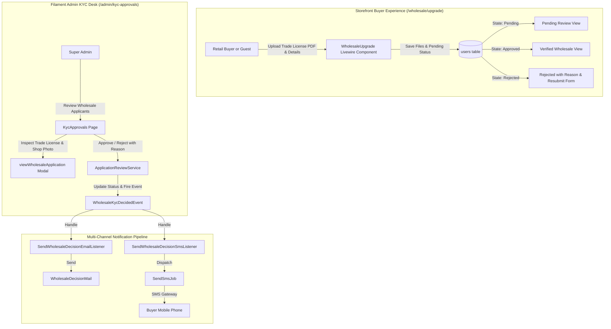

# Wholesale Buyer KYC & Trade License Verification Implementation Plan

> **For agentic workers:** REQUIRED SUB-SKILL: Use superpowers:subagent-driven-development to implement this plan task-by-task. Steps use checkbox (`- [ ]`) syntax for tracking.

**Goal:** Build an authentic, complete wholesale buyer onboarding system: document uploads (Trade License PDF/image, TIN/BIN, Shop Photo), a multi-state storefront status tracking and resubmission portal (`/wholesale/upgrade`), Filament Admin KYC document inspection, and automated multi-channel (SMS + Email) decision notifications.

**Architecture:** Extend the `users` table with file path and business metadata fields. Enhance `WholesaleUpgrade` Livewire component to handle file uploads (`WithFileUploads`) and render 4 persistent states (Unapplied, Pending, Approved, Rejected with Resubmission). Upgrade `KycApprovals` and `ApplicationReviewActions` in Filament Admin with interactive document viewers. Add `SendWholesaleDecisionSmsListener` to trigger instant SMS notifications upon approval and rejection via `SendSmsJob`.

**Architecture Diagram:**

**Tech Stack:** PHP 8.5 (`declare(strict_types=1);`), Laravel 13, Livewire 3 (`WithFileUploads`), Filament 3, Tailwind CSS, PHPUnit 11.

## Global Constraints

- Must run strictly on PHP 8.5 with `declare(strict_types=1);` on all classes and tests.
- Multi-tenant isolation: Buyers must strictly only access their own application state (`$user->id === auth()->id()`).
- Document storage: Store files securely on the `public` disk under `kyc-documents/{userId}/` with random hashed names.
- Allowed file types: Trade license & TIN allow `pdf,jpg,jpeg,png,webp` (max 5MB). Shop photo allows `jpg,jpeg,png,webp` (max 5MB).
- Migration rollback safety: Ensure clean index/column removal on `down()`.
- Currency formatting: ASCII `BDT` in SMS copies.
- All 993 existing tests must continue to pass with zero regressions.

---

### Task 1: Database Migration & User Model Enhancements

**Files:**
- Create: `database/migrations/2026_11_08_200001_add_kyc_document_fields_to_users_table.php`
- Modify: `app/Models/User.php`
- Test: `tests/Unit/WholesaleKycModelTest.php`

**Interfaces:**
- Consumes: `User` model
- Produces: `trade_license_document`, `tax_id_document`, `shop_photo`, `business_type`, `business_city` attributes; helper methods `hasTradeLicenseDocument(): bool`, `getTradeLicenseUrl(): ?string`, `getTaxIdDocumentUrl(): ?string`, `getShopPhotoUrl(): ?string`.

- [ ] **Step 1: Write unit tests for User KYC model attributes and helpers**

Create `tests/Unit/WholesaleKycModelTest.php` testing:
- Model fillable includes the new columns.
- `hasTradeLicenseDocument()` returns true when file path is set, false otherwise.
- `getTradeLicenseUrl()`, `getTaxIdDocumentUrl()`, `getShopPhotoUrl()` generate correct storage URLs or null when empty.
- `isWholesalePending()`, `isWholesaleApproved()`, and `isWholesaleRejected()` return correct boolean states.

- [ ] **Step 2: Run test to verify failure**

Run: `php artisan test tests/Unit/WholesaleKycModelTest.php`
Expected: FAIL with missing columns/methods.

- [ ] **Step 3: Implement migration and User model updates**

1. Create migration `2026_11_08_200001_add_kyc_document_fields_to_users_table.php`:
   - Adds `trade_license_document` (`string`, 255, nullable).
   - Adds `tax_id_document` (`string`, 255, nullable).
   - Adds `shop_photo` (`string`, 255, nullable).
   - Adds `business_type` (`string`, 64, nullable).
   - Adds `business_city` (`string`, 100, nullable).
   - In `down()`: drops all added columns.
2. Run migration: `php artisan migrate`.
3. Update `app/Models/User.php`:
   - Add new attributes to `$fillable`.
   - Implement `hasTradeLicenseDocument(): bool`: `return filled($this->trade_license_document);`
   - Implement `getTradeLicenseUrl(): ?string`: `return $this->trade_license_document ? Storage::disk('public')->url($this->trade_license_document) : null;`
   - Implement `getTaxIdDocumentUrl(): ?string`: `return $this->tax_id_document ? Storage::disk('public')->url($this->tax_id_document) : null;`
   - Implement `getShopPhotoUrl(): ?string`: `return $this->shop_photo ? Storage::disk('public')->url($this->shop_photo) : null;`
   - Ensure `isWholesaleApproved(): bool`: `return (bool) $this->is_wholesale_approved;`

- [ ] **Step 4: Run tests to verify pass**

Run: `php artisan test tests/Unit/WholesaleKycModelTest.php`
Expected: PASS with 100% assertions green.

- [ ] **Step 5: Run Pint & Commit**

Run: `vendor/bin/pint --dirty --format agent`
Commit: `git commit -am "feat(kyc): add kyc document fields and helpers to users table"`

---

### Task 2: Storefront Wholesale Verification & Status Portal (`/wholesale/upgrade`)

**Files:**
- Modify: `app/Livewire/Storefront/WholesaleUpgrade.php`
- Modify: `resources/views/livewire/storefront/wholesale-upgrade.blade.php`
- Test: `tests/Feature/WholesaleUpgradePortalTest.php`

**Interfaces:**
- Consumes: `User` model, `WithFileUploads` trait
- Produces: Persistent 4-state portal (Unapplied, Pending, Approved, Rejected with Resubmission), file upload handling.

- [ ] **Step 1: Write feature tests for storefront wholesale verification portal**

Create `tests/Feature/WholesaleUpgradePortalTest.php` testing:
- Guest can submit application with trade license file upload, and is automatically created and logged in.
- Authenticated retail buyer can apply with trade license upload (persists file and updates user).
- File upload validations (PDF or image required, max 5MB).
- Authenticated buyer with pending application sees "Application Under Review" card.
- Authenticated buyer with approved application sees "Verified Wholesale Buyer" card.
- Authenticated buyer with rejected application sees rejection reason and can resubmit with updated documents.

- [ ] **Step 2: Run test to verify failure**

Run: `php artisan test tests/Feature/WholesaleUpgradePortalTest.php`
Expected: FAIL with missing upload handling or views.

- [ ] **Step 3: Implement Livewire component and Blade view**

1. In `app/Livewire/Storefront/WholesaleUpgrade.php`:
   - Add `use Livewire\WithFileUploads;`
   - Add properties:
     - `public $tradeLicenseFile;`
     - `public $tinDocumentFile;`
     - `public $shopPhotoFile;`
   - In `mount()`: if user is authenticated, populate existing `business_type` and `business_city` alongside other fields.
   - In `applyForWholesale()`:
     - Validate `tradeLicenseFile` (`required_without:tradeLicenseDocument|nullable|file|mimes:pdf,jpg,jpeg,png,webp|max:5120`).
     - Validate `tinDocumentFile` (`nullable|file|mimes:pdf,jpg,jpeg,png,webp|max:5120`).
     - Validate `shopPhotoFile` (`nullable|image|mimes:jpg,jpeg,png,webp|max:5120`).
     - Store uploaded files: `$path = $this->tradeLicenseFile->store("kyc-documents/{$userId}", 'public');`
     - Update user or create user with new file paths, `business_type`, `business_city`.
     - Reset `wholesale_rejected_at` and `wholesale_rejection_reason` on resubmission.
2. In `resources/views/livewire/storefront/wholesale-upgrade.blade.php`:
   - Check user status:
     - If `$user?->isWholesaleApproved()`: render Approved banner with catalog button and badge.
     - Else if `$user?->isWholesalePending()`: render Pending Review card showing submitted business name, trade license number, file attachment indicators, and 24-48h turnaround notice.
     - Else (Unapplied OR `$user?->isWholesaleRejected()`):
       - If rejected, display prominent amber alert banner with `$user->wholesale_rejection_reason` and explanation: "Please update your information or upload a clearer document below."
       - Form with:
         - Business Name, Contact Person, Business Type (dropdown), City/District.
         - Trade License Number + Trade License File Upload (with file preview/status).
         - TIN Number + TIN Document File Upload (optional).
         - Shopfront Photo Upload (optional).
         - Password & contact fields for guests.
         - Submit button with Livewire loading state.

- [ ] **Step 4: Run tests to verify pass**

Run: `php artisan test tests/Feature/WholesaleUpgradePortalTest.php`
Expected: PASS with 100% assertions green.

- [ ] **Step 5: Run Pint & Commit**

Run: `vendor/bin/pint --dirty --format agent`
Commit: `git commit -am "feat(storefront): enhance wholesale upgrade portal with file uploads, multi-state tracking, and resubmission"`

---

### Task 3: Admin KYC Approvals Desk & Document Inspection Modal (`/admin/kyc-approvals`)

**Files:**
- Modify: `app/Filament/Admin/Pages/KycApprovals.php`
- Modify: `app/Filament/Admin/Support/ApplicationReviewActions.php`
- Test: `tests/Feature/Admin/WholesaleKycDeskTest.php`

**Interfaces:**
- Consumes: `User` model with document paths
- Produces: Enhanced `wholesaleTable` with document indicators; enhanced `viewWholesaleApplication` modal with document viewer actions.

- [ ] **Step 1: Write feature tests for Admin KYC desk upgrades**

Create `tests/Feature/Admin/WholesaleKycDeskTest.php` testing:
- Admin can see wholesale applicant's business type, trade license, and document attachment status in table.
- Admin can open `viewWholesaleApplication` and see document URLs and details.
- Admin can approve wholesale applicant $\rightarrow$ sets `is_wholesale_approved = true` and updates role to `wholesale_buyer`.
- Admin can reject wholesale applicant with reason $\rightarrow$ sets `is_wholesale_approved = false` and records reason.

- [ ] **Step 2: Run test to verify failure**

Run: `php artisan test tests/Feature/Admin/WholesaleKycDeskTest.php`
Expected: FAIL with missing fields/infolist entries.

- [ ] **Step 3: Implement Admin KYC desk upgrades**

1. In `app/Filament/Admin/Pages/KycApprovals.php`:
   - In `wholesaleTable()`:
     - Add `TextColumn::make('business_type')->label('Type')->badge()->placeholder('—')->sortable()`.
     - Add `TextColumn::make('business_city')->label('District')->placeholder('—')->searchable()`.
     - Add document indicator column showing icons for attached Trade License, TIN, and Shop Photo.
2. In `app/Filament/Admin/Support/ApplicationReviewActions.php`:
   - In `viewWholesaleApplication()` modal schema:
     - Add `TextEntry::make('business_type')->label('Business Type')->badge()`.
     - Add `TextEntry::make('business_city')->label('District / City')`.
     - Add document view links:
       - Trade License Document: link to open/download stored document in new tab.
       - TIN Document: link to open/download.
       - Shopfront Photo: image thumbnail entry with modal preview.

- [ ] **Step 4: Run tests to verify pass**

Run: `php artisan test tests/Feature/Admin/WholesaleKycDeskTest.php`
Expected: PASS with 100% assertions green.

- [ ] **Step 5: Run Pint & Commit**

Run: `vendor/bin/pint --dirty --format agent`
Commit: `git commit -am "feat(admin): upgrade kyc approvals desk with document inspection and business metadata"`

---

### Task 4: Multi-Channel SMS Decision Pipeline (`SendWholesaleDecisionSmsListener`)

**Files:**
- Create: `app/Listeners/Sellers/SendWholesaleDecisionSmsListener.php`
- Modify: `app/Providers/AppServiceProvider.php`
- Test: `tests/Feature/WholesaleKycNotificationTest.php`

**Interfaces:**
- Consumes: `App\Events\Sellers\WholesaleKycDecidedEvent`, `App\Jobs\SendSmsJob`
- Produces: Automated SMS delivery on wholesale KYC approval and rejection.

- [ ] **Step 1: Write feature tests for Wholesale KYC decision notifications**

Create `tests/Feature/WholesaleKycNotificationTest.php` testing:
- Approving a wholesale buyer dispatches `SendSmsJob` to user's phone with approval message and catalog URL, alongside `WholesaleDecisionMail`.
- Rejecting a wholesale buyer dispatches `SendSmsJob` to user's phone with specific rejection reason and upgrade URL, alongside `WholesaleDecisionMail`.
- Missing or invalid phone numbers do not throw unhandled exceptions.

- [ ] **Step 2: Run test to verify failure**

Run: `php artisan test tests/Feature/WholesaleKycNotificationTest.php`
Expected: FAIL with SMS listener not registered / job not dispatched.

- [ ] **Step 3: Implement `SendWholesaleDecisionSmsListener` and register in `AppServiceProvider`**

1. Create `app/Listeners/Sellers/SendWholesaleDecisionSmsListener.php`:
   - Implements `ShouldQueue`.
   - In `handle(WholesaleKycDecidedEvent $event): void`:
     - Resolves user: `$user = $event->user;`
     - Validates phone: `if (! $user->phone || ! PhoneNormalizer::isValid($user->phone)) { return; }`
     - Normalizes phone: `$phone = PhoneNormalizer::normalize($user->phone);`
     - Formats message:
       - If `$event->isApproved`:  
         `"B2Bhaat: Congratulations! Your Wholesale Buyer account for '{$user->business_name}' is approved. You can now access factory-direct pricing: " . route('catalog.index')`  
         Dispatches `SendSmsJob::dispatch($phone, $message, 'wholesale_kyc_approved');`
       - If rejected:  
         `"B2Bhaat: Your Wholesale Buyer application for '{$user->business_name}' was not approved: {$event->rejectionReason}. Update and resubmit at: " . route('wholesale.upgrade')`  
         Dispatches `SendSmsJob::dispatch($phone, $message, 'wholesale_kyc_rejected');`
2. In `app/Providers/AppServiceProvider.php`:
   - Register listener: `Event::listen(WholesaleKycDecidedEvent::class, SendWholesaleDecisionSmsListener::class);`

- [ ] **Step 4: Run tests to verify pass**

Run: `php artisan test tests/Feature/WholesaleKycNotificationTest.php`
Expected: PASS with 100% assertions green.

- [ ] **Step 5: Run Pint & Commit**

Run: `vendor/bin/pint --dirty --format agent`
Commit: `git commit -am "feat(kyc): add automated SMS milestone notification listener for wholesale decisions"`

---

### Task 5: Complete Verification, Pint Formatting & Whole-Branch Review

- [ ] **Step 1: Run Pint code formatter (`vendor/bin/pint --format agent`)**
- [ ] **Step 2: Run entire test suite (`php artisan test --compact`)**
- [ ] **Step 3: Dispatch final whole-branch code reviewer subagent**
- [ ] **Step 4: Resolve any findings and fast-forward merge into `production`**
