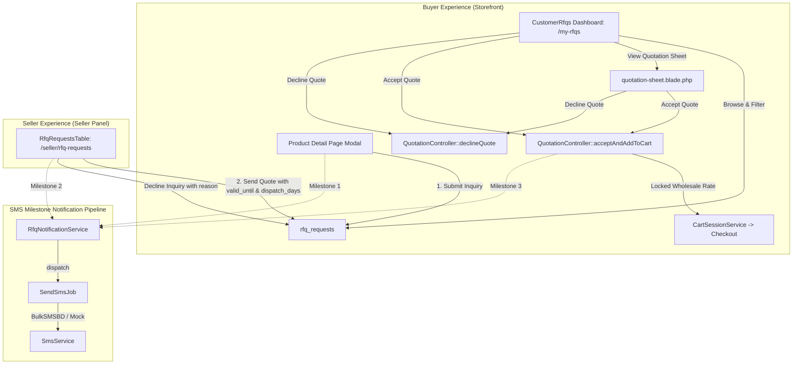

# Wholesale RFQ & Custom Volume Quotation Flow Implementation Plan

> **For agentic workers:** REQUIRED SUB-SKILL: Use superpowers:subagent-driven-development to implement this plan task-by-task. Steps use checkbox (`- [ ]`) syntax for tracking.

**Goal:** Build an end-to-end commercial wholesale negotiation pipeline: a buyer dashboard (`/my-rfqs`) for managing bulk factory inquiries, quotation expiry & lead time controls, structured decline actions, and an automated SMS milestone alert pipeline via `SendSmsJob`.

**Architecture:** A database migration introduces `valid_until`, `dispatch_days`, `rejected_by`, and `rejection_reason` to `rfq_requests`. A dedicated Livewire component `CustomerRfqs` (`/my-rfqs`) provides wholesale buyers with an inquiry portal with tabbed views, expiry countdowns, and quote acceptance/decline actions. The seller panel (`/seller/rfq-requests`) is enhanced with validity windows (7, 14, 30 days) and decline controls. An event-driven notification service `RfqNotificationService` pushes SMS jobs at critical commercial milestones.

**Architecture Diagram:**

**Tech Stack:** PHP 8.5 (`declare(strict_types=1);`), Laravel 13, Livewire 3, Filament 3, Tailwind CSS, PHPUnit 11.

## Global Constraints

- Must run strictly on PHP 8.5 with `declare(strict_types=1);` on all classes.
- Multi-tenant isolation: Buyers must strictly only access their own RFQ records (`buyer_id === auth()->id()`). Sellers must strictly only access RFQs for their products (`seller_id === auth()->id()`).
- Expiry enforcement: An expired quote (`now() > valid_until`) can never be accepted into cart.
- Monetary values formatted in BDT (`৳`) with 2 decimal precision.
- All existing 965 tests must continue to pass with zero regressions.

---

### Task 1: Database Migration, Model Helpers & Expiry State Rules

**Files:**
- Create: `database/migrations/2026_11_08_140001_add_validity_and_rejection_to_rfq_requests_table.php`
- Modify: `app/Models/RfqRequest.php`
- Modify: `app/Http/Controllers/Storefront/QuotationController.php`
- Test: `tests/Unit/RfqLifecycleTest.php`

**Interfaces:**
- Consumes: `RfqRequest` model
- Produces: `valid_until`, `dispatch_days`, `rejected_by`, `rejection_reason` attributes; `$rfq->isExpired(): bool`, `$rfq->canBeAccepted(): bool`; `QuotationController::decline()` endpoint.

- [ ] **Step 1: Write unit tests for RFQ lifecycle and expiry rules**

Create `tests/Unit/RfqLifecycleTest.php` testing:
- Model casts `valid_until` to `datetime` and `dispatch_days` to `integer`.
- `isExpired()` returns true when `valid_until` is in the past.
- `isExpired()` returns false when `valid_until` is in the future or null.
- `canBeAccepted()` returns true only when status is `quoted` and not expired.
- `QuotationController::acceptAndAddToCart` aborts/redirects with error if quote is expired.

- [ ] **Step 2: Run test to verify failure**

Run: `php artisan test tests/Unit/RfqLifecycleTest.php`
Expected: FAIL with missing columns/methods.

- [ ] **Step 3: Implement migration and model updates**

1. Create migration `2026_11_08_140001_add_validity_and_rejection_to_rfq_requests_table.php`:
   - Adds `valid_until` (`timestamp`, nullable).
   - Adds `dispatch_days` (`unsignedInteger`, nullable).
   - Adds `rejected_by` (`string`, 32, nullable).
   - Adds `rejection_reason` (`text`, nullable).
2. Run migration: `php artisan migrate`.
3. Update `app/Models/RfqRequest.php`:
   - Add new columns to `$fillable`.
   - Add casts: `'valid_until' => 'datetime'`, `'dispatch_days' => 'integer'`.
   - Implement `isExpired(): bool`:
     `return $this->valid_until !== null && now()->isAfter($this->valid_until);`
   - Implement `canBeAccepted(): bool`:
     `return $this->status === 'quoted' && ! $this->isExpired();`
4. Update `app/Http/Controllers/Storefront/QuotationController.php`:
   - In `acceptAndAddToCart()`: check `if ($rfq->isExpired()) { return redirect()->back()->with('error', 'This quotation has expired and can no longer be accepted.'); }`
   - Add `decline(Request $request, int $id): RedirectResponse`:
     - Authorize buyer or admin.
     - Validate `rejection_reason`.
     - Update `$rfq->update(['status' => 'rejected', 'rejected_by' => 'buyer', 'rejection_reason' => $reason])`.
     - Redirect back with success message.
   - Register route in `routes/web.php`: `Route::post('/rfq/{id}/decline', [QuotationController::class, 'decline'])->name('rfq.quotation.decline')->middleware(['web', 'auth']);`

- [ ] **Step 4: Run tests to verify pass**

Run: `php artisan test tests/Unit/RfqLifecycleTest.php`
Expected: PASS with 100% assertions green.

- [ ] **Step 5: Run Pint & Commit**

Run: `vendor/bin/pint --dirty --format agent`
Commit: `git commit -am "feat(rfq): add validity, lead time, rejection tracking, and expiry guards"`

---

### Task 2: Seller Panel RFQ Enhancements & Decline Controls

**Files:**
- Modify: `app/Filament/Seller/Resources/RfqRequests/Tables/RfqRequestsTable.php`
- Test: `tests/Feature/Seller/SellerRfqQuotationTest.php`

**Interfaces:**
- Consumes: `RfqRequest` model with new columns.
- Produces: Enhanced "Send Quote" modal action with validity window and dispatch lead time; "Decline Inquiry" modal action.

- [ ] **Step 1: Write feature tests for Seller RFQ table actions**

Create `tests/Feature/Seller/SellerRfqQuotationTest.php` testing:
- Seller can quote an RFQ with custom validity (7, 14, 30 days) and production days.
- Quoting calculates and stores exact `valid_until` timestamp.
- Seller can decline an inquiry with a structured reason (`status = 'rejected'`, `rejected_by = 'seller'`).
- Multi-tenant isolation: Seller A cannot quote or decline Seller B's RFQ.

- [ ] **Step 2: Run test to verify failure**

Run: `php artisan test tests/Feature/Seller/SellerRfqQuotationTest.php`
Expected: FAIL with missing form schema fields / decline action.

- [ ] **Step 3: Implement Seller RFQ table upgrades**

In `app/Filament/Seller/Resources/RfqRequests/Tables/RfqRequestsTable.php`:
1. Update `send_quote` action form:
   - `seller_quoted_price` (`numeric`, required, min 1).
   - `validity_days` (`Select::make('validity_days')->label('Quotation Validity')->options([7 => '7 Days', 14 => '14 Days (Standard)', 30 => '30 Days (Extended)'])->default(14)->required()`).
   - `dispatch_days` (`TextInput::make('dispatch_days')->label('Production & Dispatch Timeline (Days)')->numeric()->default(7)->minValue(1)`).
   - `seller_notes` (`Textarea::make('seller_notes')`).
   - In action callback: compute `valid_until = now()->addDays((int) $data['validity_days'])->endOfDay()`. Update record.
2. Add `decline_inquiry` action:
   - Label `'Decline Inquiry'`, icon `heroicon-o-x-circle`, color `danger`.
   - Visible only when `status === 'pending' && auth()->user()->can('update', $record)`.
   - Form with `Select::make('reason_preset')` and `Textarea::make('rejection_reason')`.
   - In action callback: update `status = 'rejected'`, `rejected_by = 'seller'`, `rejection_reason = $reason`.
3. Add table column for `valid_until` (with countdown badge) and `dispatch_days`.

- [ ] **Step 4: Run tests to verify pass**

Run: `php artisan test tests/Feature/Seller/SellerRfqQuotationTest.php`
Expected: PASS with all tests green.

- [ ] **Step 5: Run Pint & Commit**

Run: `vendor/bin/pint --dirty --format agent`
Commit: `git commit -am "feat(seller): enhance RFQ quotation modal with validity, lead time, and decline action"`

---

### Task 3: Buyer Dashboard (`/my-rfqs`) & Storefront Integration

**Files:**
- Create: `app/Livewire/Storefront/CustomerRfqs.php`
- Create: `resources/views/livewire/storefront/customer-rfqs.blade.php`
- Modify: `routes/web.php`
- Modify: `resources/views/storefront/quotation-sheet.blade.php`
- Modify: Header / Account dropdown navigation view (if applicable)
- Test: `tests/Feature/CustomerRfqsTest.php`

**Interfaces:**
- Consumes: `RfqRequest::where('buyer_id', auth()->id())`
- Produces: Livewire route `/my-rfqs` (`customer.rfqs`), tabs filtering, quote cards, decline action.

- [ ] **Step 1: Write feature tests for Buyer RFQ dashboard**

Create `tests/Feature/CustomerRfqsTest.php` testing:
- Authenticated buyer can access `/my-rfqs`.
- Unauthenticated guest is redirected to login.
- Multi-tenant isolation: Buyer A cannot see Buyer B's RFQs.
- Filter tabs (`all`, `quoted`, `pending`, `accepted`, `declined`) filter records accurately.
- Buyer can decline a quote directly from `/my-rfqs`.
- Expired quotes show expired badge and disable "Accept & Order" button.
- Acceptance redirects to checkout with locked quoted rate.

- [ ] **Step 2: Run test to verify failure**

Run: `php artisan test tests/Feature/CustomerRfqsTest.php`
Expected: FAIL with route not found.

- [ ] **Step 3: Implement `CustomerRfqs` Livewire component and Blade views**

1. Create `app/Livewire/Storefront/CustomerRfqs.php`:
   - Extends `Livewire\Component` with `WithPagination`.
   - Properties: `$tab = 'all'`, `$declineRfqId = null`, `$declineReason = ''`.
   - Query: strictly scopes to `RfqRequest::where('buyer_id', auth()->id())` with `product` and `seller.sellerProfile`.
   - Filter methods: `setTab(string $tab)`.
   - Action method: `confirmDecline(int $id)`, `submitDecline()`.
2. Create `resources/views/livewire/storefront/customer-rfqs.blade.php`:
   - Breadcrumb & Title: "My Quotations & RFQs".
   - Tab pills: All Inquiries, Active Quotes, Awaiting Factory, Accepted & Ordered, Declined / Expired.
   - RFQ Cards:
     - Product thumbnail, title, seller store name.
     - Target Qty & Budget vs Factory Quoted Rate & Lead Time.
     - Expiry countdown badge (e.g., "Valid for 5 more days" or "Expired on ...").
     - Action buttons: "View Quotation Sheet", "Accept & Order", "Decline Quote".
   - Decline Modal with feedback textarea.
   - Clean empty states for each tab.
3. Register route in `routes/web.php`:
   `Route::get('/my-rfqs', CustomerRfqs::class)->name('customer.rfqs')->middleware('auth');`
4. Update `resources/views/storefront/quotation-sheet.blade.php`:
   - Display dynamic `valid_until` date and expiration warning banner if expired.
   - Display `dispatch_days` in shipping terms.
   - Add "Decline Quote" button and form alongside "Accept Quote".

- [ ] **Step 4: Run tests to verify pass**

Run: `php artisan test tests/Feature/CustomerRfqsTest.php`
Expected: PASS with all tests green.

- [ ] **Step 5: Run Pint & Commit**

Run: `vendor/bin/pint --dirty --format agent`
Commit: `git commit -am "feat(storefront): implement buyer RFQ dashboard, quote cards, and decline workflow"`

---

### Task 4: SMS Milestone Notification Pipeline

**Files:**
- Create: `app/Services/Rfq/RfqNotificationService.php`
- Modify: `app/Livewire/Storefront/ProductDetail.php` (Milestone 1 trigger)
- Modify: `app/Filament/Seller/Resources/RfqRequests/Tables/RfqRequestsTable.php` (Milestone 2 trigger)
- Modify: `app/Http/Controllers/Storefront/QuotationController.php` (Milestone 3 trigger)
- Test: `tests/Feature/RfqSmsNotificationTest.php`

**Interfaces:**
- Consumes: `App\Jobs\SendSmsJob`, `App\Models\RfqRequest`, `App\Models\User`.
- Produces: `RfqNotificationService::notifySellerOfNewInquiry()`, `notifyBuyerOfQuotation()`, `notifySellerOfAcceptedQuote()`.

- [ ] **Step 1: Write feature tests for RFQ SMS notifications**

Create `tests/Feature/RfqSmsNotificationTest.php` testing:
- Submitting an RFQ dispatches `SendSmsJob` to the seller's phone.
- Disagreeing/quoting an RFQ dispatches `SendSmsJob` to the buyer's phone with quotation link.
- Accepting an RFQ dispatches `SendSmsJob` to the seller's phone confirming the accepted order.
- In-memory mock driver (`SMS_DRIVER=mock`) records all SMS logs accurately.

- [ ] **Step 2: Run test to verify failure**

Run: `php artisan test tests/Feature/RfqSmsNotificationTest.php`
Expected: FAIL with service not found / jobs not dispatched.

- [ ] **Step 3: Implement `RfqNotificationService` and integrate triggers**

1. Create `app/Services/Rfq/RfqNotificationService.php`:
   - `notifySellerOfNewInquiry(RfqRequest $rfq): void`:
     - Resolves seller phone.
     - Pushes `SendSmsJob::dispatch($phone, $message, 'rfq_new_inquiry', $rfq->id)`.
   - `notifyBuyerOfQuotation(RfqRequest $rfq): void`:
     - Resolves buyer phone.
     - Formats message with quoted unit price, validity days, and short quotation URL (`route('rfq.quotation.print', $rfq->id)`).
     - Pushes `SendSmsJob::dispatch($phone, $message, 'rfq_quote_sent', $rfq->id)`.
   - `notifySellerOfAcceptedQuote(RfqRequest $rfq): void`:
     - Resolves seller phone.
     - Pushes `SendSmsJob::dispatch($phone, $message, 'rfq_quote_accepted', $rfq->id)`.
2. Connect triggers:
   - In `ProductDetail::submitRfq()`: call `app(RfqNotificationService::class)->notifySellerOfNewInquiry($rfq)`.
   - In `RfqRequestsTable::send_quote` action: call `app(RfqNotificationService::class)->notifyBuyerOfQuotation($record)`.
   - In `QuotationController::acceptAndAddToCart()`: call `app(RfqNotificationService::class)->notifySellerOfAcceptedQuote($rfq)`.

- [ ] **Step 4: Run tests to verify pass**

Run: `php artisan test tests/Feature/RfqSmsNotificationTest.php`
Expected: PASS with 100% assertions green.

- [ ] **Step 5: Run Pint & Commit**

Run: `vendor/bin/pint --dirty --format agent`
Commit: `git commit -am "feat(rfq): integrate automated SMS milestone notification pipeline"`

---

### Task 5: Complete Verification, Pint Formatting & Whole-Branch Review

- [ ] **Step 1: Run Pint code formatter (`vendor/bin/pint --dirty --format agent`)**
- [ ] **Step 2: Run entire test suite (`php artisan test --compact`)**
- [ ] **Step 3: Dispatch final whole-branch code reviewer subagent**
- [ ] **Step 4: Resolve any findings and merge into `production`**
