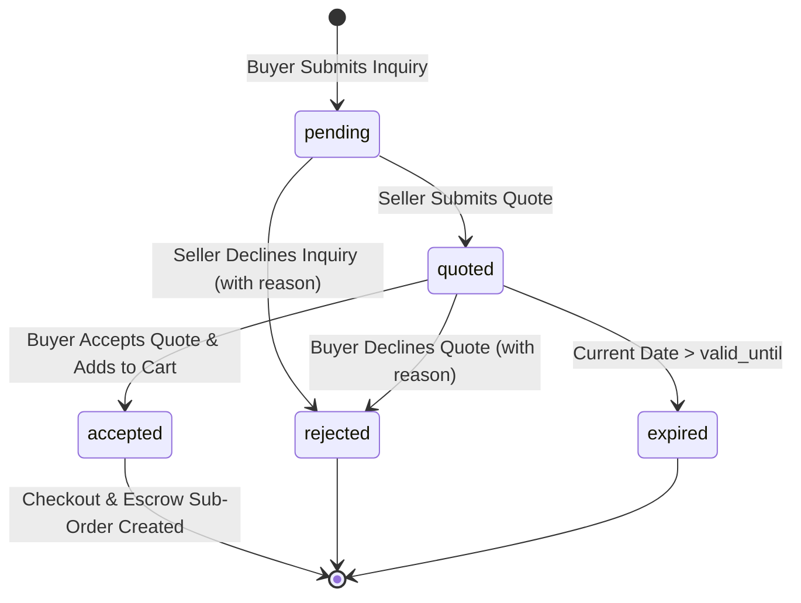

# Wholesale RFQ & Custom Volume Quotation Flow Design Specification

- **Module:** Wholesale B2B Commercial Negotiation Subsystem
- **Status:** APPROVED DESIGN SPECIFICATION
- **Target Surfaces:**
  - Buyer RFQ & Quotation Dashboard: `/my-rfqs`
  - Storefront Pro-Forma Quotation Sheet: `/rfq/{id}/quotation`
  - Seller RFQ Management Desk: `/seller/rfq-requests`
  - Admin RFQ Overview: `/admin/rfq-requests`
- **Core Notification Engine:** `App\Services\Sms\SmsService` via `SendSmsJob`
- **Design Mode:** Operate / Persuade (Clear Commercial Workflow, Expiry Protection, Mobile-First Storefront Craft)

---

## 1. Executive Summary & Business Intent

In B2B wholesale trade, catalog tier brackets (e.g. 50–100 pcs) do not cover custom high-volume manufacturing, OEM private labeling, and bulk factory consignments (e.g., 500–10,000 pcs).

The **Wholesale Request for Quotation (RFQ) Subsystem** allows verified business buyers to negotiate custom volume rates directly with verified factory merchants.

This specification enhances the existing basic RFQ mechanism into a complete, end-to-end commercial trading pipeline:
1. **Buyer Dashboard (`/my-rfqs`):** A dedicated, authenticated portal where buyers can track all submitted inquiries, compare active quotes, view expiry countdowns, accept quotes into checkout, or decline with feedback.
2. **Quotation Expiry & Decline Controls:** Factory sellers can specify validity windows (7, 14, 30 days) and production timelines, preventing stale price locks, while both parties can decline with structured reasons.
3. **SMS Alert Pipeline:** Real-time SMS notifications keeping factory owners and wholesale buyers informed at critical milestones.

---

## 2. Database Schema & State Transitions

### 2.1 Database Migration (`rfq_requests`)
Add four new columns to `rfq_requests`:
```php
Schema::table('rfq_requests', function (Blueprint $table) {
    $table->timestamp('valid_until')->nullable()->after('seller_quoted_price');
    $table->unsignedInteger('dispatch_days')->nullable()->after('valid_until'); // Production & delivery lead time in days
    $table->string('rejected_by', 32)->nullable()->after('status'); // 'seller' or 'buyer'
    $table->text('rejection_reason')->nullable()->after('rejected_by');
});
```

### 2.2 Lifecycle State Machine


### 2.3 State Definitions & Invariants
- **`pending`**: Initial inquiry submitted by buyer. Awaiting factory response.
- **`quoted`**: Seller has submitted `seller_quoted_price`, `valid_until`, and `dispatch_days`.
  - An inquiry in `quoted` status can only be accepted if `valid_until` is null or in the future (`now() <= $rfq->valid_until`).
- **`accepted`**: Buyer accepted the quote. Converts into a locked wholesale cart item (`overrideUnitPrice = seller_quoted_price`) and moves to checkout. Cannot be accepted again.
- **`rejected`**: Either the seller declined the initial inquiry or the buyer declined the quoted price. Records `rejected_by` (`'seller'` or `'buyer'`) and `rejection_reason`.
- **`expired`**: Dynamically evaluated when `status == 'quoted'` and `now() > valid_until`.

---

## 3. Buyer Dashboard (`/my-rfqs`) & Storefront Integration

### 3.1 Livewire Component (`App\Livewire\Storefront\CustomerRfqs`)
- **Route:** `Route::get('/my-rfqs', CustomerRfqs::class)->name('customer.rfqs')->middleware('auth');`
- **Customer Navigation Menu:** Added to header dropdown and dashboard sidebar alongside `My Orders`, `My Addresses`, and `My Wishlist`.
- **Filter Tabs:**
  - `all`: All inquiries submitted by the authenticated buyer.
  - `quoted`: Active open quotes awaiting buyer decision (`status = quoted` and not expired).
  - `pending`: Inquiries awaiting factory response (`status = pending`).
  - `accepted`: Accepted quotes (`status = accepted`).
  - `declined`: Declined or expired quotes (`status = rejected` or expired).

### 3.2 UI Card Layout & Interactive Affordances
Each inquiry card presents:
- **Product Information:** Image thumbnail, product title, and category.
- **Factory / Merchant Store:** Seller store name and verified factory badge.
- **Financial Details:**
  - Target Quantity & Target Budget: e.g. `500 pcs @ ৳1,200.00 / unit`.
  - Factory Quoted Price: Displayed prominently in bold emerald `৳1,250.00 / unit` when quoted.
  - Production Timeline: e.g. "Dispatched within 7 days".
- **Status & Validity Countdown:**
  - Amber countdown pill: "Valid for 5 days" (dynamically calculates remaining days).
  - Expired pill: "Expired on [Date]" (disables acceptance).
  - Declined banner: Displays reason if declined by seller or buyer.
- **Actions:**
  - **View Pro-Forma Quotation:** Direct link to `/rfq/{id}/quotation`.
  - **Accept & Order:** Calls `QuotationController::acceptAndAddToCart`, adds item to cart with locked factory rate, and redirects to checkout.
  - **Decline Quote:** Triggers a modal allowing the buyer to decline with a reason (e.g. "Price exceeds budget", "Found alternate supplier").

---

## 4. Seller Panel Upgrades (`/seller/rfq-requests`)

### 4.1 Enhanced "Send Quote" Modal
- **Quoted Unit Price:** Input with `৳` prefix, required, numeric, min 1.
- **Validity Window:** Select options:
  - `7` (Valid for 7 Days)
  - `14` (Valid for 14 Days - Default)
  - `30` (Valid for 30 Days)
  - Automatically calculates and stores `valid_until = now()->addDays($days)->endOfDay()`.
- **Production Lead Time (`dispatch_days`):** Integer input (e.g., `5`, `7`, `10` days).
- **Seller Terms & Notes:** Textarea for packaging specs, freight terms, or advance requirements.

### 4.2 "Decline Inquiry" Modal Action
- Available when `status == 'pending'`.
- Form with structured decline reasons:
  - *"Insufficient factory capacity at this time"*
  - *"Target quantity below minimum production batch requirement"*
  - *"Cannot meet target price point"*
  - *"Custom specification"* (custom text note).
- Updates `status = 'rejected'`, `rejected_by = 'seller'`, and `rejection_reason`.

---

## 5. Pro-Forma Quotation Sheet (`/rfq/{id}/quotation`)

The existing printable quotation sheet (`quotation-sheet.blade.php`) is upgraded with:
1. **Dynamic Validity Banner:** Shows exact `valid_until` date. If expired, displays warning banner "This commercial quotation expired on [Date] and can no longer be accepted."
2. **Production Timeline:** Shows `dispatch_days` (e.g. "Factory dispatches within 7 working days following escrow confirmation").
3. **Decline Quote Button:** Allows the buyer to decline directly from the quotation sheet with feedback.

---

## 6. SMS Milestone Notification Pipeline

Integrated via `App\Services\Sms\SmsService` dispatching `SendSmsJob`:

1. **Milestone 1: New Inquiry Submitted**
   - **Trigger:** Buyer submits RFQ modal on product page.
   - **Recipient:** Seller user phone (`$seller->phone`).
   - **Template:** `"B2Bhaat: New Wholesale RFQ for [Product Title] (Qty: [Qty] pcs). Review inquiry in seller portal: [SellerURL]"`

2. **Milestone 2: Quotation Dispatched**
   - **Trigger:** Seller submits quote in seller panel.
   - **Recipient:** Buyer phone (`$rfq->buyer_phone`).
   - **Template:** `"B2Bhaat: [Store Name] quoted ৳[Price]/unit for [Product Title]. Valid for [N] days. View quote: [QuotationURL]"`

3. **Milestone 3: Quotation Accepted**
   - **Trigger:** Buyer accepts quotation and places order.
   - **Recipient:** Seller phone (`$seller->phone`).
   - **Template:** `"B2Bhaat: Your quote for [Product Title] was accepted by [Buyer Name]! Order #[OrderNumber] placed in escrow."`

---

## 7. Verification & Testing Strategy

1. **Unit & State Machine Tests (`tests/Unit/RfqLifecycleTest.php`):**
   - Test RFQ model relationships (`product`, `seller`, `buyer`).
   - Test quote expiration helper (`isExpired()`).
   - Test rejection tracking (`rejected_by`, `rejection_reason`).
2. **Feature Tests (`tests/Feature/CustomerRfqsTest.php`):**
   - Test buyer can access `/my-rfqs` and view their submitted inquiries.
   - Test multi-tenant isolation: Buyer A cannot see Buyer B's inquiries.
   - Test tab filtering (`quoted`, `pending`, `accepted`, `declined`).
   - Test buyer can decline a quote with feedback.
   - Test buyer cannot accept an expired quote.
3. **Seller Panel Tests (`tests/Feature/Seller/SellerRfqQuotationTest.php`):**
   - Test seller can quote with custom validity (7, 14, 30 days) and dispatch days.
   - Test seller can decline an inquiry with a structured reason.
   - Test SMS jobs are dispatched for new RFQ and quote sent.
4. **Code Standards:** 100% Laravel Pint compliance (`vendor/bin/pint --dirty --format agent`).
