# B. System Inventory and Architecture Map

Laravel (PHP 8.5) monolith on PostgreSQL. Three front ends share one codebase:
- the Livewire storefront (`app/Livewire/Storefront`, routes in `routes/web.php`);
- the Filament admin panel at `/admin` (`app/Filament/Admin`);
- the Filament seller panel at `/seller` (`app/Filament/Seller`).

A small JSON API (`routes/api.php`, `app/Http/Controllers/Api/V1`) serves the catalog, order tracking, sign-up and the courier webhook. There is no separate SPA.

## 1. Modules

| Module | Main classes | Tables | Entry points |
|---|---|---|---|
| Catalog and pricing | `Product`, `ProductVariation`, `ProductPrice`, `SalesChannel`, `Catalog\PriceSet`, `Catalog\ProductApprovalService`, `ProductChangeRequest` | `products`, `product_variations`, `product_prices`, `sales_channels`, `product_change_requests` | Seller `Products` resource, admin `ProductApprovals`, `ChangeRequestApprovals`, `ProductModeration`; storefront `ProductCatalog`, `ProductDetail`, `SellerStore`; API `CatalogController` |
| Cart | `Cart\CartSessionService` (session-stored lines, tier and lot pricing, coupon in session), `Cart\CouponService`, `Coupon` | `coupons`, `coupon_usages` (the cart itself lives in the session) | `CartComponent`, `ProductDetail::addBulkMatrixToCart`, `ProductCatalog`, `CustomerWishlist::quickAddToCart`, `QuotationController::acceptAndAddToCart` |
| Checkout | `Storefront\CheckoutComponent`, `Actions\Checkout\ResolveCheckoutCustomer`, `Logistics\ShippingCalculatorService`, `Settings\StoreConfigurationService` | `orders`, `customer_addresses`, `otps` | `/checkout` |
| Order split | `Orders\OrderSplitterService`, `Inventory\StockReservationService`, `Promotions\FlashSaleAllocationService` | `orders`, `sub_orders`, `order_items` | called only by `CheckoutComponent::placeOrder` |
| Order lifecycle | `Orders\OrderDisputeService` (cancel), `OrderStatusReconciler`, `PartialReturnService`, `RefundRecorder`, `Logistics\CourierStatusService`, `CourierBookingService`, `SelfDeliveryService` | `order_tracking_logs`, `return_requests`, `return_request_items`, `refunds` | Seller `SubOrders` resource; admin `Orders`, `CourierParcels`, `ReturnRequests`, `Refunds`; storefront `CustomerOrders`, `OrderTracking`; API courier webhook |
| Payments | `Payments\PaymentVerificationService`, `PaymentMethod`, `PaymentStatus` | `payment_methods`, `payment_statuses`, MFS fields on `orders` | admin `Orders` (verify / reject), `payments:expire-unverified` |
| Escrow and wallet | `Escrow\EscrowLedgerService` (`holdInEscrow` :47, `releaseFromEscrow` :224, `requestPayout` :399), `WalletTransactionObserver` | `seller_wallets`, `wallet_transactions` | `escrow:release-delivered` (hourly), seller `SellerWallets`, admin `WalletTransactions` |
| Monetization | `Monetization\MonetizationEngineService` (commission rate :50), `SellerInvoiceSettlementService`, `CodDeficitBillingService`, `MonetizationSuspensionService` | `seller_plans`, `seller_subscriptions`, `seller_invoices`, `seller_payments` | seller `SubscriptionBilling`, admin `SellerPlans`, `SellerMonetization`, five monetization commands |
| Platform books | `Accounting\JournalPostingService`, handlers in `Accounting\EventPipeline` (`OrderPaymentJournalHandler`, `CodDeliveryJournalHandler`, `RefundJournalHandler`, `PayoutJournalHandler`, …), `FinancialStatementService`, `SettlementService` | `accounting_*` | admin `AccountingAccounts`, `AccountingJournalEntries`, `AccountingPeriods`, report pages |
| Seller books | `SellerAccounting\SellerBooksProjector`, `SellerFinancialReportService` | `seller_accounting_*` | seller `SellerAccounts`, `SellerJournalEntries` |
| Flash sales | `Promotions\FlashSalePricing`, `FlashSaleLifecycleService`, `FlashSaleSubmissionService`, `FlashSaleConflictChecker` | `flash_sales`, `flash_sale_products` | admin and seller `FlashSales`; storefront `FlashSaleIndex`, `FlashSaleShow` |
| RFQ | `RfqRequest`, `Rfq\RfqNotificationService`, `QuotationController` | `rfq_requests` | storefront `CustomerRfqs`, `/rfq/{id}/…`; seller and admin `RfqRequests` |
| Wholesale KYC | `Kyc\ApplicationReviewService`, `User::isWholesaleBuyer()` (`User.php:205`), `canSeeWholesalePrices()` (:210) | trade-licence fields on `users` | storefront `WholesaleUpgrade`; admin KYC inbox (`Users`) |
| Reporting | `Reporting\SellerInsightsService`, `DailyTotals` | `product_daily_views` | seller `SalesInsights` |
| Notifications | `Sms\*`, `Email\*`, `SendSmsJob`, `OrderNotificationService` | `sms_logs`, `email_logs`, templates | events below |
| Audit | `Audit\*`, `Auditable` trait, `LogAuditJob` | `audit_logs` | admin `AuditLogs`, seller `Activities` |

**Events → listeners** (`AppServiceProvider.php:105-117`): `OrderPlacedEvent` → buyer confirmation email and seller new-consignment email. `ConsignmentStatusUpdatedEvent` → tracking email. `RefundSettledEvent` → refund email and `RecordCustomerRefundDisbursedListener`. `PayoutStatusUpdatedEvent`, `SellerRegisteredEvent`, `SellerKycDecidedEvent`, `WholesaleKycDecidedEvent` and `FlashSaleSubmissionDecidedEvent` → emails. Login, Failed and Logout → auth audit.

**Policies**: `OrderPolicy`, `SubOrderPolicy`, `SellerWalletPolicy`, `RfqRequestPolicy`, `ProductChangeRequestPolicy`, `UserPolicy`, `AuditLogPolicy`. **Middleware**: `VerifyCourierSignature`, `SecurityHeadersMiddleware`, `AuditRequestContextMiddleware`.

**Schedules** (`php artisan schedule:list`):

| Schedule | Command |
|---|---|
| hourly | `escrow:release-delivered` |
| hourly | `payments:expire-unverified` |
| hourly | `promotions:sync-active-campaigns` |
| hourly | `monetization:enforce-suspensions` |
| every 5 min | `inventory:release-expired-reservations` |
| every minute | `flash-sales:sync-statuses` |
| daily 18:05 | `monetization:process-renewals` |
| daily 19:00 | `monetization:check-grace-periods` |
| daily 19:30 | `monetization:bill-cod-deficits` |
| daily 21:30 | `audit:prune` |

The times are UTC by cron; the display timezone is Asia/Dhaka (PERF-5).

**Storefront routes** (45 non-vendor routes): catalog, product, store, cart, checkout, flash sales, track (by token or by order and phone), invoice (by token or signed in), my-orders, my-rfqs, my-addresses, my-wishlist, wholesale/upgrade, become-a-seller, RFQ quotation accept/decline/print, seller print and CSV routes, and `demo-login/{role}`. The last one is refused outside `local`/`testing` (`routes/web.php:69-73`).

## 2. Money columns

All money columns are `decimal`; there is no `float` or `double` column in any migration:
- `decimal(12,2)` for prices, totals, balances, discounts, commission amounts and refunds;
- `decimal(14,2)` for journal debits and credits;
- `decimal(8,2)` for seller zone rates and the older `sub_orders.shipping_amount`;
- `decimal(5,2)` for every rate and percentage.

The database stores exact values. Any rounding risk is in PHP, where values are cast to `float` (see report D).

Per-line snapshot columns on `order_items`: `unit_price`, `original_unit_price`, `flash_sale_product_id`, `unit_cost`, `quantity`, `total_price`, `commission_rate`, `sales_channel_id`. Per-parcel columns on `sub_orders`: `subtotal`, `commission_amount`, `shipping_amount`. Order-level columns on `orders`: `total_amount`, `shipping_amount`, `discount_amount`, `tax_amount` (always 0), `coupon_id`, `coupon_code`. **No column holds a parcel's share of the coupon discount** (see WA-MNY-01).

## 3. Money flow

```mermaid
flowchart LR
  PP[product_prices tiers<br/>per channel, per variation] -->|unit_price| CART
  FS[flash_sale_products] -->|campaign price, retail only| CART
  RFQ[rfq_requests.seller_quoted_price] -->|overrideUnitPrice, is_quoted| CART
  CART[CartSessionService<br/>session lines] -->|items: unit_price, qty, channel| CHK
  CP[coupons] -->|discount from code| CHK
  SHIP[ShippingCalculatorService<br/>zone fee per seller, free threshold] -->|shipping_amount| CHK
  CHK[CheckoutComponent::placeOrder] -->|orderPayload| SPL
  SPL[OrderSplitterService] -->|orders.total_amount, shipping_amount, discount_amount| ORD[(orders)]
  SPL -->|subtotal, commission_amount, shipping_amount| SUB[(sub_orders)]
  SPL -->|unit_price, total_price, commission_rate, unit_cost| OI[(order_items)]
  SUB -->|prepaid verified / mock| ESC[EscrowLedgerService::holdInEscrow]
  SUB -->|COD delivered| ESC
  ESC -->|escrow_held_balance| W[(seller_wallets)]
  ESC -->|48 h after delivery: releaseFromEscrow| W
  W -->|requestPayout| PO[wallet_transactions payout]
  SUB -->|cancel / return| REF[OrderDisputeService, PartialReturnService → refunds]
  ESC --> JH[Accounting EventPipeline handlers] --> GL[(accounting journals)]
  REF --> JH
  PO --> JH
```

## 4. Business rules as implemented

| Rule | Enforced at | Matches owner decision? |
|---|---|---|
| Wholesale prices visible only to approved wholesale buyers and super admins | `User::canSeeWholesalePrices()` `User.php:210`; checked when the line is added (`ProductDetail.php:263`, `CustomerWishlist.php:41`) | Yes at add time. **Not re-checked at checkout** (WA-PRC-02) |
| MOQ = lowest wholesale tier, counted across all variations | `CartSessionService::wholesaleMinimumQuantity` :458, `lotQuantity` :437, `wholesaleMoqViolations` :414 (checkout `CheckoutComponent.php:313`) | Yes (D7) |
| Wholesale tier chosen on the lot total | `repriceWholesaleGroup` :353 | Yes (D7) |
| Retail tier chosen on the line quantity; flash price applies to retail lines only | `linePricing` :333, `applyFlashSale` :473 | No decision on flash for wholesale; code: never |
| Accepted RFQ quote = fixed-price, fixed-quantity line, outside MOQ | `putItem` :147-170, `updateQuantity` :238 | No decision (open Q15). See WA-PRC-01 |
| Every product and price change needs admin approval | `ProductApprovalService`; `Product::sellable()` | Yes (INV-8) |
| Order refused if the seller is suspended or on vacation, or an option is no longer sold | `OrderSplitterService.php:85-105` | Yes |
| Minimum basket per channel (wholesale minimum if any wholesale line) | `CheckoutComponent.php:321-330`, `StoreConfigurationService::getMinOrderAmount` :232 | No decision on mixed carts |
| COD limit on the grand total | `CheckoutComponent.php:337` | Admin-configured |
| Delivery fee per seller per zone; seller override; free above a threshold | `ShippingCalculatorService::calculateShipping` :58 | Yes (D6) |
| Coupon: one per order, platform-wide, on the cart subtotal | `CouponService`, `Coupon::validateForSubtotal` :76, `calculateDiscount` :117 | No decision on who funds it (see WA-MNY-01) |
| Commission rate: custom → plan → default; 0 when monetization is off | `MonetizationEngineService::resolveCommissionRate` :50 | Yes (MON-8, MON-16) |
| Commission base = the parcel subtotal before coupon | `OrderSplitterService.php:202-213` | No decision (WA-MNY-01) |
| Prepaid (MFS) needs admin verification; reminder at 12 h, cancel at 72 h | `PaymentVerificationService`, `ExpireUnverifiedPaymentsCommand.php:45,59`, settings :184-192 | Yes (PAY-2) |
| Escrow held at payment (prepaid) or delivery (COD); released after the holding period | `EscrowLedgerService.php:47,224`, `getEscrowHoldingPeriodHours` :251 | Yes (48 h, D2) |
| Courier parcels marked delivered only by the signed webhook | `VerifyCourierSignature`, `CourierStatusService` | Yes (D4) |
| Self-delivery confirmed by a handover code | `SelfDeliveryService` | Yes (D5) |
| Cancellation window | `getOrderCancellationWindowHours` :216, `OrderDisputeService` | Admin-configured |
| Payout minimum; blocked while a marketplace bill is overdue | `getMinPayoutAmount` :243, `EscrowLedgerService::requestPayout` :399 | Yes (MON-12) |
| VAT/tax | `orders.tax_amount` hard-set to 0 (`OrderSplitterService.php:162`) | Owner-deferred |
