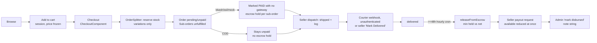

# B2B Haat — Business Workflows

> Part of the B2B Haat discovery audit (read-only, 2026-10-28). Evidence labels: **[F]** fact · **[I]** inference · **[A]** unverified assumption · **[Q]** stakeholder decision. Cross-referenced IDs (FR-, BRL-, D-, L-, R-, W-) live in the sibling files of `documents/audit/`.

## H. End-to-End Workflows

| Workflow | Implemented path | Broken or missing paths |
|---|---|---|
| W1 Retail purchase | Works (tested) | No payment; no failure or timeout; no cancel; stock never returned; guest account collisions (D-04) |
| W2 Wholesale purchase | Works for one SKU ≥ MOQ (tested) | Split across SKUs fails (G-07); no B2B invoice tax; no freight scheduling |
| W3 Wholesale onboarding | Self-service, auto-approved | No document upload or verification; admin approval meaningless; overwrites seller/admin roles |
| W4 Seller onboarding | Registers, waits for approval, then gets the panel (tested) | No notification; no KYC docs; no rejection path; wallet created before approval |
| W5 Fulfilment | Dispatch → shipped → delivered | No packing/processing step used; no state machine (webhook can regress `delivered`→`in_transit`, because unknown statuses fall back to `in_transit`); seller can self-confirm delivery |
| W6 Escrow and payout | Hold → release → payout → mark disbursed (tested) | **COD release takes other orders' escrow** (D-01); no dispute window check; no reversal on return or refund; payout cannot be rejected; double hold possible |
| W7 Cancellation, return, refund, dispute | **None** | Statuses exist in lookups; no logic, UI or API |
| W8 RFQ | Buyer submits → seller quotes | Buyer never sees the quote; no accept, reject or convert-to-order; statuses hard-coded |
| W9 Tracking | Public by order, sub-order or tracking number (± phone) | Phone optional; partial `LIKE %phone%` match; no rate limit |
| W10 Account recovery | **None** | No password reset, email verification or OTP |
